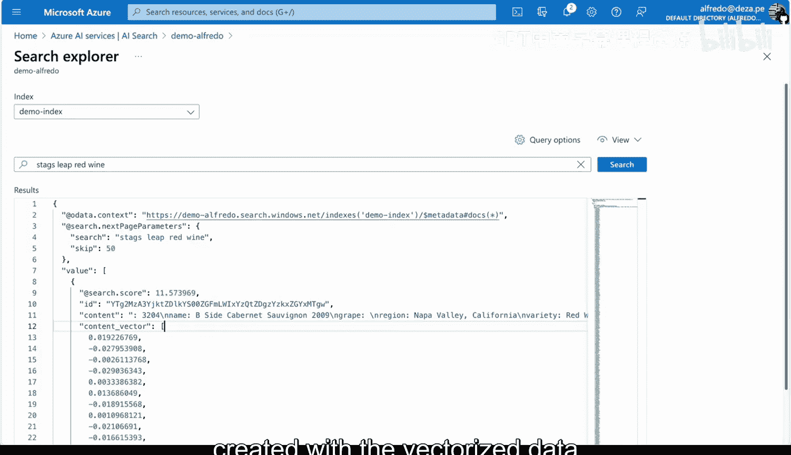

# 大型语言模型实践：第4章：验证嵌入向量

在本节课中，我们将学习如何验证在Azure AI搜索服务中创建的索引和嵌入向量。我们将通过搜索示例数据来确认向量化数据已正确生成并可用于检索。

---

上一节我们介绍了如何创建索引和生成嵌入向量。本节中，我们来看看如何验证这些嵌入向量是否已成功集成到我们的搜索索引中。

现在我们已经生成了嵌入向量，并回到了Microsoft Azure门户。我已经导航到我之前创建的AI搜索服务。接下来，我将进入“搜索浏览器”来测试我拥有的索引。

我将点击这里进入搜索浏览器。请记住，我使用了一个关于葡萄酒的CSV文件。该文件包含产区、品名、评分和葡萄品种等列，虽然列数不多，但足以让我们开始探索。例如，我们可以搜索“Oregon”。我知道数据中有一些来自俄勒冈州的记录。

当我点击搜索后，搜索词“Oregon”立即被执行，我们在此处得到了返回的内容。你可以看到，内容被分割成了新的行。如果你还记得，我的索引中包含名称、葡萄品种、产区和种类。

这里的返回结果实际上是“sparkling”和“champagne”，这并不完全符合我的预期。因此，让我们尝试调整一下搜索词。

那么，试试搜索“Stags Leap red wine”。我们将搜索词改为“Stags Leap red wine”。完美，我们得到了来自纳帕谷的“Cabernet Sauvignon”。

这样我们就成功检索到了一些内容。让我们再确认一下，看看它是否真的来自“Stags Leap”这个纳帕谷内非常著名的子产区。由于界面限制，我无法逐字搜索，但让我看看能否在这里直接修改。

我滚动到这里，找到了。来源显示为“Rutherford and Stags Leap”。我在这里尝试并希望演示的是，Azure AI搜索的搜索能力允许你使用像这里这样的搜索词，它会处理我CSV文件中的所有文本块，并能够定位并返回我需要的信息。

现在，对于大型语言模型来说，有趣的部分来了。你看到这里所有绿色的部分了吗？那些绿色高亮就是我们之前创建的嵌入向量——我们创建的文本块。那些就是向量。这也正是为什么这类数据库有时被称为向量数据库，因为模型能够理解这些向量，它们是所生成文本对应的数值表示。

以上就是你如何验证索引是否已正确创建，并包含了大型语言模型所需的向量化数据。

---

本节课中，我们一起学习了如何在Azure AI搜索中验证嵌入向量索引。我们通过执行搜索查询，确认了文本数据已被成功转换为向量，并且搜索服务能够基于这些向量返回相关结果。这验证了我们的数据管道已为后续的LLM应用准备好了结构化的向量数据。