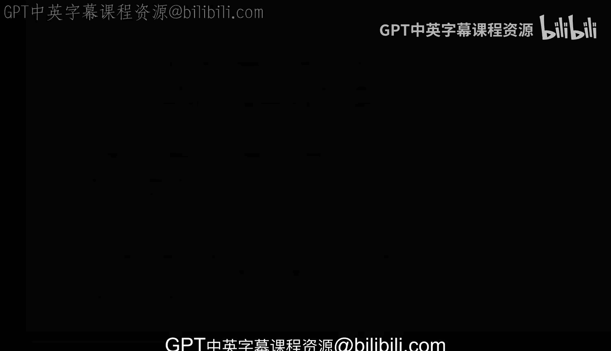
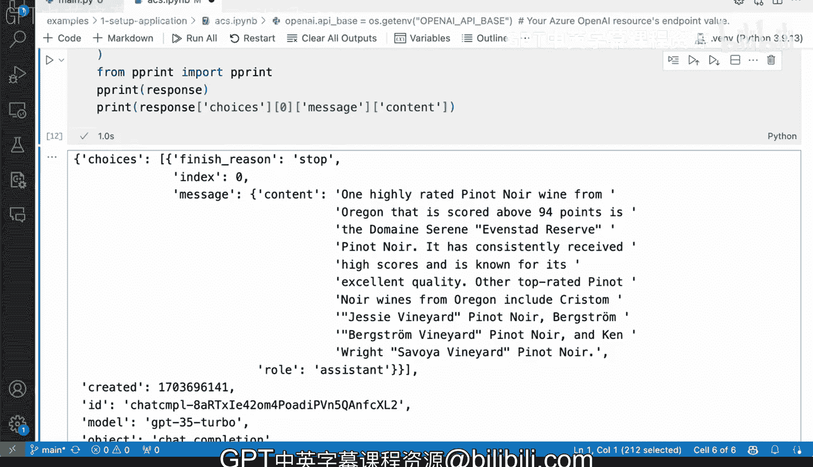

# 大型语言模型实践：第4章：在Azure OpenAI中使用RAG



## 概述
在本节课中，我们将学习如何在Azure OpenAI服务中实现检索增强生成（RAG）。我们将把之前准备好的文档数据与Azure AI搜索结合，通过向大型语言模型提供相关上下文，来生成更准确、更相关的回答。

---

上一节我们介绍了如何使用CSV加载器准备数据。本节中，我们来看看如何将这些数据与Azure AI搜索和Azure OpenAI服务连接起来，构建一个完整的RAG应用。

首先，我们将使用相似性搜索功能来查找与查询最相关的文档。以下是执行此操作的代码：

```python
# 使用Azure AI搜索进行相似性搜索
search_results = vector_store.similarity_search_with_relevance_scores(
    query="What is the best governance of wine in Napa Valley above 94 points?"
)
```

运行这段代码后，我们会得到一个结果列表。例如，我们可能得到“Declaration Napa Valley Governance”这样的相关文档片段。这证明了我们的搜索索引工作正常。

接下来，我们需要设置Azure OpenAI服务，以便将搜索到的上下文发送给大型语言模型进行处理。以下是配置Azure OpenAI客户端所需的组件：

```python
import os
from openai import AzureOpenAI

# 从环境变量加载配置
client = AzureOpenAI(
    azure_endpoint = os.getenv("AZURE_OPENAI_ENDPOINT"),
    api_key = os.getenv("AZURE_OPENAI_KEY"),
    api_version = "2023-05-15"  # 注意：这是API版本，至关重要
)
```

这里需要特别注意`api_version`参数。如果你需要使用更新或不同版本的API，必须在此处指定，否则调用将失败。

配置好客户端后，我们需要构建发送给模型的“消息”列表。这是RAG流程的核心部分，消息结构如下：

以下是构建消息列表的步骤：

1.  **系统消息**：设定AI助手的角色和背景。用户看不到此消息。
    ```python
    {"role": "system", "content": "You are a chatbot that helps you find the best wine for your taste."}
    ```

2.  **用户消息**：包含用户的实际查询。
    ```python
    {"role": "user", "content": "What is the best governance of wine in Napa Valley above 94 points?"}
    ```

3.  **助手消息**：包含从Azure AI搜索中检索到的额外上下文内容。这部分内容将来自我们之前执行的相似性搜索的结果。

当所有这些消息准备就绪后，我们就可以看到各个部分是如何组合在一起的：系统消息设定了背景，用户消息提出了问题，而助手消息则提供了从外部知识库（Azure AI搜索）中获取的具体信息。

最后，我们调用Azure OpenAI的聊天补全接口来获取最终答案：

```python
# 调用模型生成回复
response = client.chat.completions.create(
    model="your-deployment-name",  # 你的模型部署名称
    messages=messages  # 上面构建的消息列表
)

# 打印模型的回复
print(response.choices[0].message.content)
```

运行上述代码，大约1.2秒后，我们得到了模型的回复。回复内容可能是：“这里有一款来自纳帕谷、评分高于94分的高分赤霞珠葡萄酒：2014年的Declaration Cabernet Sauvignon。不过其评分91分并不算很高。”

你可以看到，模型能够以一种清晰的方式整合信息并输出回答。

为了验证整个流程的灵活性，我们可以尝试一个不同的查询。例如，将问题改为：“What is the best Pinot Noir wine in Oregon above 94 points?”

我们需要确保新的查询被正确传递到搜索和消息构建步骤中。修改查询后重新运行代码，模型会基于新的上下文生成回答：“一款来自俄勒冈州、评分高于94分的高分黑皮诺葡萄酒是……”

至此，我们已验证了所有组件都已正确连接并协同工作。我们成功地将Azure AI搜索（之前称为Azure Cognitive Search）与Azure OpenAI服务结合，实现了一个功能完整的RAG应用。

---



## 总结
本节课中，我们一起学习了在Azure平台上构建RAG应用的关键步骤。我们首先使用Azure AI搜索检索相关文档，然后配置Azure OpenAI客户端，接着构建包含系统指令、用户查询和检索上下文的消息列表，最后调用模型生成基于上下文的精准回答。这个过程展示了如何将外部知识库与大语言模型的能力相结合，以提供更可靠、更相关的信息。