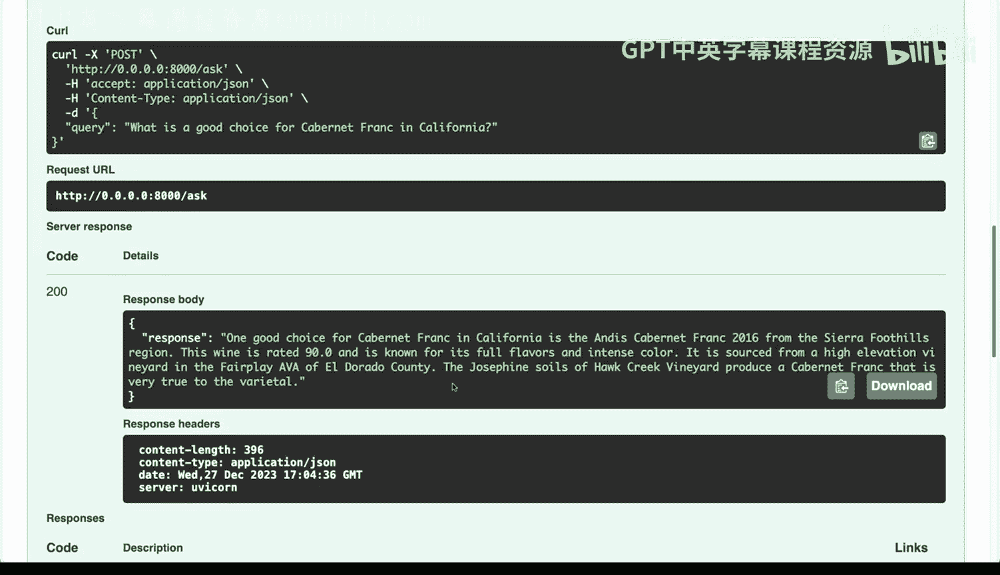
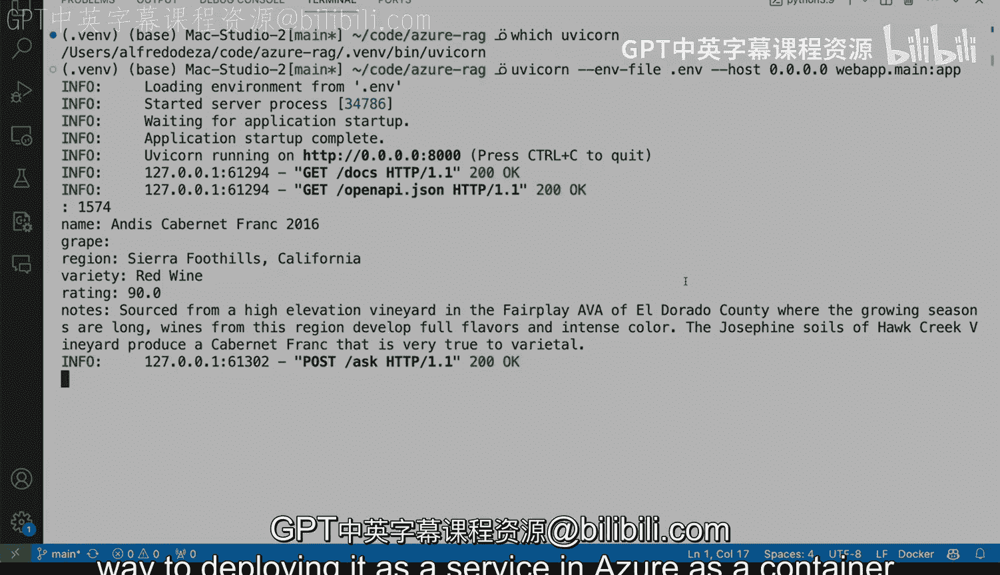

# 大型语言模型实践：P150：应用概览 🚀


在本节课中，我们将把之前学到的所有组件整合起来，构建一个完整的应用程序。我们将创建一个基于FastAPI的API服务，该服务会部署在Azure容器中，但在部署前，我们可以在本地进行验证。

## 应用架构概述

上一节我们介绍了各个独立组件，本节中我们来看看如何将它们组合成一个完整的应用。我们的应用将使用OpenAI的嵌入模型和Azure认知搜索，通过一个API接口来响应用户的查询。

## 核心组件与代码实现

我们将从定义应用开始，首先需要导入所有必要的库并配置相关服务。

```python
import openai
from azure.core.credentials import AzureKeyCredential
from azure.search.documents import SearchClient
from fastapi import FastAPI, HTTPException
from pydantic import BaseModel
```

以下是应用启动和配置的关键步骤：

1.  **初始化FastAPI应用**：创建FastAPI实例作为我们的Web框架。
2.  **配置服务连接**：设置连接到OpenAI和Azure认知搜索所需的密钥和端点信息。
3.  **定义数据模型**：使用Pydantic模型来定义API请求体的结构。

## 定义API路由

我们的应用将暴露两个主要路由。根路由`/`将重定向到文档页面，而核心功能则通过`/ask`路由提供。

以下是定义的路由及其功能：

*   **`GET /`**：根路径，重定向到API文档。
*   **`POST /ask`**：核心接口，接收用户查询并返回AI生成的答案。

`/ask`路由的处理流程分为三步：
1.  将用户查询提交给Azure认知搜索进行检索。
2.  将查询和检索结果一起发送给大型语言模型（助手函数）。
3.  将LLM生成的增强响应返回给用户。

响应的JSON结构为：`{"response": chatgpt_response}`。

## 辅助函数详解

接下来，我们深入看看支撑应用运行的两个核心辅助函数。

### 搜索函数

`search`函数与之前在Jupyter笔记本中使用的逻辑完全相同。它执行相似性搜索并返回相关度分数。我们添加了`print`语句以便在运行应用时查看搜索返回的内容，方便调试。

```python
def search(query: str):
    # 连接到Azure认知搜索索引
    search_client = SearchClient(endpoint=AZURE_SEARCH_ENDPOINT,
                                 index_name=INDEX_NAME,
                                 credential=AzureKeyCredential(AZURE_SEARCH_KEY))
    # 执行搜索并打印结果
    results = search_client.search(search_text=query, top=5)
    for result in results:
        print(f"Score: {result['@search.score']}, Content: {result['content'][:100]}...")
    return results
```

### 助手函数

`assistant`函数负责与OpenAI服务进行AI交互。它遵循我们之前在Jupyter笔记本中使用的相同模式。

以下是构建请求的步骤：

1.  **系统消息**：设定AI助手的角色和行为。
2.  **用户消息**：包含原始的用户查询。
3.  **上下文内容**：包含从Azure AI搜索返回的文本信息。

最后，我们将所有这些信息组合到`messages`列表中，并提交给OpenAI的聊天补全接口。响应内容将从`response.choices[0].message.content`中提取。

## 运行与测试应用

要运行此应用，我们需要安装依赖并启动服务器。

### 依赖与环境

应用的主要依赖是：
*   `uvicorn`：用于运行FastAPI应用的ASGI服务器。
*   `fastapi`：构建API的Web框架。

其他与OpenAI和Azure相关的依赖与之前相同。应用将通过Docker容器化，Dockerfile中会安装所有依赖并使用Uvicorn作为Web服务器。

### 本地启动与验证

在终端中，我们可以使用以下命令启动应用：
```bash
uvicorn main:app --host 0.0.0.0 --port 8000 --reload
```
命令解析：
*   `main:app`：`main`是Python文件名，`app`是FastAPI应用实例变量。
*   `--host 0.0.0.0`：允许所有网络接口访问。
*   `--port 8000`：指定运行端口。
*   `--reload`：开发模式下，代码更改后自动重启。

启动后，我们可以在浏览器中访问`http://localhost:8000`，看到自动生成的API文档。通过`/ask`路由，我们可以提交查询进行测试。例如，提问“What is a good choice for Cabernet Franc in California?”，应用会调用搜索和LLM，最终返回一个包含推荐葡萄酒（如“2016 Andy Cabernet Franc”）及其评级的答案。

在后台，我们可以看到打印出的搜索日志，验证了应用确实从我们最初加载的CSV数据中检索到了相关信息，并被大型语言模型成功利用。



## 总结



本节课中我们一起学习了如何构建一个端到端的LLM应用。我们从整合数据检索（Azure认知搜索）与文本生成（OpenAI LLM）开始，使用FastAPI框架将其封装为Web服务，并在本地成功运行和测试。这个应用概述了我们即将部署到Azure容器的完整服务流程，实现了从数据准备到部署为可用服务的全过程。