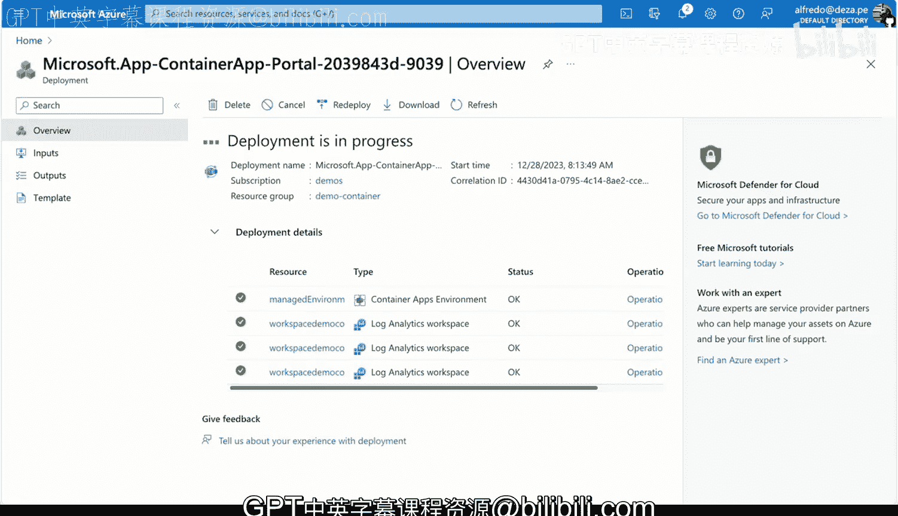

# 大型语言模型实践：P151：设置Azure组件 🛠️

在本节课中，我们将学习如何设置Azure云服务中的关键组件，以便为后续部署连接到Azure OpenAI服务的应用程序做好准备。我们将重点关注创建容器应用，并确保其配置与自动化部署脚本相匹配。

---

## 创建容器应用

上一节我们介绍了项目背景，本节中我们来看看如何在Azure门户中创建容器应用。这是将应用程序部署到云端的第一步。

我们再次进入Azure门户。接下来，我们将导航到“容器应用”服务并创建一个新的容器应用。但在开始之前，有一个非常重要的细节需要注意：我们的自动化部署脚本已经就位，其配置必须与我们将要创建的资源名称保持一致。

为了确保配置正确，我们需要切换到代码仓库查看预置的GitHub Actions工作流文件。以下是关键步骤：

1.  访问GitHub仓库的 `/.github/workflows/` 目录。
2.  查看已有的GitHub Action工作流文件。
3.  找到其中定义的资源组名称和容器应用名称。这两个名称至关重要。

在我的例子中，这些资源在创建服务之前就已经存在。但如果你还没有创建，只需确保在创建容器时，使用的名称与自动化脚本中定义的名称完全匹配即可。

---

## 在门户中配置资源

现在，我们回到Azure门户进行实际操作。我将进入“容器应用”服务。我之前已经创建过一个，这次我将从头开始创建一个新的。

点击“创建”按钮后，需要填写以下信息：

*   **资源组**：选择或创建一个新的资源组。我将使用之前提到的 `demo-container`。
*   **容器应用名称**：将其设置为与资源组相同的名称 `demo-container`，以确保自动化流程能正确识别。

我发现 `demo-container` 资源组已经存在，因此可以直接从下拉菜单中选择它。将应用程序命名为相同的名称，可以确保后续步骤能够正常工作。

接下来需要选择区域。`Australia` 不是我的首选区域，我更喜欢 `East US`。确认所有信息无误后，点击“查看 + 创建”进行验证，最后点击“创建”。

这个过程需要一些时间。一旦资源创建完成，我们就可以开始使用自动化部署流程了。

---

## 理解自动化部署架构

这些就是我们所需的核心资源。现在，让我们回到GitHub Action来理解其工作原理。

这个GitHub Action将使用 **GitHub容器注册表**。这意味着，我构建的任何容器镜像都会存储在GitHub自身的服务中。

这是一种架构设计选择，允许我将容器存储在特定的位置。你并非必须使用GitHub容器注册表，也可以选择将镜像推送到Azure容器注册表。但在本教程中，我们将利用GitHub提供的简单直接的容器注册表服务。

一旦资源就绪，你将看到部署进度开始推进。当所有步骤完成后，我们的环境就准备就绪，可以继续推进，实现连接到Azure OpenAI服务的应用程序的自动化部署。

---

## 总结

本节课中，我们一起学习了在Azure中设置容器应用的核心步骤。关键点在于确保手动创建的资源名称（如资源组和容器应用名称）与自动化部署脚本中的定义完全一致。我们还了解了如何使用GitHub容器注册表作为镜像仓库，为后续的自动化部署流程奠定了基础。