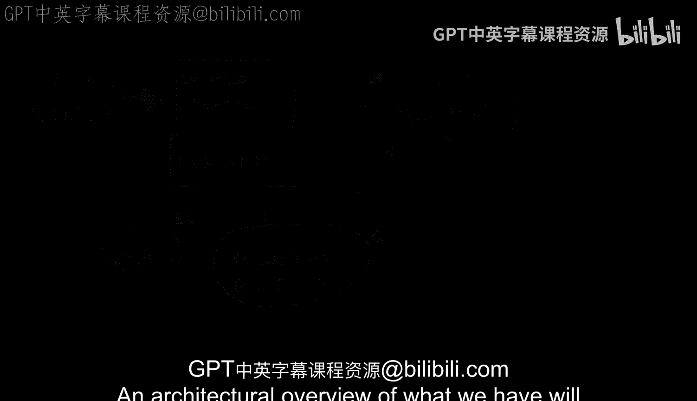
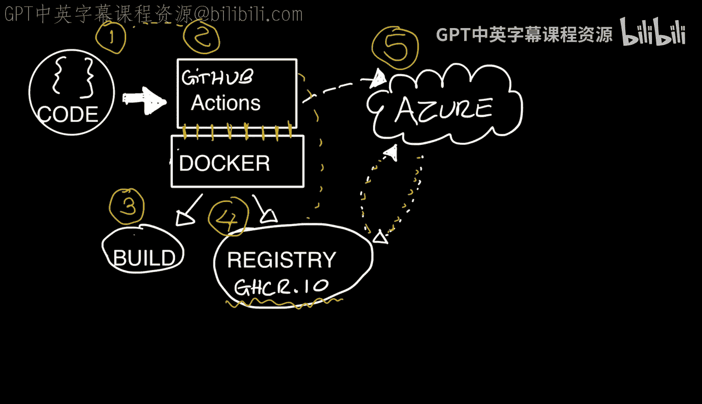
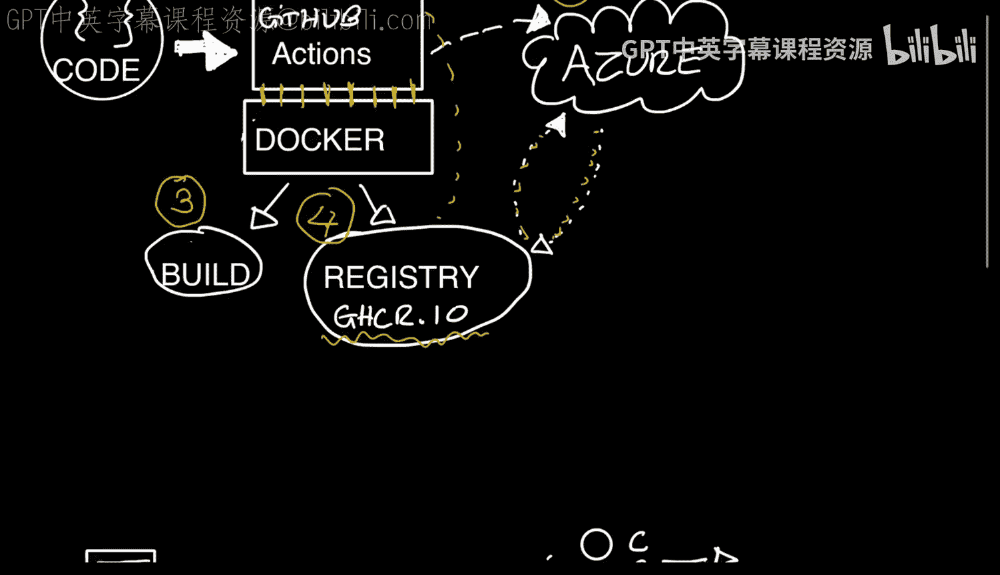
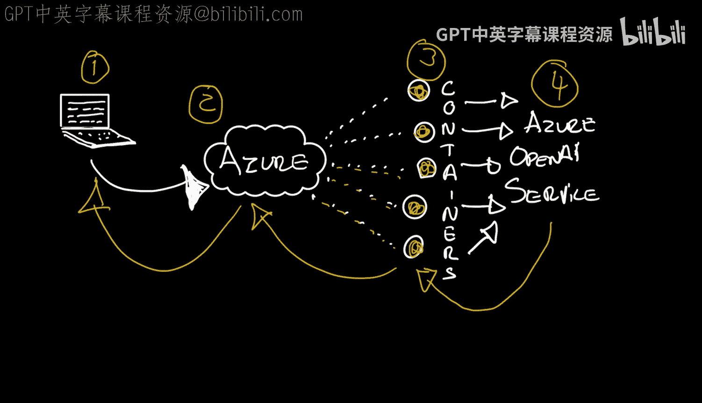

# 大型语言模型实践：P152：架构概览 🏗️

在本节课中，我们将学习如何将一个基于大型语言模型的应用部署到云端。我们将通过一个清晰的架构概览，了解从代码开发到最终用户交互的完整流程，以及各个组件是如何协同工作的。

## 概述

理解我们拥有的架构概览，将帮助我们理解所有组件如何协同工作。

我们从代码开始。我们有一个应用程序，其代码托管在 GitHub 上。该应用包含一个 HTTP API，用于接收请求并与模型交互。那么，这个应用将如何实际部署呢？

## 部署流程详解

上一节我们介绍了整体目标，本节中我们来看看具体的部署步骤。以下是实现从代码到云端部署的核心步骤：

1.  **代码与 GitHub**：我们从应用程序代码开始，代码托管在 GitHub 仓库中。
2.  **自动化构建 (GitHub Actions)**：我们将使用 GitHub Actions 来实现自动化。GitHub Actions 将与 Docker 交互，设置 Docker 构建系统并执行命令。
3.  **容器化构建**：通过上述步骤，我们将能够构建我们的容器化应用程序。构建容器应用是至关重要的一步，目的是为了将其部署到 Azure 云上。这个过程会构建一个容器。
4.  **推送镜像到仓库**：构建完成后，我们将把生成的容器镜像推送到一个注册表。在本案例中，我们使用的是 GitHub 容器注册表 (GHCR)。当然，你也可以使用其他注册表。这里我们选择简化流程，因为用户名和密码等配置已经为我们预先设置好了，稍后我们在查看 GitHub Actions 工作流时会详细看到这些细节。
5.  **触发 Azure 拉取镜像**：当注册表步骤完成后，GitHub Actions 会通知 Azure（具体是 Azure 容器实例服务）去从我们的注册表中拉取构建好的镜像。这是一个触发效应，我们告诉 Azure：“镜像已就绪，可以拉取了。”
6.  **应用部署与运行**：Azure 从注册表（GHCR）拉取容器后，便会将其发布并运行起来。

## 用户交互与系统扩展

现在，让我们进一步看看应用运行起来后，用户如何与之交互，以及系统如何处理负载。

最终，用户将开始与我们的应用程序交互。用户会发送一些提示或查询。

这些请求将被 Azure 云接收，因为我们的应用程序就运行在云端。Azure 能够扩展我们的应用程序，这被称为**水平扩展**。随着请求增多，Azure 可以部署更多的小单元（即容器）来处理这些请求。这种根据需求增长容器数量的能力，就是一个水平扩展系统，它使我们能够处理所有涌入容器的请求。

当请求到达容器后，应用程序便能与 Azure OpenAI 服务进行通信。

一旦能够与 Azure OpenAI 服务通信，用户的请求就会被处理：请求发送到容器，容器与 Azure OpenAI 服务交互，处理完成后，响应再通过 Azure 返回给用户。

## 总结

本节课中，我们一起学习了将一个 LLM 应用部署到 Azure 的完整架构流程。我们不仅看到了应用程序、HTTP API 和代码本身，更重要的是理解了如何通过 GitHub Actions 实现自动化构建与部署，以及 Azure 如何提供容器化运行环境和水平扩展能力。这个概览为你提供了一个坚实的概念基础，接下来我们将深入 GitHub Actions，查看具体的工作流配置。