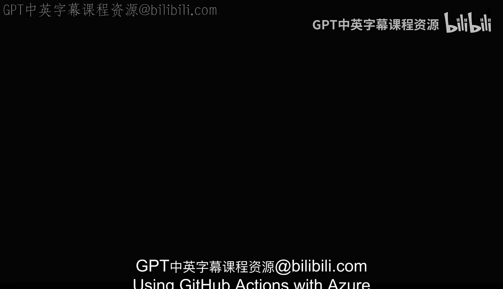
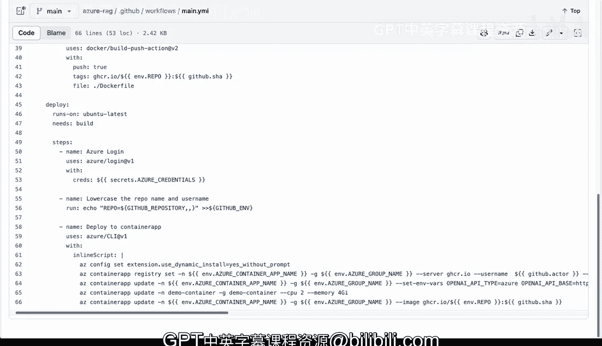

# 大型语言模型实践：P153：在Azure中使用GitHub Actions 🚀



在本节课中，我们将学习如何配置和使用GitHub Actions，以实现将应用程序自动构建并部署到Azure容器应用服务。我们将详细解析工作流程文件，并说明如何设置必要的认证信息。

---

上一节我们介绍了Azure容器应用的基本概念，本节中我们来看看如何通过GitHub Actions实现自动化部署。

GitHub Actions与Azure的结合使用是我非常推荐的方式。正如之前简要提到的，其核心是一个YAML配置文件。该文件位于我们的应用程序代码仓库中（在我的账户下是`azure-dash-rag`仓库）。我们的目标是在此文件中定义一系列自动化步骤。虽然之前已经快速浏览过，但我会再次强调一些核心组件。

除了可以自定义的`name`字段外，以下部分至关重要：
*   `env` 环境变量部分：这里定义了容器应用服务的名称。例如，我创建的服务名为 `demo-container`。如果你使用其他名称，需要在此处修改。
*   `on` 触发器部分：`workflow_dispatch` 选项非常重要，它允许我们手动触发工作流。这意味着工作流不会在代码推送到主分支时自动运行。如果你确信代码变更经过验证并希望自动部署到云端，未来可以改为监听 `push` 事件。目前，我们依赖手动触发。

接下来是构建阶段。此阶段将构建Docker容器，并认证到GitHub容器注册表。可以看到，`GITHUB_ACTOR`（会解析为我的用户名）和`GITHUB_TOKEN`已预先设置好，无需额外操作。这为后续Docker推送镜像到注册表做好了认证准备。

需要注意，镜像标签使用了 `ghcr.io` 前缀，这至关重要。构建完成后，镜像将被推送到GitHub容器注册表。

最后是部署阶段。我们将在此与Azure交互。为了进行身份验证，必须预先设置Azure凭据。这需要创建一个服务主体。

以下是创建Azure服务主体的步骤：
1.  在Azure门户使用Cloud Shell或本地终端，运行以下命令（需替换你的订阅ID）：
    ```bash
    az ad sp create-for-rbac --name "myApp" --role contributor --scopes /subscriptions/<subscription-id>/resourceGroups/<resource-group-name> --sdk-auth
    ```
2.  命令会输出一段JSON。复制整个JSON输出。
3.  进入GitHub仓库的`Settings` -> `Secrets and variables` -> `Actions`。
4.  点击`New repository secret`。
5.  将秘密名称设为`AZURE_CREDENTIALS`，并将复制的JSON内容粘贴到值中，然后保存。

完成上述步骤后，就可以在工作流中使用 `azure/login` 动作登录Azure，并开始向容器应用部署。

在工作流中，我们使用 `azure/CLI` 动作来运行Azure CLI命令。首先，我们设置容器应用的注册表信息，包括应用名称、资源组、服务器地址（GitHub容器注册表）、用户名（`GITHUB_ACTOR`）和密码。

密码使用的是名为 `PAT` 的个人访问令牌。你需要创建一个具有`write:packages`权限的GitHub个人访问令牌。
*   访问 `https://github.com/settings/tokens/new` 创建令牌。
*   描述可设为“Azure Container Apps”，权限选择`write:packages`。
*   创建后，复制令牌值，并像设置`AZURE_CREDENTIALS`一样，在仓库的Actions Secrets中创建一个名为`PAT`的秘密。

回到工作流文件，接下来我们设置一些环境变量，这些变量将注入到容器应用中：
*   `OPENAI_TYPE`: 设置为 `azure`。
*   `OPENAI_BASE`: 你的Azure OpenAI部署端点。
*   `OPENAI_KEY`: Azure OpenAI API密钥（需设置为GitHub秘密）。
*   `AZURE_SEARCH_SERVICE`: 你的Azure AI搜索服务名称。
*   `AZURE_SEARCH_KEY`: 搜索服务的API密钥（需设置为GitHub秘密）。
*   `AZURE_SEARCH_INDEX`: 搜索索引的名称，例如 `demoredo`。

然后，我们配置容器应用的计算资源，例如2个CPU核心和4GB内存。由于是Python应用，需要这些资源来保证运行。

最后，通过命令指示容器应用拉取新构建的镜像并开始部署。工作流文件的第66行负责执行此操作。

完成所有配置后，我们就可以触发工作流。成功后，应用程序将自动部署到Azure并开始运行。

---



本节课中我们一起学习了如何配置GitHub Actions工作流文件，以及如何设置Azure服务主体和GitHub个人访问令牌等关键秘密，最终实现将应用自动化部署到Azure容器应用服务。掌握这些步骤，你就能建立一套高效的CI/CD流程。