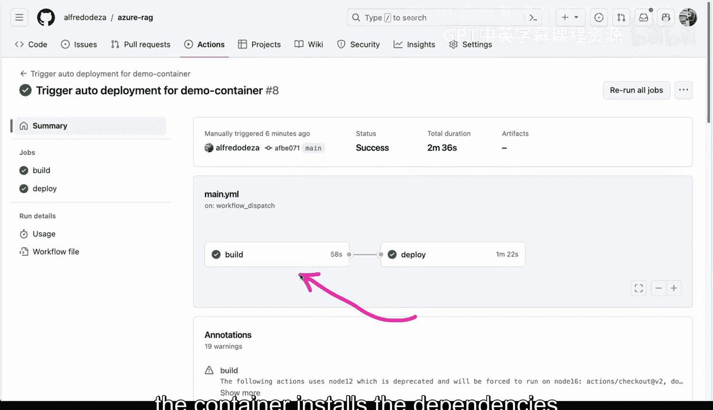
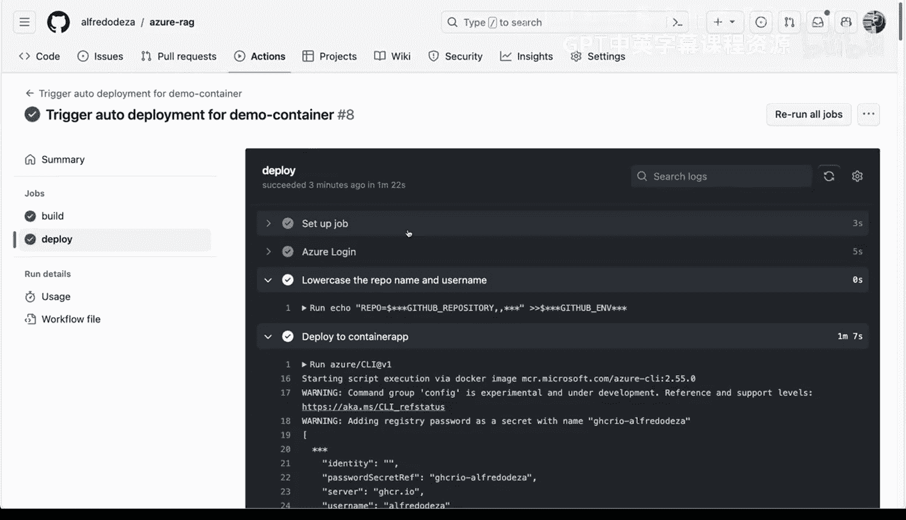
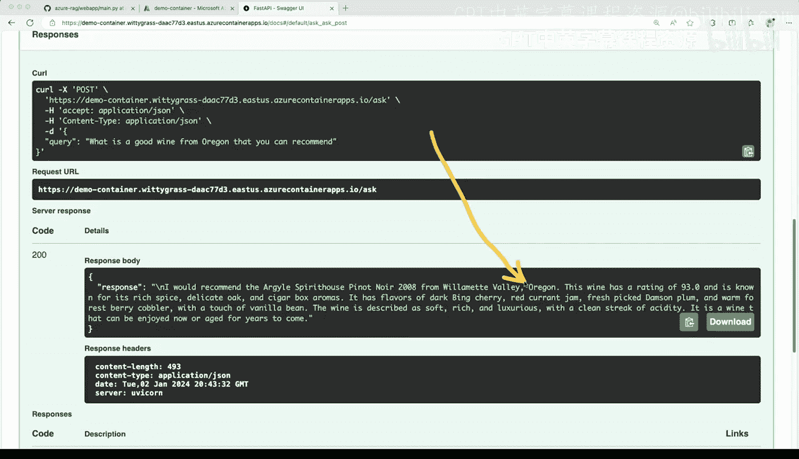
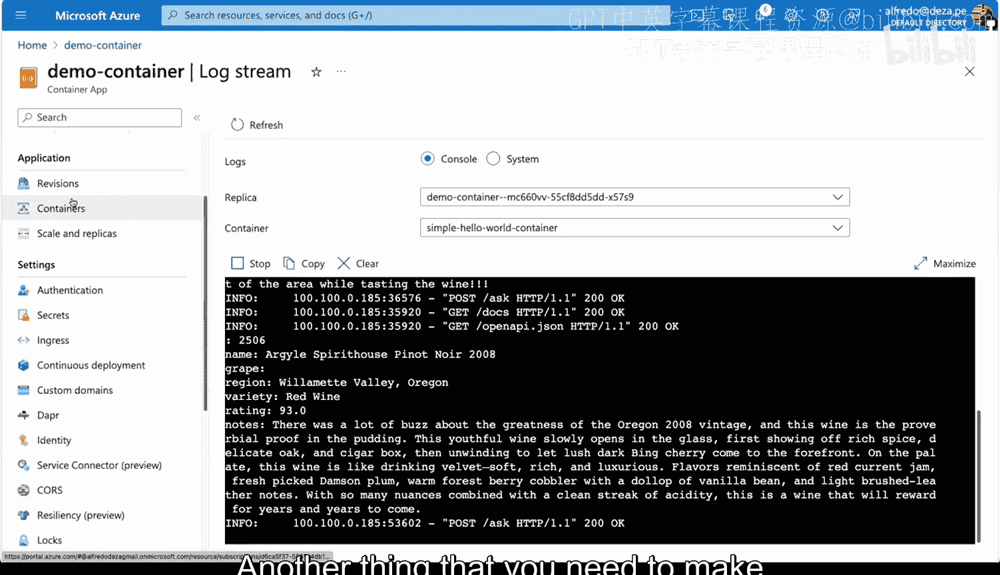
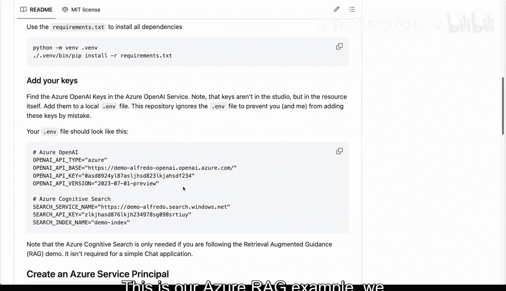
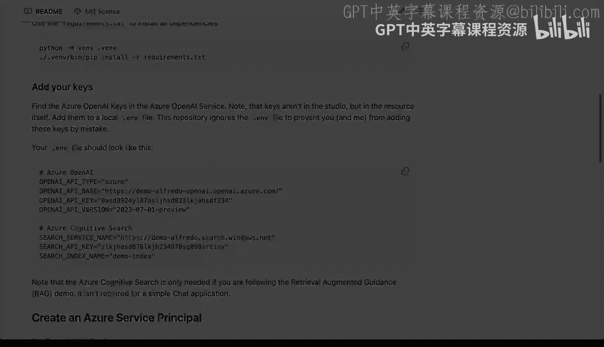

# 大型语言模型实践：P154：验证与故障排除部署 🚀

在本节课中，我们将学习如何验证和排查一个已部署到Azure容器应用（Azure Container Apps）的应用程序。我们将通过检查工作流日志、修正配置错误以及验证应用功能，来确保部署成功。

---

## 概述

我们已经准备好部署应用程序。这是最后的步骤。我们有一个之前创建资源时部署过的演示容器应用。现在，我们需要前往代码仓库，在Actions（操作）步骤中手动触发部署工作流。

在开始之前，需要了解一个关于自动化构建的现实：失败是常态。你很少能第一次就完全正确。你可能会遗漏变量、出现拼写错误，需要通过查看失败日志来定位问题。

我已经触发了工作流。接下来，我们将查看工作流的运行情况，而不是等待它完成。

---

## 检查工作流日志

工作流包含两个主要步骤：**构建（Build）** 和 **部署（Deploy）**。

以下是每个步骤的功能：
*   **构建步骤**：创建容器镜像，安装所有依赖项，并将应用打包。
*   **部署步骤**：将构建好的容器镜像推送到Azure容器应用。

点击任意一个步骤，可以查看详细的日志输出。在部署步骤的日志中，你会看到它执行了Azure登录、处理仓库名称，并最终完成部署。一些敏感设置会以星号（`*`）显示，以防止泄露。

现在，部署已经成功完成。

---

## 排查应用访问问题

上一节我们确认了部署流程成功，本节中我们来看看如何访问已部署的应用。

接下来，我们需要在Azure门户中验证应用是否正常运行。在容器应用的“概览”部分，可以找到应用URL。

点击这个URL在新标签页中打开。你可能会遇到第一个问题：页面可能显示连接错误或重置。这是因为我们的容器内部使用的是端口 **`8000`**，而Azure容器应用默认尝试访问的是端口 `80`。

要解决此问题，请按以下步骤操作：
1.  在Azure容器应用页面，找到并点击“入口（Ingress）”设置。
2.  向下滚动，找到“目标端口（Target Port）”设置。
3.  将目标端口从默认值修改为 **`8000`**。
4.  保存更改，并等待入口配置更新完成。

更新成功后，使用相同的URL重新加载页面，现在应该能看到我们的FastAPI应用程序界面了。这表明应用正在Azure上成功运行。

---

## 验证应用功能

现在应用可以访问了，我们需要测试其核心功能是否正常。

在FastAPI的交互式文档页面（通常为 `/docs`），点击“Try it out”按钮。例如，我们可以输入一个问题：“**What is a good wine from Oregon you can recommend?**”（你能推荐一款俄勒冈州的好葡萄酒吗？）。

点击执行后，应用会：
1.  联系我们集成的索引。
2.  通过Azure OpenAI服务处理请求。
3.  返回一个关于俄勒冈州葡萄酒的推荐回答。

如果能看到正确的回答，就证明从前端界面到后端Azure OpenAI服务的整个链路都是通畅的，并且应用已公开可用。

---

## 监控与高级配置

应用运行后，持续的监控和正确的配置是保证其稳定性的关键。

**1. 查看日志流（Log Stream）**
在Azure门户中进入“日志流（Log Stream）”，可以实时查看容器的终端输出。这是排查运行时问题（如代码错误、异常请求）的首要位置。如果一切正常，你会看到常规的请求和响应日志。

**2. 检查环境变量**
在“容器（Containers）”设置中，确认所有环境变量（如API密钥、端点URL）都已正确设置。这是应用能连接到Azure OpenAI等外部服务的基础。

**3. 调整缩放与副本（Scale and Replicas）**
在“缩放（Scale）”设置中，你可以配置应用的处理能力。例如，可以将副本数范围设置为 **`0`** 到 **`10`**。增加副本数可以提升应用处理并发请求的能力和带宽。

---

## 总结

本节课中我们一起学习了部署后的验证与故障排除全流程。我们首先检查了GitHub Actions的工作流日志，确认了构建和部署步骤的成功。接着，我们排查并修复了因容器端口（`8000`）与默认入口端口（`80`）不匹配导致的访问问题。然后，我们通过调用API验证了应用功能与Azure OpenAI服务的连接是正常的。最后，我们介绍了如何通过日志流监控应用状态，以及如何检查环境变量和配置缩放规则以确保应用性能。

至此，我们的应用程序已成功部署到Azure容器应用，并通过GitHub Actions实现了自动化部署流程。