# 大型语言模型实践（高级数据工程、AWS、Databricks和本地LLM）：P4：04_01_03_队列概述 📚

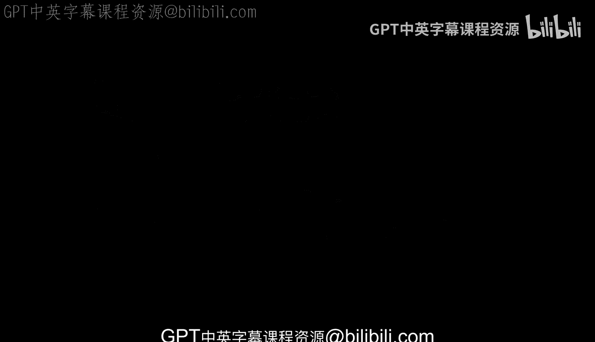

在本节课中，我们将要学习队列的基本概念。队列是消息传递和异步处理系统中的核心组件，理解其工作原理对于后续学习RabbitMQ等消息队列工具至关重要。

## 队列的基本概念

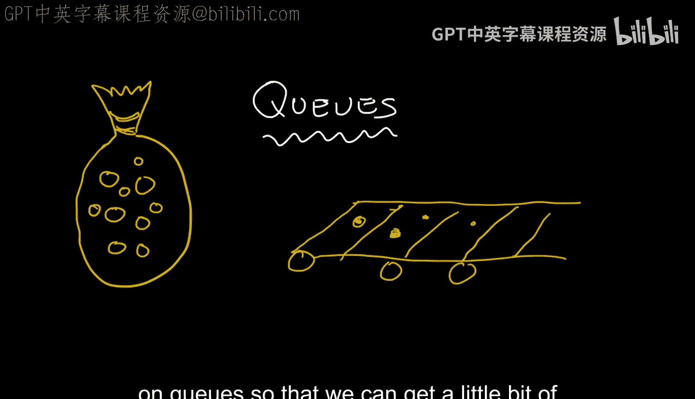

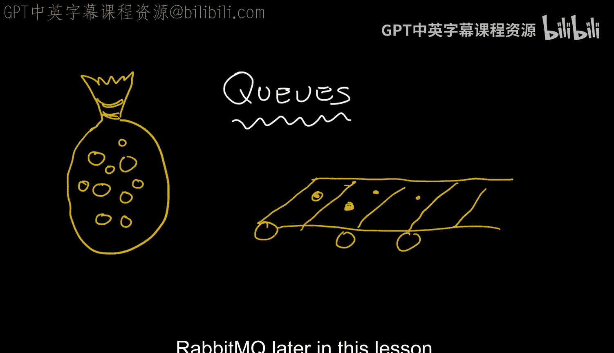

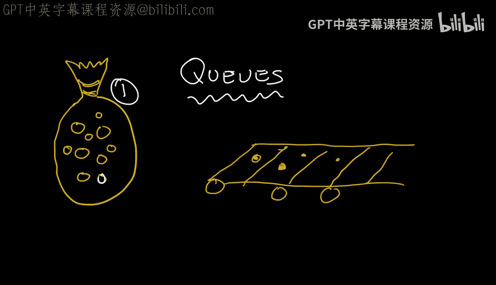

上一节我们介绍了数据处理的基本流程，本节中我们来看看队列在其中扮演的角色。队列本质上是一个可以存放工作项的地方。这些工作项代表需要被处理的单元。

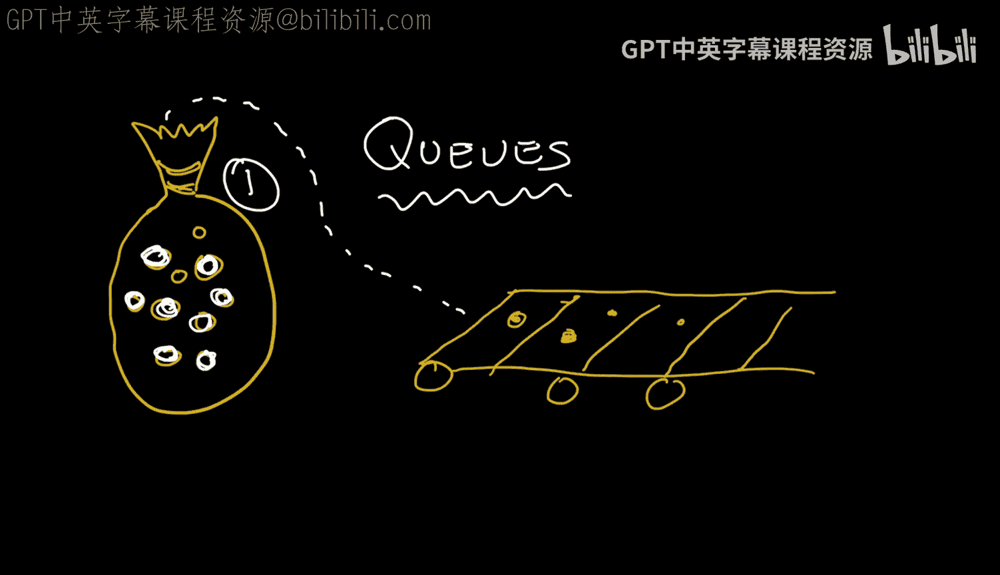

例如，这些工作项可以是数据、一封待发送的电子邮件，或任何需要在某个时间点执行的任务。这些工作单元以某种方式被生产出来，然后进入一个类似传送带的系统。这个传送带系统会接收这些工作单元，并进行处理。通常，会有另一个组件来处理这些工作单元并执行相应的操作。

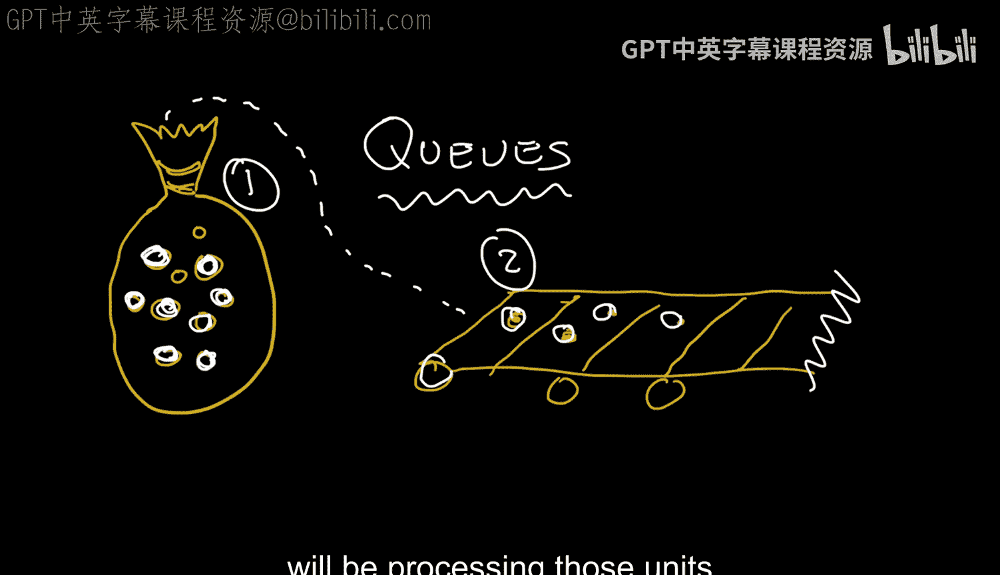

简而言之，这是一个非常快速的概述：工作单元被生产出来，而队列则负责管理这些被生产出来的工作。

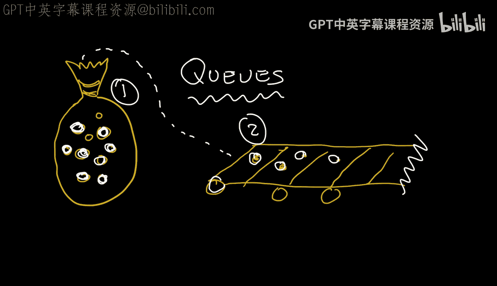

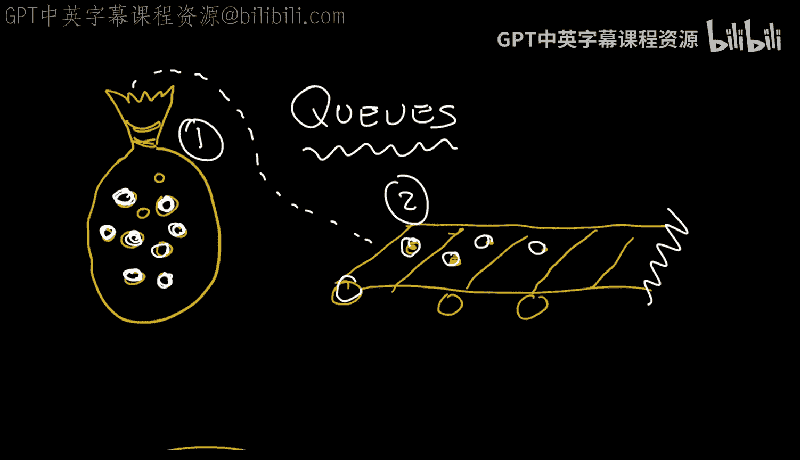

## 队列的工作模式

接下来，我们需要了解队列有多种不同的工作模式。

以下是两种常见的队列处理模式：

*   **后进先出**：在这种模式下，最后进入队列的项目将最先被取出。假设我们有一系列按顺序进入队列的项目：A最先进入，B其次，依此类推，F最后进入。当需要从队列中消费一个项目时，字母F将是第一个被取出的。
*   **先进先出**：在这种模式下，最先进入队列的项目将最先被取出。以同样的项目序列为例，如果A最先进入，那么无论队列中有多少其他项目，队列都会优先让A被消费。A被取出后，B将是下一个，依此类推。

因此，队列可以是“后进先出”，即最后进入的第一个出去；也可以是“先进先出”，即最先进入的第一个出去。

## 生产者-消费者架构

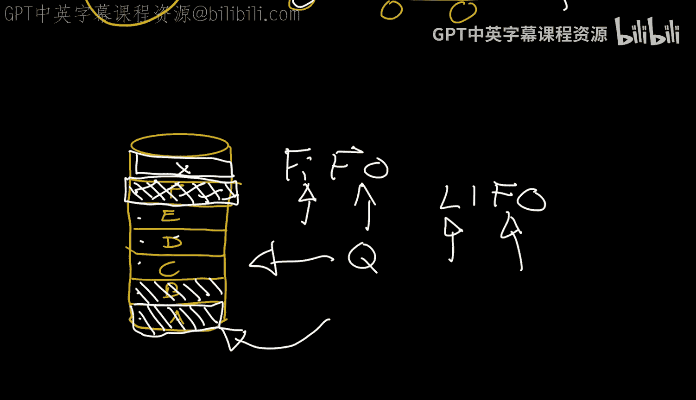

为了总结这部分内容，我们需要理解一个完整的队列系统通常包含两个部分：生产者和消费者。

在这种架构中，总会有一个组件负责生产工作项，我们称之为**生产者**。生产者会将项目放入队列。例如，生产者可能先放入A，然后放入B。这些工作单元进入的队列可以是像RabbitMQ这样的消息队列。RabbitMQ等消息队列本身也有多种类型。

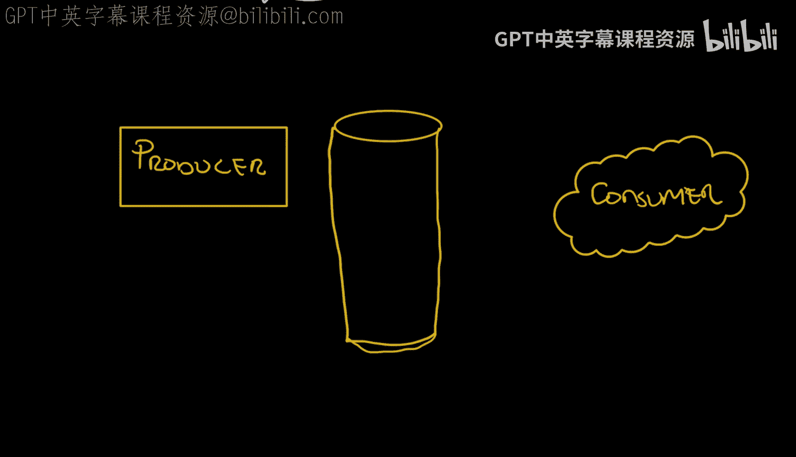

生产者将项目放入队列后，另一个独立的进程——**消费者**——会查看队列并获取下一个需要处理的项目。这种架构和工作模式是你在实现和使用队列时应该关注的。

生产者和消费者协同工作。如果消费者没有任务可做，它将保持空闲状态，直到队列中有新的项目出现。这种工作模式非常有用，因为生产者可以持续向队列中添加项目，而消费者可以按照自己的节奏从队列中取出并处理。这种关注点分离使得消费者可以独立于生产者运行，并且这些系统可以根据你正在处理的工作负载类型进行独立扩展。

## 总结

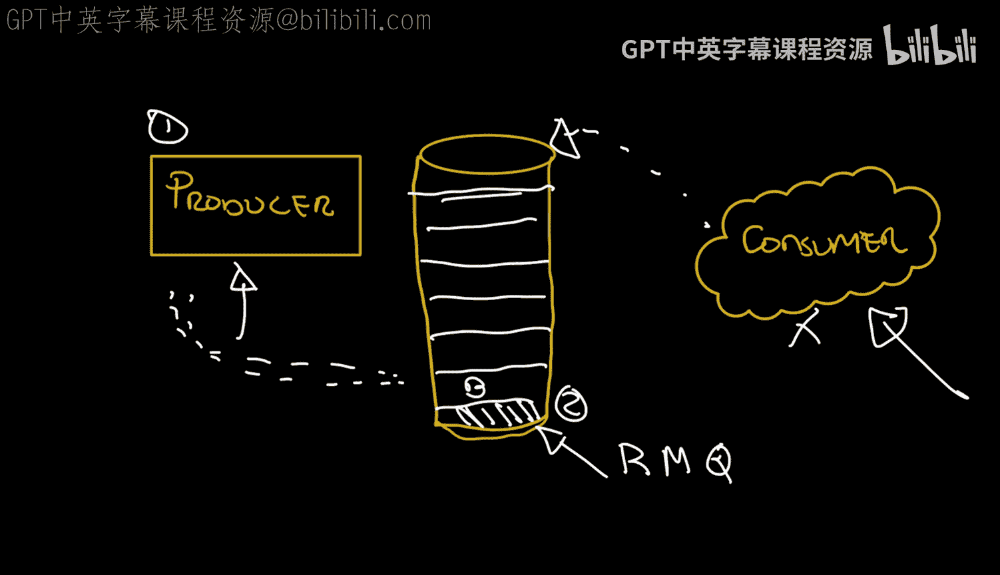

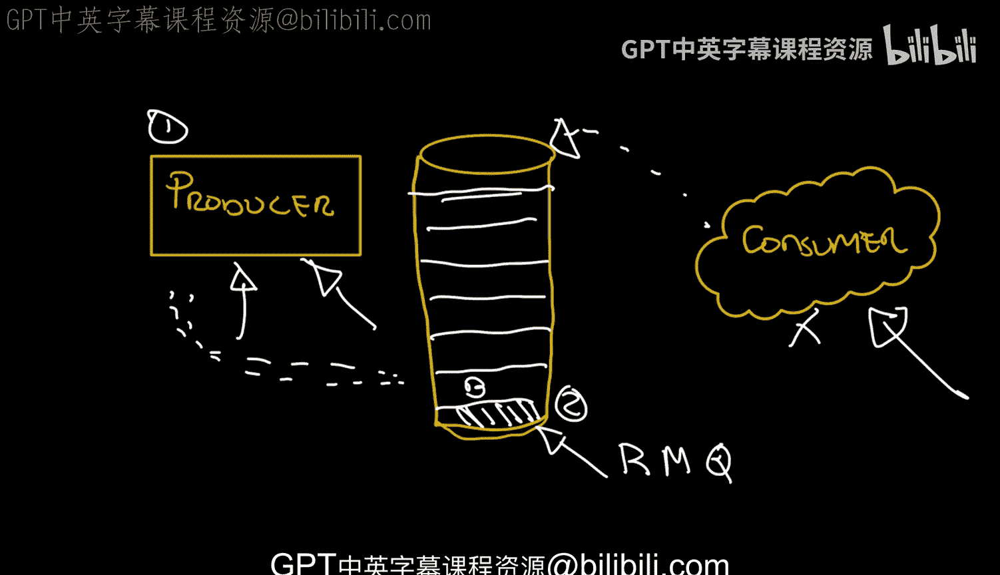

本节课中我们一起学习了队列的核心概念。我们了解到队列是用于存放和管理工作单元的地方，并探讨了**先进先出**和**后进先出**两种基本工作模式。最后，我们介绍了基于队列的**生产者-消费者**架构，这种模式通过分离生产与消费过程，提高了系统的可扩展性和灵活性。理解这些基础知识是后续学习具体消息队列技术（如RabbitMQ）的重要前提。