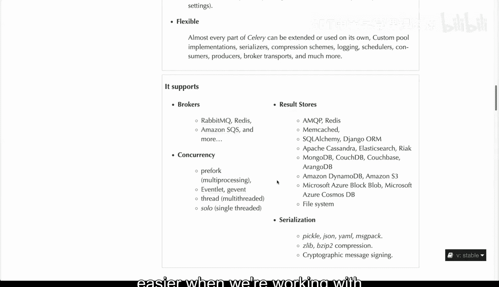
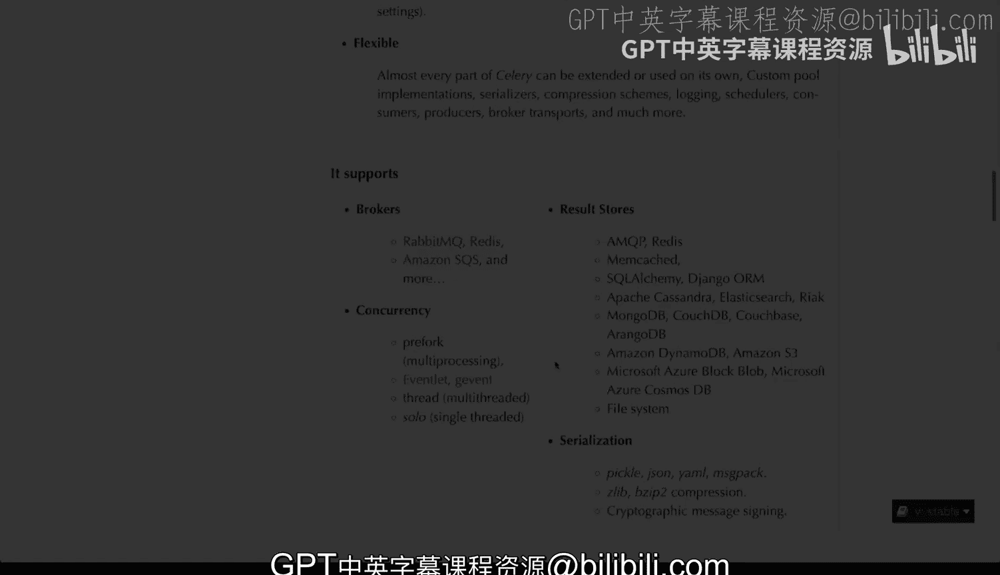

# 大型语言模型实践（高级数据工程、AWS、Databricks和本地LLM）：P5：05_01_04：什么是Celery 🐇

在本节课中，我们将要学习Celery，一个用于处理分布式任务队列的Python包。我们将了解它的核心作用、支持的中间件（Broker）以及它如何作为Python应用与消息队列（如RabbitMQ）之间的“中间人”来协调工作。

## 概述

Celery是一个Python包，它能够与多种不同的框架和消息代理（Broker）协同工作，例如RabbitMQ。它的核心作用是充当中间人，允许你在Python中创建工作项，并将这些工作项发送到其他地方（如RabbitMQ）进行处理。

## Celery的核心角色

上一节我们概述了Celery的基本概念，本节中我们来看看它的具体角色和工作原理。

简单来说，Celery是一个中间人。它让你能够在Python环境中生成工作任务，并将这些任务放置到别处。在我们将要演示的案例中，这个“别处”就是RabbitMQ（一个消息队列）。文档中详细说明了任务队列的具体细节，我们已经对其有了一些初步了解。

AMQP是RabbitMQ所使用的协议。从图中可以看到，Celery明确支持该协议。

我相信Celery最初发布时，首先支持的就是RabbitMQ。

## 支持的Broker与功能

了解了Celery的角色后，我们来看看它支持哪些消息代理以及具备哪些功能。

以下是Celery支持的部分消息代理（Broker）：
*   你可以使用**RabbitMQ**（这也是我们课程的重点）。
*   它支持**Redis**。
*   它支持**Amazon SQS**等更多服务。
*   你甚至可以使用数据库作为队列。我个人认为RabbitMQ非常出色。

这意味着你的Python应用会生成工作任务，这些任务会连接到Celery，然后由Celery将它们放到其他地方，比如RabbitMQ。因此，Celery扮演着中间人的角色。

我倾向于将Celery看作邮递员，负责来回传递所有消息。生产者（你的Python应用）就像写信的人，Celery就像负责将信件送往别处的邮递员，它负责投递。而邮局就是RabbitMQ，本质上负责找出传递所有这些消息的路径。

## 结果存储与特性

Celery不仅负责发送任务，还能处理任务执行后的结果。

这里还提供了存储结果的后端。这意味着当任务不仅被生产出来，而且被处理完成后，你可以捕获这些结果并能够将它们取回。这表明Celery允许你消费一些消息，并能将它们存储回来。

当然，它还支持并发和序列化。你可以看到它支持Pickle、JSON、YAML等消息格式。我们不会深入探讨所有这些，但会快速浏览一下。

那么，这究竟意味着什么？本质上，Celery是必需的，因为它让我们的工作变得更轻松。当我们在Python中工作，并想使用像RabbitMQ这样的服务时，Celery提供了极大的便利。

## 总结

本节课中我们一起学习了Celery。我们了解到Celery是一个用于分布式任务队列的Python包，它充当Python应用程序与消息代理（如RabbitMQ）之间的中间人。它负责将Python中产生的任务发送到消息队列，并可以处理任务结果的返回与存储，从而简化了在Python中使用消息队列的复杂性。