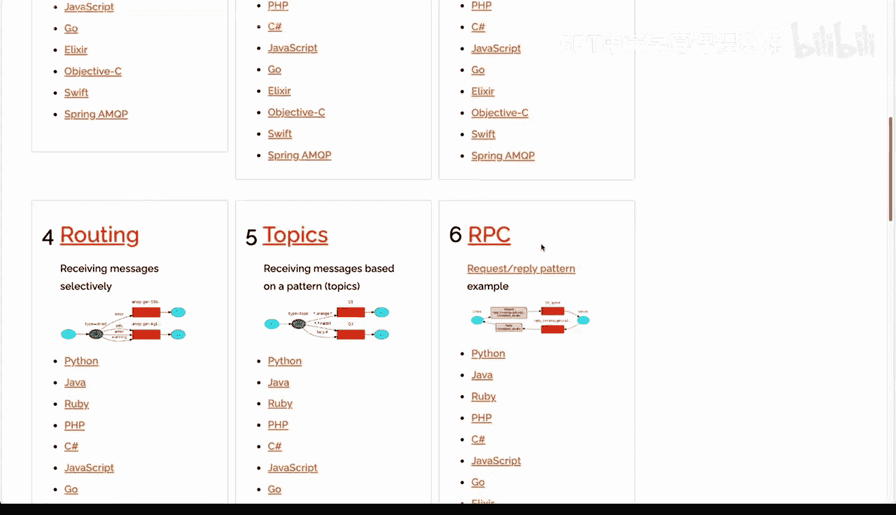
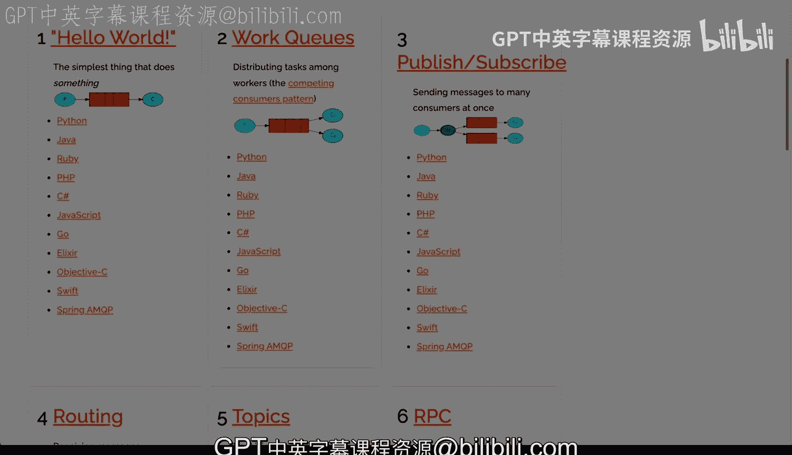

# 大型语言模型实践（高级数据工程、AWS、Databricks和本地LLM）：P6：06_01_06_RabbitMQ的用例 🐇

在本节课程中，我们将学习RabbitMQ的几个核心应用场景。我们将参考RabbitMQ官方文档中的教程，并挑选其中一些典型用例进行讲解，以帮助你理解消息队列在实际系统中的用途。

## 工作队列（Work Queues） ⚙️

上一节我们介绍了消息队列的基本概念，本节中我们来看看RabbitMQ的第一个常见用例：工作队列。工作队列本质上就是我们之前描述的模式：一个生产者创建工作任务单元，并将其放入队列；同时，多个消费者从该队列中取出并处理任务。这是一种“一对多”的关系，但也可以是“多对多”的，即多个生产者向队列投放任务，多个消费者从队列消费任务。

以下是工作队列的一个典型应用示例：

*   **图像处理**：我曾构建过类似的系统。用户上传一张可能很大的图片，系统将其作为一个任务单元放入队列。随后，独立的处理节点会从队列中获取这个图像任务，并执行不同格式的尺寸调整。这对于运行大规模网站非常有用，例如需要为大型图像生成多种缩略图。

## 发布/订阅（Publish/Subscribe） 📢

接下来，我们探讨发布/订阅模式。这种模式适用于需要发送消息的场景。想象一个需要在多个组件之间进行通信的系统，你有多个不同的生产者，而消费者可以订阅一个队列。

订阅队列意味着当特定事件发生时，你能收到通知。发布/订阅（常简称为Pub/Sub）模式可以实现多种功能，它允许消费者接收的不仅是工作任务单元，更可以是用于通信的消息，从而实现多个节点间的相互通信。

## 路由（Routing）与RPC（远程过程调用） 🔀

我们还有路由功能，它允许选择性地接收消息。这更像是声明“我想将这些消息发送到这个队列，将那些发送到另一个队列”。这与其说是一种独立功能，不如说是一种架构模式，类似于主题（Topics）模式。

然而，RPC（远程过程调用）是一个非常有趣的模式。在RPC中，你不仅可以发出请求，还能收到回复。如下图所示，客户端发送请求，通过队列到达服务器，然后服务器会回复响应。这种请求-回复模式也非常有用。

## 总结 📝

本节课中，我们一起学习了RabbitMQ的几个关键用例。最常见的模式包括用于处理耗时任务的**工作队列**，以及用于系统间通信和事件通知的**发布/订阅**模式。理解这些模式将帮助你在设计分布式系统时，有效地利用消息队列来解耦组件、平衡负载和实现可靠通信。