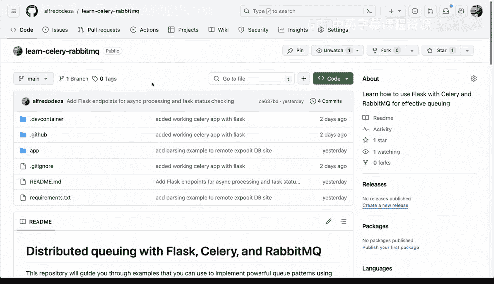

# 大型语言模型实践（高级数据工程、AWS、Databricks和本地LLM）：P7：07_01_08_Flask与Celery应用概述 🚀

在本节课中，我们将要学习一个结合了Flask、Celery和RabbitMQ的应用程序的概述。这个应用程序包含了多个示例，旨在演示不同的功能，因此其结构并非为单一目的而设计得极其简洁。我们将从查看项目依赖开始，逐步了解其核心组件和基本工作流程。

## 项目依赖与核心组件 📦

首先，我们来看看这个应用程序安装了哪些核心库。以下是`requirements.txt`文件中的关键依赖：

*   **Flask**: 作为Web应用框架。
*   **Celery**: 作为处理异步任务的中间件。
*   **BeautifulSoup4** 和 **requests**: 作为支持库，用于网页抓取等辅助功能。

这个应用的核心架构是：Flask处理Web请求，而Celery作为中间人处理后台的异步任务。

## 应用结构与初始化 🔧

应用程序的主要逻辑位于`app`子目录中。让我们快速浏览一下`main.py`文件，了解其初始化过程。

在`main.py`中，通常会看到一些辅助函数来设置应用环境。例如，有专门设置Celery的代码，以及设置Flask应用并为其配置Celery的代码。这些配置的细节我们将在后续课程中深入探讨。

## 应用路由与功能示例 🌐

现在，我们来看看应用程序定义的具体路由和功能。

当有请求访问网站的根路径（`/`）时，应用会返回一个简单的HTML页面。这个页面包含了一个`curl`命令示例，你可以用它来尝试触发Celery任务。

接下来是一个典型的用例。假设你需要发送邮件，你会有一个**同步路由**。请求到达这个路由后，会被处理，然后它会**异步地**调用另一个函数。这个异步函数是如何工作的呢？我们通过一个`shared_task`装饰器来定义它。在任务函数中，我们特意使用`time.sleep(5)`让任务休眠5秒，这样可以清晰地观察到任务是如何被放入队列，并在5秒后被处理的。这是一种常见模式：一个暴露的同步路由接收请求，然后将其交给后台的异步代码处理。

类似地，我们还将详细展示其他类型的路由。在这些路由中，你不仅可以触发像发送邮件这样的操作，还可以选择返回一个**任务ID**。这样，你不仅可以在后台处理任务，还可以在之后通过这个ID来查询任务的处理结果。

## 总结 📝

本节课我们一起学习了一个集成Flask、Celery和RabbitMQ的应用程序的快速概述。这个应用虽然简单直接，但它清晰地展示了这些组件如何协同工作：Flask负责Web接口，Celery管理异步任务队列，而RabbitMQ作为消息代理。在后续课程中，我们将深入这个应用的细节，并按顺序研究这些示例的具体实现。