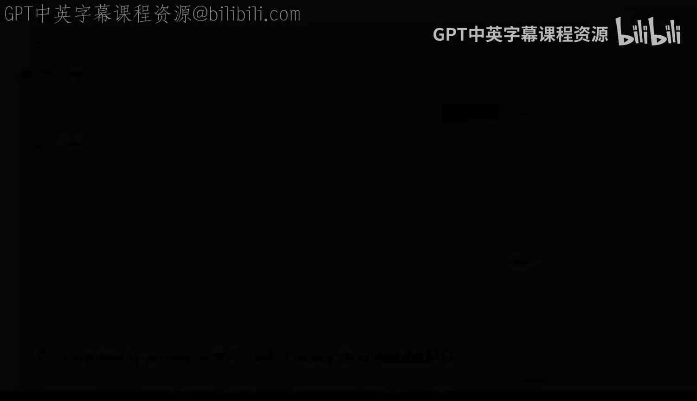
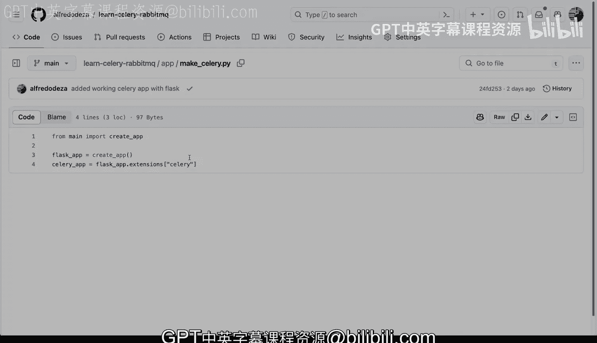

# 大型语言模型实践（高级数据工程、AWS、Databricks和本地LLM）：P10：在Flask中配置Celery 🚀



在本节课中，我们将学习如何在Flask应用中配置Celery。Celery是一个分布式任务队列，常用于处理后台任务。我们将一步步讲解配置过程，确保Flask应用能与Celery协同工作。

## 概述

我们将配置一个Flask应用，使其能够使用Celery处理异步任务。这个过程涉及初始化Celery应用、配置消息代理（如RabbitMQ），并确保Flask的应用上下文能正确传递给Celery任务。

## 配置步骤详解

上一节我们介绍了Celery的基本概念，本节中我们来看看如何在Flask项目中具体配置它。

### 初始化Celery应用

首先，我们需要创建一个Celery应用实例，并将其与Flask应用关联。以下是关键步骤：

以下是初始化Celery应用的核心代码：

```python
from celery import Celery

def make_celery(app):
    celery = Celery(
        app.import_name,
        broker=app.config['CELERY_BROKER_URL']
    )
    celery.conf.update(app.config)
    return celery
```

这段代码定义了一个函数`make_celery`，它接收一个Flask应用实例作为参数。函数内部创建了一个Celery实例，其名称与Flask应用相同，并从Flask配置中获取消息代理的URL。最后，它将Flask的配置更新到Celery实例中。

### 配置Flask应用

接下来，我们需要在Flask应用工厂函数中创建并配置Celery。

以下是Flask应用工厂函数中的配置部分：

```python
from flask import Flask

def create_app():
    app = Flask(__name__)
    # 配置Celery的消息代理URL，这里使用RabbitMQ
    app.config['CELERY_BROKER_URL'] = 'amqp://localhost:5672'

    # 初始化Celery
    celery = make_celery(app)
    app.celery = celery

    return app
```

在这段代码中，我们首先创建了一个Flask应用实例，并设置了Celery所需的消息代理URL。这里使用的是RabbitMQ，运行在本地主机的5672端口，并采用AMQP协议。然后，我们调用之前定义的`make_celery`函数来创建Celery实例，并将其附加到Flask应用上，以便在其他地方使用。

### 创建独立的Celery启动文件

由于Celery需要作为一个独立的进程运行，我们通常需要创建一个单独的启动文件。

以下是启动Celery工作进程的脚本示例：

```python
# make_celery.py
from main import create_app

app = create_app()
celery = app.celery

if __name__ == '__main__':
    celery.start()
```

这个文件从主应用模块导入`create_app`函数，创建Flask和Celery应用实例。当直接运行此脚本时，它会启动Celery工作进程，准备执行任务。

## 总结



本节课中我们一起学习了在Flask应用中配置Celery的完整流程。我们首先初始化了Celery应用并将其与Flask绑定，然后配置了基于RabbitMQ的消息代理，最后创建了独立的Celery进程启动文件。理解这些配置步骤是构建能够处理异步任务的可扩展Web应用的基础。