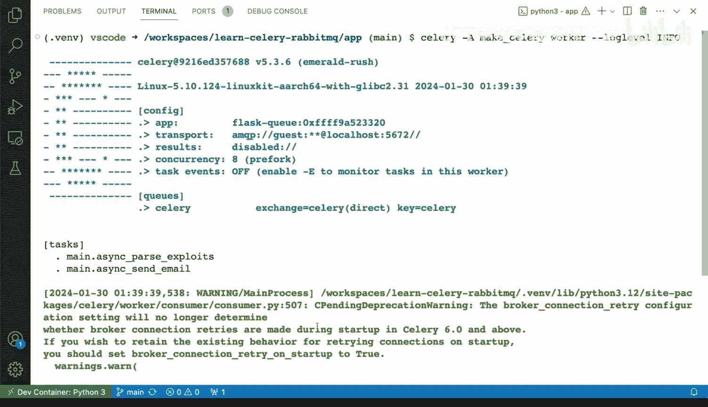
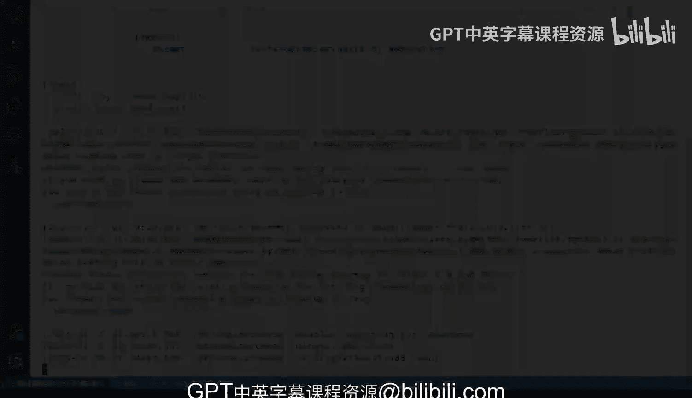

# 大型语言模型实践（高级数据工程、AWS、Databricks和本地LLM）：P11：11_01_06_将Celery与RabbitMQ连接 🚀

在本节课中，我们将学习如何将Celery任务队列与RabbitMQ消息代理连接起来。我们将从检查环境开始，逐步完成依赖安装、应用启动和连接验证，并会指出在此过程中可能遇到的常见问题及其解决方法。

## 环境检查与准备

上一节我们介绍了Celery和RabbitMQ的基本概念，本节中我们来看看如何在实际环境中建立连接。首先，需要确认RabbitMQ服务正在运行。

我当前有一个运行RabbitMQ的环境。让我们查看一下系统类型。系统是Debian 11，这没有问题。在这个Debian 11系统中，我们已经运行了RabbitMQ。让我们再次确认。

我将检查所有进程，并查找RabbitMQ。这是检查RabbitMQ是否运行的好方法。可以看到系统中已经运行和执行了许多不同的进程。这是连接Celery的前提条件。

接下来，我们需要检查Python版本。和往常一样使用Python时，我们需要再次确认版本。我们使用的是Python 3.12。我将使用Python3并通过`venv`模块创建一个`.venv`文件夹。

Python 3正在为我创建该文件夹。现在让我们激活这个虚拟环境。这创建了一个虚拟环境，它是一个子目录，所有Python依赖项都将安装在这里。你会看到提示符已经改变，这是Python的标准做法。

## 安装依赖与启动应用

现在我们需要安装项目依赖。我们之前已经见过`requirements.txt`文件。我将运行`pip install -r requirements.txt`命令。等待安装完成。

安装完成后，我们需要检查是否安装了Celery命令行工具。我们确实安装了Celery。接下来，我们需要进入`app`目录。点击`app`文件夹，让我们查看`make_celery`文件。我们之前见过它，就是这个文件。我们将使用它和Celery来启动Celery应用。这是一个必要步骤。

我将清空一些空间，以便查看我们将要看到的内容。我们将运行命令：`celery -A make_celery worker --loglevel=info`。如果你不在正确的目录中，就会遇到这类错误。如果我们进入`app`目录，然后找到`make_celery`文件，就应该能正常运行，没有问题。

我们运行这些命令，可能会发现一些问题。这里发生了什么？我们的应用遇到了问题，其中一个依赖项（`requests`）没有安装。这是你在尝试连接Celery时可能遇到的另一个问题。因为Celery在运行时会加载那个Python应用，你只需要确保你的`requirements.txt`文件中列出的所有依赖都已安装。Python包管理有时会比较棘手。但这并不是大问题。

我们需要确保`requests`已安装。现在看起来已经准备就绪。我们已经看到了一些可能出错的地方。让我们再试一次。我将使用命令`celery -A make_celery worker --loglevel=info`启动Celery。

## 连接验证与任务队列

现在Celery已经启动。让我们看看这里发生的一些事情。在最顶部，我们获得了一些信息。这是我们的应用名称，记住是`flask_queue`。这非常重要，因为它确保我们连接到了正确的队列。我们正在连接到运行在本地主机的RabbitMQ实例。

我们还获得了一些并发信息。那么有哪些队列呢？队列就在这里，它们是`async_parse_exploits`和`async_send_email`。我们稍后会看到它们。这些队列基本上来自我的Flask应用，我在那里定义了它们。这很有用，因为我可以确保一切正常，并且Celery正确加载了我的Flask应用，完全理解这些任务来自哪里。

你可以在这里看到Celery已经准备就绪。当我们开始与这些任务交互时，我们将在这里看到一些活动。

## 总结

本节课中我们一起学习了将Celery与RabbitMQ连接的全过程。我们从检查RabbitMQ服务状态开始，然后创建并激活Python虚拟环境，安装项目依赖，最后启动Celery worker并验证其成功连接到RabbitMQ。我们还探讨了可能遇到的常见问题，如依赖缺失和路径错误，并提供了相应的解决方案。成功连接后，Celery worker就能开始处理来自Flask应用定义的异步任务队列了。