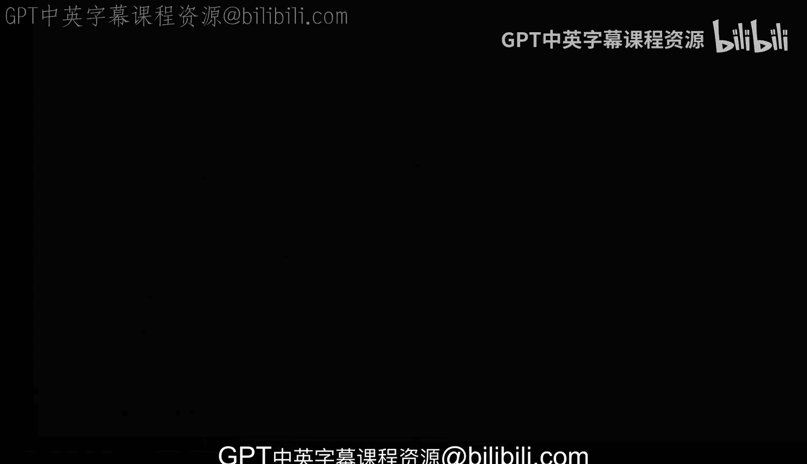
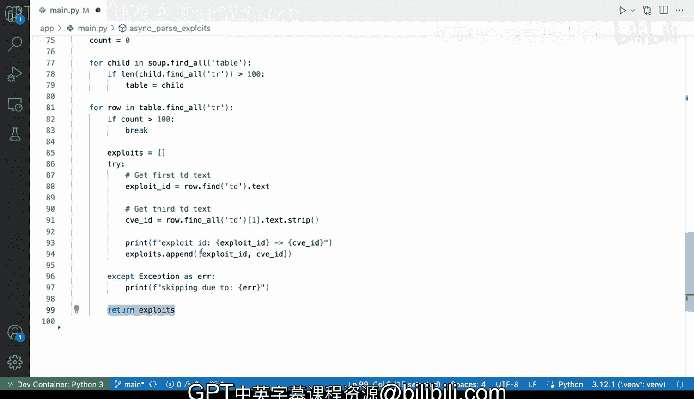

# 大型语言模型实践（高级数据工程、AWS、Databricks和本地LLM）：P12：12_01_07_在Flask中定义Celery任务 🚀

在本节课中，我们将学习如何在Flask应用中定义Celery任务。我们将探讨两种定义任务的方式：一种是简单的“发送邮件”示例，另一种是更复杂的、用于解析网页漏洞信息的真实世界示例。通过本节内容，你将理解如何使用Celery的`shared_task`装饰器来创建后台任务，以及如何将任务放入队列进行异步处理。

## 定义Celery任务的不同方式

在Flask应用中结合Celery定义任务有多种方法。接下来，我们将详细展示本应用中已经使用过的方式。

### 模拟发送邮件任务 📧



首先，我们来看一个“发送邮件”的示例。在这个例子中，我们将模拟发送邮件的过程，而不是真正发送。让我们看看它是如何工作的。

以下是一个同步函数，它将调用我们的异步`send_email`任务。其中的`delay()`方法是关键，它能确保任务被放入后台，进入Celery队列，并在稍后被处理。

```python
@app.route('/send_email')
def send_email_sync():
    # 调用异步任务
    send_email.delay()
    return "邮件发送请求已提交"
```

我们使用`@shared_task`装饰器来定义这个Celery任务。使用`shared_task`主要是为了方便。如果你想深入了解如何为生产环境配置Celery，可能不会使用`shared_task`，因为它本质上只是简单地连接本地现有的RabbitMQ（或第一个可用的消息代理）并开始工作。

在这个任务函数中，我们将接收来自前一个函数的参数，然后简单地返回一个成功状态。这个处理过程非常简单直接。

```python
from celery import shared_task

@shared_task
def send_email():
    # 这里可以放置模拟发送邮件的逻辑
    # 例如：记录日志、调用第三方API等
    # 本例中我们仅模拟处理
    print("模拟发送邮件中...")
    # 模拟处理完成
    return {"success": True}
```

在这里，你可以根据需要进行任何额外的处理。这只是一个基础示例。

### 解析漏洞报告的复杂任务 🛡️

上一节我们介绍了一个简单的后台任务。本节中，我们来看看一个更复杂的、来自真实世界的操作示例：解析漏洞报告。

这个任务将从`exploit-db.com`网站解析漏洞信息。该网站提供的HTML结构比较粗糙，我们需要从中提取数据。最后，任务将返回一个任务ID或解析出的漏洞列表。

让我们看一下这个使用`shared_task`定义的任务。

```python
@shared_task
def parse_exploits():
    import requests
    from bs4 import BeautifulSoup

    url = "https://www.exploit-db.com/"
    response = requests.get(url)
    soup = BeautifulSoup(response.content, 'html.parser')

    exploits = []
    # 假设漏洞信息在特定的表格中
    tables = soup.find_all('table')
    for table in tables:
        rows = table.find_all('tr')
        for row in rows:
            # 这里需要根据实际的粗糙HTML结构编写解析逻辑
            # 例如提取每个行的列数据
            cols = row.find_all('td')
            if cols:
                exploit_data = [col.text.strip() for col in cols]
                exploits.append(exploit_data)
    # 返回解析结果
    return exploits
```

我们将请求目标URL，使用BeautifulSoup进行解析，抓取内容，并查看表格和行以捕获信息。由于HTML结构粗糙，提取这些信息需要一些技巧。

定义在这些共享任务中的所有操作，都是你可以执行的示例。它们可以是“触发后不管”的任务，也可以是你希望稍后捕获信息的任务。在本例中，我直接返回了漏洞信息。

你可以将Celery连接到后端数据库，以便稍后存储处理过的信息。你也可以在这里尝试让事情发生。在本例中，为了使内容超级简单，我只是返回漏洞信息。接下来我们将看看它是如何工作的。

## 总结



本节课中，我们一起学习了在Flask应用中定义Celery任务的两种主要方式。我们从一个简单的模拟发送邮件任务开始，了解了如何使用`delay()`方法将任务推入后台队列。接着，我们探讨了一个更复杂的真实世界示例，即解析粗糙的HTML页面以提取漏洞信息。通过使用`@shared_task`装饰器，我们可以方便地创建异步任务，无论是进行简单的操作还是复杂的网页抓取与数据处理。理解这些模式是构建高效、可扩展后台处理系统的关键。