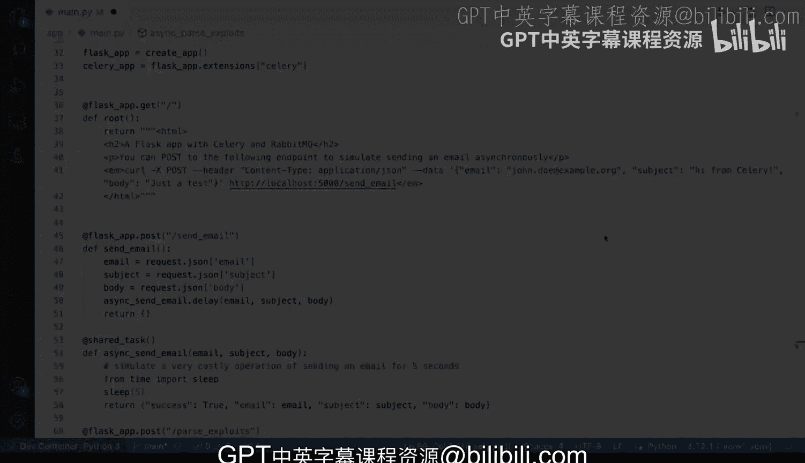
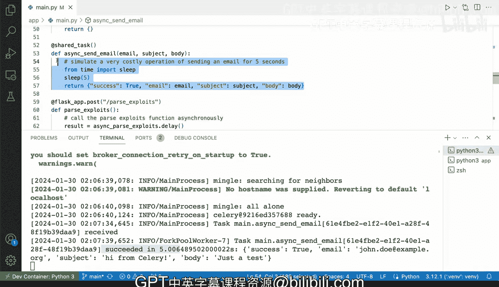

# 大型语言模型实践（高级数据工程、AWS、Databricks和本地LLM）：P13：Flask中的即发即弃任务

## 概述



在本节课程中，我们将学习如何在Flask应用中实现“即发即弃”类型的异步任务。我们将通过一个具体的例子，演示如何发送一个HTTP请求，该请求会触发一个后台长时间运行的任务，而不会阻塞主请求的即时响应。

## 环境准备与启动

首先，我们需要启动两个应用程序。在终端中，我们首先启动`saraly`应用。接着，我们在另一个端口启动Flask应用。

以下是启动应用的命令：
```bash
# 启动saraly应用
python saraly_app.py

# 启动Flask应用（假设运行在端口5000）
flask run --port=5000
```

启动后，Flask应用将在本地主机的5000端口运行。我们暂时不在浏览器中打开它。

## 发送异步请求

现在，我们将使用`curl`命令向Flask应用发送一个POST请求。这个请求将模拟触发一个后台任务。

我们将发送以下JSON数据：
```json
{
  "email": "johndoe@example.org",
  "subject": "Hi from saraly",
  "body": "A test"
}
```

请求的目标端点是`http://localhost:5000/email`。

执行以下`curl`命令：
```bash
curl -X POST http://localhost:5000/email \
  -H "Content-Type: application/json" \
  -d '{"email":"johndoe@example.org", "subject":"Hi from saraly", "body":"A test"}'
```

## 观察请求响应

执行`curl`命令后，你会发现终端**立即**返回，并且没有收到任何响应内容。这表明请求被快速处理并返回，没有等待。

然而，在`saraly`应用的后台，一个耗时任务正在执行。我们在代码中明确设置了**5秒**的休眠来模拟这个长时间处理。

## 理解即发即弃机制

为什么主请求没有阻塞5秒呢？让我们来分析其工作原理。

上一节我们介绍了基本的请求-响应模型，本节中我们来看看异步任务处理。

关键在于，Flask应用在收到请求后，并没有自己执行耗时操作。它执行了以下步骤：
1.  立即返回一个“成功”响应给客户端。
2.  将需要处理的真实任务（如发送邮件）及其数据放入一个消息队列（例如**RabbitMQ**）。
3.  独立的`saraly`应用作为“工作者”，从消息队列中取出任务并执行。

这个过程就像一个“即发即弃”的操作：主程序发出指令后就不再关心其执行过程，由后台系统负责完成。

## 验证后台任务

虽然`curl`请求立即返回，但我们可以验证后台任务确实执行了。

如果你查看`saraly`应用的后台日志或输出，大约5秒后，你会看到类似以下的信息：
```
Success: true
Processing started...
Task succeeded.
```
这证实了耗时5秒的任务已被`saraly`应用成功处理。

## 核心概念总结

以下是实现“即发即弃”异步任务的核心组件和工作流程：

1.  **消息队列**：作为任务的中转站，解耦请求发送者和任务执行者。常用工具有**RabbitMQ**、**Redis**或**Apache Kafka**。
    ```python
    # 伪代码示例：将任务发布到队列
    channel.basic_publish(exchange='', routing_key='task_queue', body=json.dumps(task_data))
    ```

2.  **生产者**：即Flask应用。它接收HTTP请求，创建任务消息，并将其发布到消息队列，然后立即响应客户端。
    ```python
    # 伪代码示例：Flask路由处理函数
    @app.route('/email', methods=['POST'])
    def send_email():
        task_data = request.get_json()
        # 将task_data发布到消息队列
        publish_to_queue(task_data)
        return jsonify({"status": "accepted"}), 202  # 202 Accepted 状态码表示请求已接受处理
    ```

3.  **消费者**：即`saraly`应用。它作为一个独立进程运行，持续监听消息队列。当有新任务时，它取出任务并执行其中的耗时逻辑。
    ```python
    # 伪代码示例：消费者处理任务
    def callback(ch, method, properties, body):
        task_data = json.loads(body)
        # 执行耗时操作，例如模拟处理5秒
        time.sleep(5)
        process_email(task_data['email'], task_data['subject'], task_data['body'])
        print("Task succeeded.")
    ```

## 总结



本节课中我们一起学习了如何在Web开发中处理耗时任务。通过将**Flask**作为生产者、**消息队列**作为中间件、独立的**工作者应用**作为消费者，我们构建了一个“即发即弃”的异步处理系统。这种模式确保了Web服务器能够快速响应客户端请求，同时将繁重的计算或I/O操作卸载到后台，极大地提升了应用的可伸缩性和用户体验。