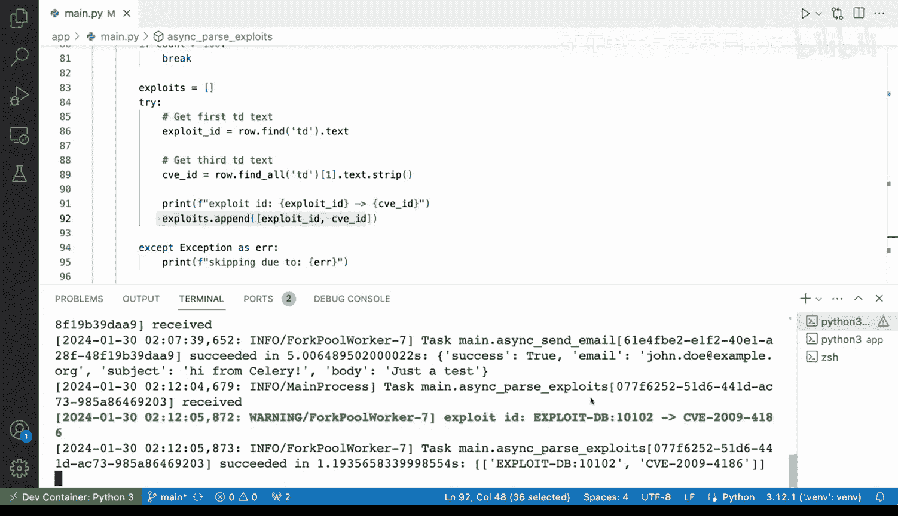

# 大型语言模型实践（高级数据工程、AWS、Databricks和本地LLM）：P14：从异步任务中检索值

## 概述
在本节课中，我们将学习如何从异步任务中检索处理结果。之前我们已经了解了如何发起“发射后不管”类型的请求，本节我们将探讨如何获取异步处理完成后的具体数据。

## 从异步任务中检索结果
上一节我们介绍了如何发起异步请求。本节中我们来看看，如果我们确实需要处理结果，应该怎么做。

我们可以修改之前的 `parse_exploits` 端点。与返回空内容不同，我们将返回一个任务ID。这个ID可以在之后用于查询处理结果。

需要注意的是，这个ID在系统内部与处理信息相关联。信息会被存储在后端存储中。虽然本应用没有配置具体的后端存储（因为那会涉及更复杂的设置），但本节内容将为你提供一个坚实的理解和基础，让你能够在此基础上构建存储功能，并理解其工作原理。

让我们开始操作。我们将向 `parse_exploits` 端点发送一个POST请求。这个请求看起来更简单，因为它不需要提交负载数据，我们只需发送POST请求来触发任务。

以下是具体步骤：

1.  我们使用 `curl` 命令发送POST请求。
2.  命令目标是 `localhost:5000/parse_exploits`。
3.  执行后，我们将获得一个任务ID。

运行命令：`curl -X POST http://localhost:5000/parse_exploits`。

执行后，我们几乎立即获得了一个任务ID。虽然只花了一秒钟，但系统在后台已经完成了处理：它向外部网站提交了请求，进行了数据解析，并发现CV编号 `2009-4186` 关联到了一个漏洞利用程序。

在后台，处理过程是这样的：系统会构建漏洞利用列表，并将找到的漏洞利用ID和CV ID配对，然后追加到一个列表中。

## 理解任务ID的用途
这就是进行更多处理的方式。你会得到一个特定的任务ID，例如本例中的 `077F6`。这个ID是关联工作任务、处理信息和在请求被处理时所捕获的所有内容的关键。

返回这个ID是一种关联工作负载和信息的方法。

## 总结
本节课中我们一起学习了如何从异步任务中检索值。关键点在于，通过让异步端点返回一个任务ID，我们能够在之后查询到该任务的处理结果。这为构建能够跟踪和返回异步操作结果的系统奠定了基础。