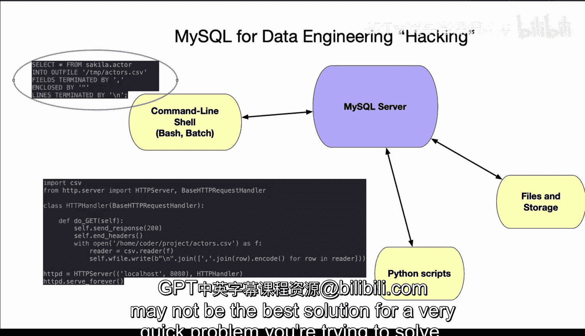

# 大型语言模型实践（高级数据工程、AWS、Databricks和本地LLM）：P16：MySQL概述


## 概述

在本节课程中，我们将学习与MySQL数据库进行交互的几种高效、非传统方法。这些方法侧重于利用现有系统工具和编程语言标准库，快速实现数据查询、导出和处理，特别适合在资源有限或需要快速原型开发的场景下使用。

## 使用“黑客式”方法快速交互

上一节我们介绍了MySQL的基本概念，本节中我们来看看如何利用系统自带工具和标准库，以更灵活、更快速的方式与MySQL进行交互。

除了使用官方的MySQL SDK或图形化界面（GUI）外，还存在一种更偏向传统Linux“黑客”风格的数据工程方法。在某些情况下，你可能需要非常快速地完成某项任务。例如，假设你只有MySQL、Python和Bash环境（这在虚拟机或容器中很常见），并且你希望在不陷入复杂的包管理、反复安装卸载依赖的情况下构建解决方案。幸运的是，使用MySQL，你可以非常迅速地开展工作。

## 将查询结果导出到文件

以下是几种核心的快速操作方法。

### 1. 导出查询结果为CSV文件

你可以将数据库中的特定查询结果直接导出到磁盘文件。例如，执行一个查询并将结果输出为CSV格式文件。一旦数据保存在CSV文件中，我们就可以使用Linux命令行工具或Python等传统工具进行后续处理。

**代码示例：将查询结果导出为CSV**
```bash
mysql -u username -p database_name -e "SELECT * FROM your_table;" > output.csv
```

### 2. 利用Python标准库构建Web服务

需要特别指出的是，Python标准库本身就是一个功能极其丰富的集合，你无需依赖第三方库就能使用Python完成许多任务，这是它的优势之一。标准库内置了各种功能，甚至包括一个简单的Web服务模块。

假设你需要快速构建一个Web服务来处理数据库中的数据，你可以这样做：先执行查询并将结果导出到磁盘，然后编写一段非常简单的Python代码来运行一个Web服务，读取那个CSV文件，最后通过`curl`命令来获取处理结果。这种方法非常适合黑客马拉松，或者与实验室的科学家合作时需要快速搭建原型的情况。

**代码示例：使用Python标准库创建简易Web服务**
```python
# 这是一个简化的示例框架
import http.server
import socketserver

class MyHandler(http.server.SimpleHTTPRequestHandler):
    def do_GET(self):
        # 在此处添加读取CSV文件并返回数据的逻辑
        self.send_response(200)
        self.end_headers()
        # ... 返回CSV数据 ...

PORT = 8000
with socketserver.TCPServer(("", PORT), MyHandler) as httpd:
    httpd.serve_forever()
```

### 3. 导出并操作整个数据库

另一种值得一提的“黑客式”MySQL用法是导出整个数据库。这也是一种令人兴奋的工作方式：你可以使用`mysqldump`命令获取大量SQL格式的数据，然后利用一些Linux工具（如`grep`、`sort`等）来解析和处理这些数据，再进行其他操作。

**代码示例：导出数据库并用Linux工具处理**
```bash
# 导出整个数据库
mysqldump -u username -p database_name > dump.sql
# 使用grep查找特定内容
grep "some_pattern" dump.sql
```

## 总结



本节课中我们一起学习了与MySQL交互的几种快速、灵活的方法。核心在于利用系统自带工具（如命令行、`mysqldump`）和编程语言标准库（如Python），绕过复杂的包管理，直接对数据进行操作。很多时候，我们可能总想安装各种功能强大的库和工具，但对于尝试解决一个快速、临时的问题而言，首先使用这些传统工具，看看它们能带你走多远，然后再决定是否需要引入更重量级的工业级解决方案，这通常是一个有价值的起点。