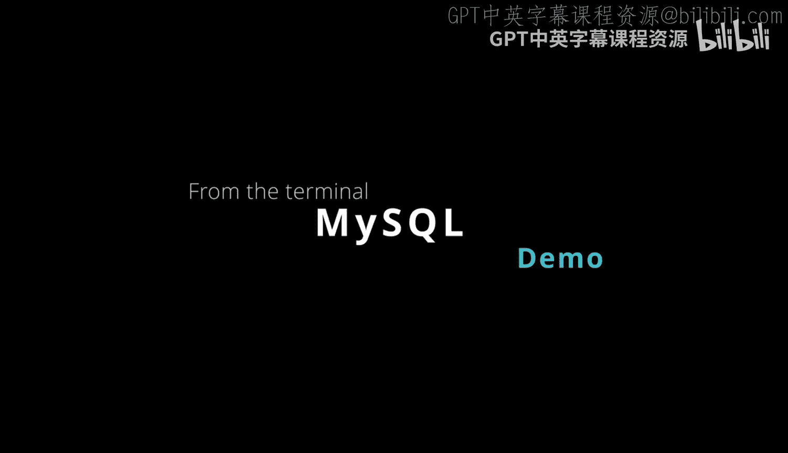
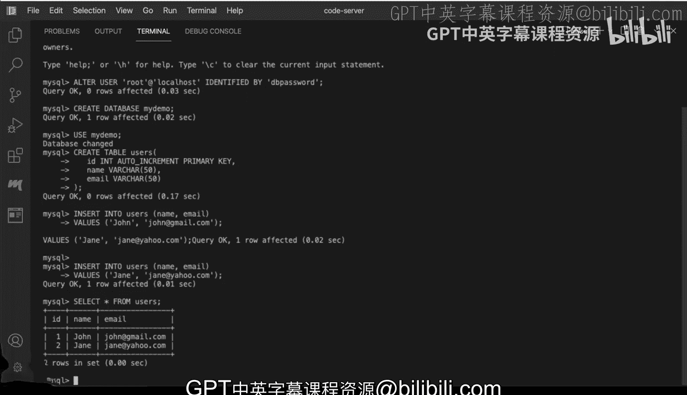

# 大型语言模型实践（高级数据工程、AWS、Databricks和本地LLM）：P17：17_01_04_从终端使用MySQL 🖥️➡️🗄️



在本节课中，我们将学习如何从终端直接连接和操作MySQL数据库。我们将从登录数据库开始，逐步完成创建数据库、定义表结构、插入数据以及查询数据等核心操作。通过终端操作，你可以更直接地理解数据库命令的执行过程。

## 登录MySQL

首先，我们需要登录到MySQL服务器。我们将以`root`用户身份登录，这是新安装MySQL后的默认管理员账户。

以下是登录命令：
```bash
mysql -u root
```
执行此命令后，你将进入MySQL的命令行提示符。

## 修改用户密码 🔐

成功登录后，一个常见的后续步骤是修改`root`用户的密码，以增强安全性。

以下是修改密码的SQL命令：
```sql
ALTER USER 'root'@'localhost' IDENTIFIED BY 'Db_password';
```
请将`'Db_password'`替换为你想要设置的新密码。

## 创建数据库 🗃️

MySQL安装后默认没有用户数据库，因此我们需要创建一个。这为后续存储数据提供了空间。

以下是创建数据库的命令：
```sql
CREATE DATABASE my_demo;
```
此命令创建了一个名为`my_demo`的数据库。

## 选择数据库

创建数据库后，我们需要明确指定后续操作将在哪个数据库中进行。

以下是选择（使用）数据库的命令：
```sql
USE my_demo;
```
执行此命令后，终端提示符通常会发生变化，表明你现在已连接到`my_demo`数据库。

## 创建数据表 📊

数据库本身是空的，我们需要在其中创建表来存储数据。表类似于电子表格，有固定的列（字段）和数据类型。

以下是创建一个简单用户表的命令：
```sql
CREATE TABLE users (
    id INT AUTO_INCREMENT PRIMARY KEY,
    name VARCHAR(100),
    email VARCHAR(100)
);
```
这段代码创建了一个名为`users`的表，包含三个字段：
*   `id`：整数类型，作为主键且自动递增。
*   `name`：可变长度字符串，最大100个字符。
*   `email`：可变长度字符串，最大100个字符。

## 向表中插入数据 ➕

表结构定义好后，我们就可以向其中添加数据了。

以下是向`users`表插入两条示例数据的命令：
```sql
INSERT INTO users (name, email) VALUES
('John', 'john@gmail.com'),
('Jane', 'jane@yahoo.com');
```
每条`INSERT`语句都会向表中添加一行数据。这里我们插入了两个用户：John和Jane。

## 查询数据 🔍

数据插入后，我们可以使用查询语句来检索和查看表中的数据。这是与数据库交互最常用的操作。

以下是查询`users`表中所有数据的命令：
```sql
SELECT * FROM users;
```
执行此命令后，终端将返回`users`表中的所有行和列，即我们刚刚插入的John和Jane的信息。

## 总结



本节课中我们一起学习了从终端操作MySQL数据库的完整基础流程。我们从登录MySQL开始，依次完成了修改密码、创建数据库、选择数据库、定义表结构、插入数据以及最终查询数据。通过终端直接操作，没有任何图形界面的阻隔，能够帮助你更牢固地理解每条SQL命令的作用和数据库的核心工作流程。掌握这个流程是进行更复杂数据工程任务的重要基础。