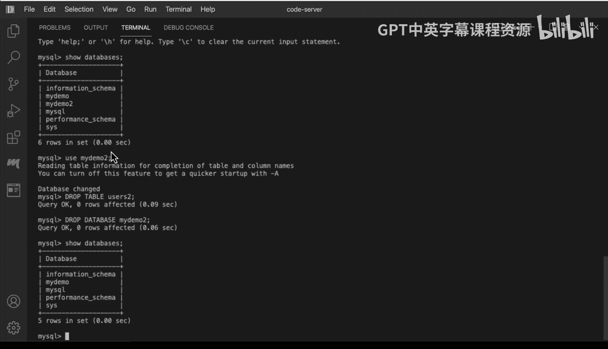

# 大型语言模型实践（高级数据工程、AWS、Databricks和本地LLM）：P18：归档与删除数据库


在本节课程中，我们将学习MySQL数据库管理中的三个核心操作：备份数据库、在数据库间复制数据以及安全地删除数据库和表。掌握这些操作是进行数据工程和模型部署前数据准备的重要基础。

## 备份数据库

上一节我们介绍了数据库的基本概念，本节中我们首先来看看如何为现有数据库创建备份。在进行任何重大数据操作前备份数据库是一个必须遵循的良好实践。

以下是使用 `mysqldump` 命令进行完整备份的步骤：

1.  打开终端。
2.  输入命令：`mysqldump -u root -p my_demo > backup_my_demo.sql`
    *   `-u root` 表示以root用户连接。
    *   `-p` 会提示输入密码。
    *   `my_demo` 是要备份的数据库名称。
    *   `> backup_my_demo.sql` 将备份输出重定向到一个名为 `backup_my_demo.sql` 的文件中。
3.  根据提示输入数据库密码。

备份完成后，建议立即验证备份文件是否有效且不为空。可以使用以下命令检查文件大小和内容：

*   检查文件大小：`ls -lh backup_my_demo.sql`
*   查看文件前几行内容：`head backup_my_demo.sql`
*   查看前100行内容：`head -n 100 backup_my_demo.sql`

验证时，你可能会看到类似 `DROP TABLE IF EXISTS` 和 `CREATE TABLE` 的SQL语句，这表明备份文件包含了数据库的完整结构和数据。

## 在数据库间复制数据

完成备份后，我们可以安全地对数据库进行操作。接下来，我们将学习如何将数据从一个数据库复制到另一个新数据库，这在数据归档或创建实验环境时非常有用。

以下是复制数据的步骤：

1.  登录MySQL：`mysql -u root -p`，然后输入密码。
2.  查看所有数据库确认目标数据库存在：`SHOW DATABASES;`
3.  创建一个新数据库：`CREATE DATABASE my_demo_2;`
4.  切换到新数据库：`USE my_demo_2;`
5.  通过查询旧数据库的数据来创建新表并复制数据：
    ```sql
    CREATE TABLE users_2 AS SELECT * FROM my_demo.users;
    ```
    这条SQL语句从 `my_demo` 数据库的 `users` 表中选取所有数据，并在当前数据库（`my_demo_2`）中创建一个名为 `users_2` 的新表来存放这些数据。
6.  操作完成后，可以退出并重新登录，使用 `SHOW DATABASES;` 命令确认新数据库 `my_demo_2` 已创建成功。

这个过程演示了如何在MySQL实例内部轻松地迁移或复制数据。

## 删除数据库和表

最后，当我们完成实验或需要清理时，需要安全地删除数据库对象。**请注意，删除操作是不可逆的，务必谨慎执行。**

以下是删除表和数据库的步骤：

1.  确保你正在使用正确的数据库：`USE my_demo_2;`
2.  删除指定的表：`DROP TABLE users_2;`
3.  删除整个数据库：`DROP DATABASE my_demo_2;`

`DROP DATABASE` 是一个极其危险的命令，它会立即永久删除数据库及其所有内容。在本例中，因为我们提前进行了备份并特意创建了这个实验数据库，所以可以安全地执行删除。

执行删除后，再次使用 `SHOW DATABASES;` 命令，你会发现 `my_demo_2` 数据库已不存在。这正是我们在第一步进行备份的重要性体现——即使误删，也可以从备份文件中恢复。

## 总结

本节课中我们一起学习了MySQL数据库管理的三个关键操作。我们首先介绍了如何使用 `mysqldump` 命令对数据库进行完整备份，这是所有重要操作前的安全网。接着，我们探讨了如何通过 `CREATE TABLE ... AS SELECT ...` 语句在数据库之间复制数据，用于归档或创建测试环境。最后，我们了解了如何使用 `DROP TABLE` 和 `DROP DATABASE` 命令进行清理，并**强烈强调了在执行删除前进行备份的必要性**。掌握这些操作能让你在数据工程实践中更加自信和安全地管理数据。



