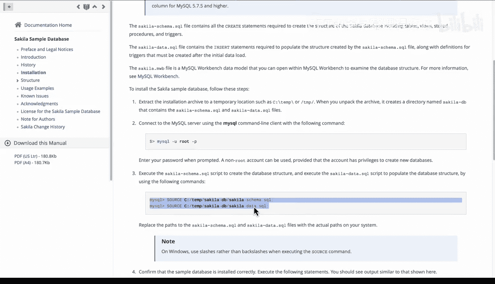
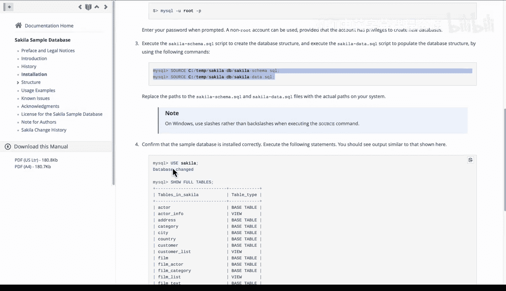
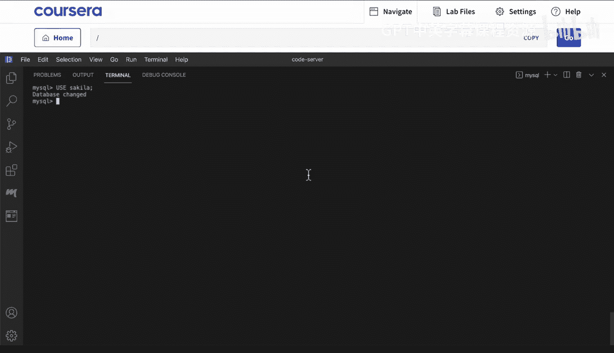
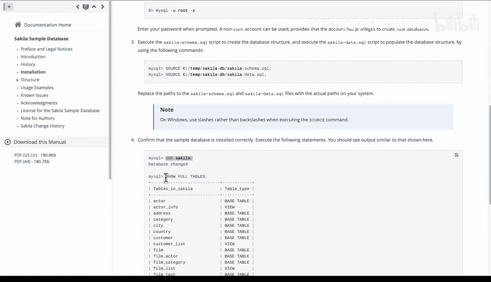
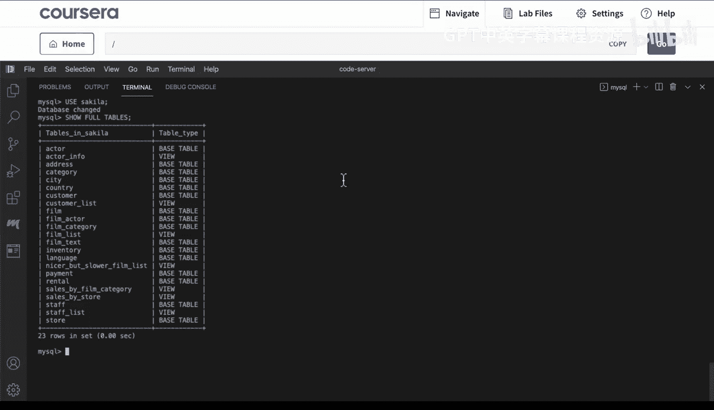
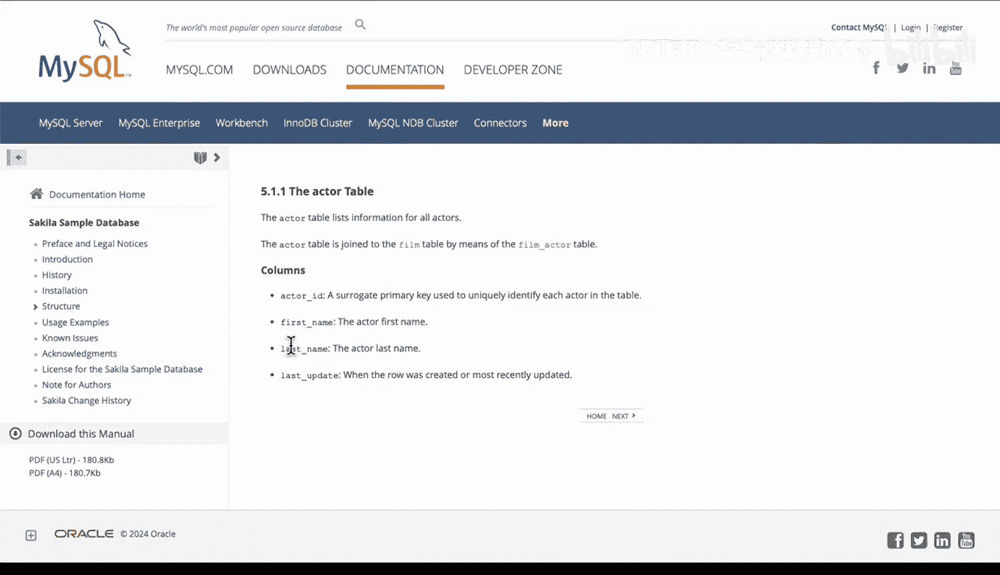
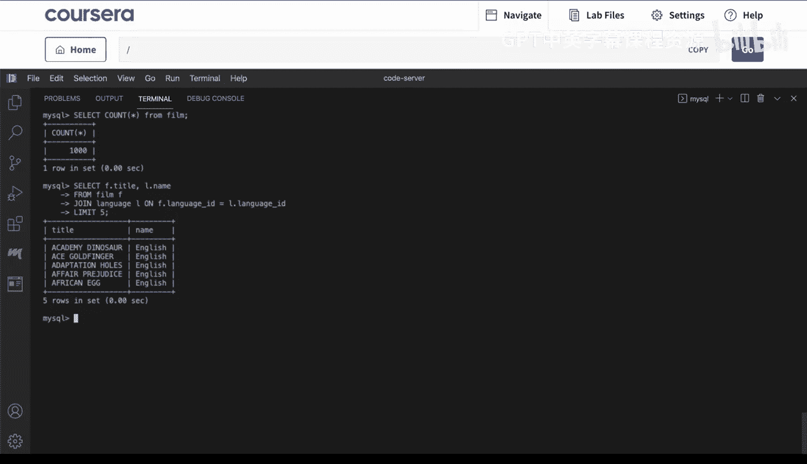

# 大型语言模型实践（高级数据工程、AWS、Databricks和本地LLM）：P19：导入外部数据库Sakila 🗄️


在本节课中，我们将学习如何导入并使用一个名为Sakila的MySQL示例数据库。这是一个经典的参考数据库，常用于学习和测试数据库操作。我们将从下载数据库文件开始，逐步完成在MySQL终端中的导入过程，并学习一些基础的查询操作来探索数据库的结构和数据。

## 概述与准备工作

首先，我们需要获取Sakila示例数据库。该数据库的官方文档可以从MySQL网站获得。拥有一个参考数据库对于理解和测试特定数据库的操作非常有帮助。



以下是获取数据库文件的步骤：
*   访问官方文档页面：`dev.mysql.com/doc/index-other.html`。
*   从该页面下载Sakila数据库文件包。

下载的文件包通常包含三个文件：
*   **Schema文件**：用于创建数据库表结构。
*   **Data文件**：包含要插入到表中的实际数据。
*   **`.MWB`文件**：专用于MySQL Workbench图形化工具，本教程中我们不需要使用它。

## 导入数据库到MySQL

上一节我们准备好了数据库文件，本节中我们来看看如何在MySQL命令行终端中执行导入。


首先，我们打开终端，导航到存放数据库文件的目录，并查看文件。可以看到数据文件通常比结构文件大得多。



```
ls -lh sakila*
```



接下来，我们需要登录MySQL。使用以下命令，并根据提示输入密码：



```
mysql -u root -p
```

成功登录MySQL后，就可以导入数据库了。导入分为两步：首先创建表结构，然后填充数据。我们需要使用`SOURCE`命令来执行对应的SQL文件。请注意，你需要将`/path/to/`替换为文件在你电脑上的实际路径。





```
SOURCE /path/to/sakila-schema.sql;
SOURCE /path/to/sakila-data.sql;
```

执行过程可能需要一些时间。完成后，我们可以切换到sakila数据库，并查看其中包含的所有表，以确认导入成功。

```
USE sakila;
SHOW FULL TABLES;
```

## 探索数据库结构与数据

现在数据库已准备就绪，我们可以开始探索它。充分利用官方文档中的结构图和表定义是理解数据库设计的关键，这对于数据库工程师或数据工程师规划自己的数据库非常有帮助。

首先，我们可以使用`DESCRIBE`命令来查看特定表的结构。例如，查看`actor`表有哪些列及其数据类型：

```
DESCRIBE actor;
```

了解表结构后，就可以进行数据查询了。一个良好的习惯是，在不确定查询结果大小时，使用`LIMIT`子句限制返回的行数。

```
SELECT * FROM actor LIMIT 5;
```

我们可以尝试更复杂的操作，例如表连接（JOIN）。以下是一个示例查询，它连接了多个表，以获取电影标题、租金、以及出演该电影的演员姓名。

```
SELECT f.title, f.rental_rate, a.first_name, a.last_name
FROM film f
INNER JOIN film_actor fa ON f.film_id = fa.film_id
INNER JOIN actor a ON fa.actor_id = a.actor_id
LIMIT 10;
```

此外，聚合函数如`COUNT()`可以帮助我们快速了解数据规模。

```
SELECT COUNT(*) AS total_films FROM film;
```



## 总结


本节课中我们一起学习了如何导入并探索Sakila示例数据库。我们完成了从下载文件、在MySQL终端中导入，到使用`DESCRIBE`、`SELECT`、`JOIN`和`COUNT`等基本命令来了解数据库结构和数据的全过程。像Sakila这样拥有完善文档的示例数据库，是增强数据库操作技能的绝佳工具，它比随意找一个未知数据库进行练习更有指导意义。