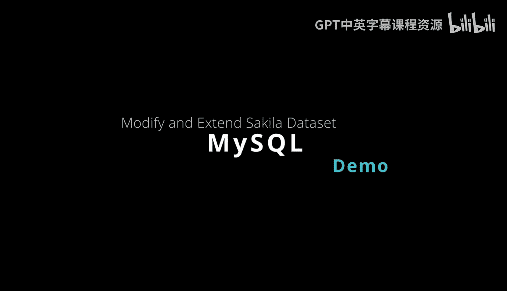
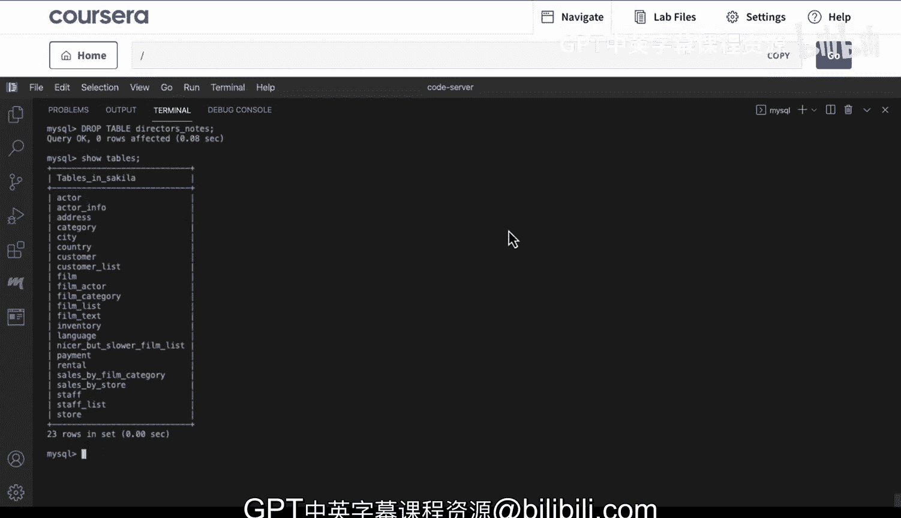

# 大型语言模型实践（高级数据工程、AWS、Databricks和本地LLM）：P20：修改Sakila数据库 🗄️



在本节课中，我们将学习如何对一个名为Sakila的示例电影数据库进行扩展和修改。我们将通过创建新表、插入数据、查询数据以及最终清理实验性数据等一系列操作，来模拟一位导演为电影库添加后期制作笔记的场景。这个过程将帮助你理解基本的数据库操作流程。

## 连接到数据库并查看现有结构

首先，我们需要登录到MySQL数据库系统，并查看其中包含的数据库。Sakila数据库是一个关于电影行业的示例数据库，其中包含了演员、电影等信息。

以下是连接到数据库并查看其内容的步骤：

1.  使用命令 `mysql -u root -p` 登录MySQL。
2.  输入密码后，使用 `SHOW DATABASES;` 命令查看所有数据库，确认 `sakila` 数据库存在。
3.  使用 `USE sakila;` 命令切换到该数据库。
4.  使用 `SHOW TABLES;` 命令查看数据库中的所有表，例如 `actor`、`category`、`film` 等。

## 扩展数据库：创建新表

上一节我们查看了数据库的现有结构，本节中我们来看看如何扩展它。假设我们是一位导演，希望为电影库中的影片添加后期制作笔记。为此，我们需要创建一个新表来存储这些信息。

我们将创建一个名为 `director_notes` 的表，它包含以下字段：
*   `note_id`：笔记的唯一标识，使用 `INT AUTO_INCREMENT PRIMARY KEY` 定义，可自动递增。
*   `film_id`：关联的电影ID，使用 `INT` 类型。
*   `director_note`：导演的笔记内容，使用 `TEXT` 类型，允许存储较长的自由文本。
*   `edit_date`：编辑日期，使用 `DATE` 类型。

创建该表的SQL语句如下：
```sql
CREATE TABLE director_notes (
    note_id INT AUTO_INCREMENT PRIMARY KEY,
    film_id INT,
    director_note TEXT,
    edit_date DATE
);
```
执行此命令后，新表 `director_notes` 就被创建了。

## 向新表中插入数据

表创建好后，里面还没有数据。为了使它变得有用，我们需要向其中插入一些记录。这里我们将模拟为两部电影添加导演笔记。

以下是插入数据的SQL语句示例：
```sql
INSERT INTO director_notes (film_id, director_note, edit_date)
VALUES
(1, 'Fix the sound in minute 20', '2023-11-01'),
(2, 'Shorten the battle scene', '2023-11-02');
```
这条语句向 `director_notes` 表插入了两条记录，分别为ID为1和2的电影添加了笔记和编辑日期。

## 查询与关联数据

仅仅查看笔记表本身信息有限。通常，我们需要将新表与原有的电影表关联起来，以获得更有意义的视图，例如看到电影标题对应的导演笔记。

我们可以使用 `JOIN` 语句来关联 `film` 表和 `director_notes` 表。

以下是一个查询示例，它选取电影标题、导演笔记和编辑日期：
```sql
SELECT f.title, dn.director_note, dn.edit_date
FROM film f
LEFT JOIN director_notes dn ON f.film_id = dn.film_id;
```
执行此查询后，结果会显示所有电影，但只有我们添加过笔记的两部电影（如“A Dinosaur”和“A Goldfinger”）会显示具体的笔记内容。这种查询结果非常适合构建一个供导演查看所有影片及其待办笔记的应用程序界面。

## 清理实验环境

假设上述操作只是一个数据副本上的实验，现在我们希望清理这个实验性的表。这可以通过删除表来实现。

删除表的SQL命令非常简单：
```sql
DROP TABLE director_notes;
```
执行此命令后，`director_notes` 表将从数据库中移除。再次使用 `SHOW TABLES;` 命令可以确认该表已被成功删除。

## 总结



本节课中我们一起学习了如何对一个现有的Sakila数据库进行修改和扩展。我们完成了从登录数据库、查看结构，到创建新表、插入数据，再到关联查询，最后清理实验环境的完整流程。这个过程涵盖了数据库操作的基本环节，是熟悉示例数据库和练习SQL语句的好方法。建议你在自己的环境中尝试类似的扩展操作，以加深理解。