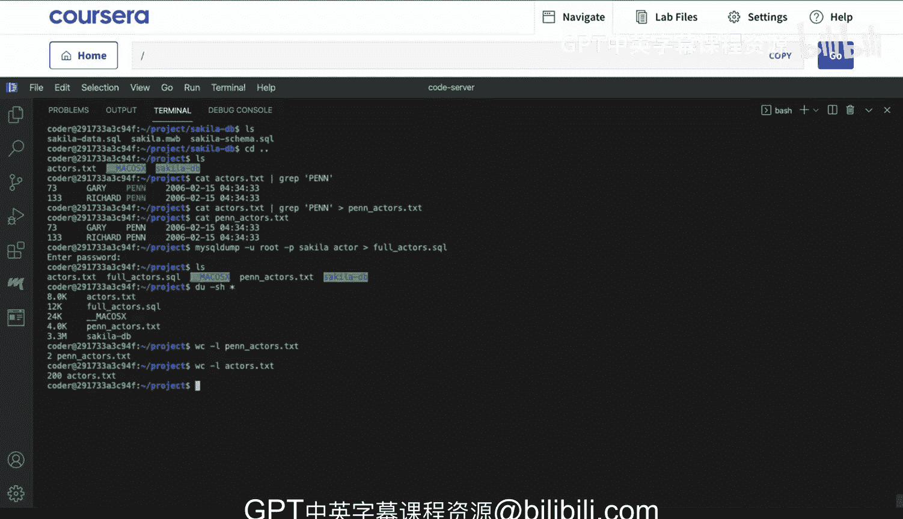

# 大型语言模型实践：P21：使用MySQL的Bash管道 🛠️💾


## 概述
在本节课中，我们将学习如何通过Bash Shell与MySQL数据库进行交互。这是一种高效的数据工程技术，它结合了SQL的强大功能和Shell脚本的灵活性，无需依赖特定编程语言即可完成数据操作。

---

## 连接到MySQL并查看数据库 🔌

首先，我们需要连接到MySQL数据库系统。使用以下命令，以root用户身份登录：

```bash
mysql -u root -p
```

登录后，我们可以查看当前有哪些数据库。输入以下SQL命令：

```sql
SHOW DATABASES;
```

执行后，你会看到数据库列表。在本例中，我们将使用名为 `sequila` 的数据库，其中包含一个演员电影数据库。

---

## 查询数据并输出到文件 📤

上一节我们连接到了数据库，本节中我们来看看如何执行查询并将结果保存到文件中。

在MySQL中，我们可以执行一个简单的查询来查看`actor`表的前5条记录：

```sql
SELECT * FROM actor LIMIT 5;
```

但更有趣的是，我们可以直接将查询结果导出到磁盘上的一个文件。为此，我们使用 `INTO OUTFILE` 语句：

```sql
SELECT * FROM actor INTO OUTFILE ‘/coder/project/actors.txt‘;
```

这条命令会将`actor`表的所有数据导出到指定路径的`actors.txt`文件中。

---

## 在Shell中处理导出的数据 🐚

现在我们已经将数据导出到文件，可以退出MySQL，在Shell环境中对数据进行进一步操作。

首先，切换到文件所在的目录：

```bash
cd /coder/project
```

然后，我们可以使用Shell命令来处理`actors.txt`文件。例如，使用`cat`、`grep`和管道符来筛选数据：

```bash
cat actors.txt | grep Penn
```

这个命令会找出所有姓氏包含“Penn”的演员记录，结果显示为“Gary Penn”和“Richard Penn”。

你还可以将筛选结果写入一个新文件：

```bash
cat actors.txt | grep Penn > penn_actors.txt
```

之后，这个新文件`penn_actors.txt`可以被重新导入到MySQL的一个新表中，或者用于其他分析。

通过这种方式，我们可以在SQL中操作数据，然后利用Shell管道进行更复杂的处理，两者结合非常强大。

---

## 不登录MySQL直接导出数据 🚀

除了在MySQL内部操作，我们还可以完全不登录MySQL，直接从命令行导出数据。

使用 `mysqldump` 工具可以导出整个表或数据库。例如，导出`sequila`数据库中`actor`表的结构和数据：

```bash
mysqldump -u root -p sequila actor > full_actors.sql
```

执行后需要输入密码。这个命令会生成一个包含表结构和数据的SQL文件`full_actors.sql`。

现在，让我们比较一下不同方式生成的文件大小：
*   `actors.txt` (纯数据): 约8KB
*   `full_actors.sql` (结构+数据): 约12KB
*   `penn_actors.txt` (筛选后的数据): 约4KB

我们可以看到，通过不同的方法，我们成功地对数据进行了子集划分。

---

## 使用Shell工具进行快速分析 📊

Shell还提供了许多快速分析文本数据的工具。例如，使用 `wc` (word count) 命令可以统计文件的行数。

统计`penn_actors.txt`的行数（即演员记录数）：
```bash
wc -l penn_actors.txt
```
输出显示有2行（条记录）。

统计原始`actors.txt`文件的行数：
```bash
wc -l actors.txt
```
输出显示有200行，即总共有200位演员。

这种方法展示了Shell与数据库协同工作的巨大优势。很多时候，我们无需切换到Python或Ruby这类功能强大的编程语言，仅使用Shell进行一些操作和管道处理，就能高效地完成许多任务。

---



## 总结
本节课中，我们一起学习了如何通过Bash Shell与MySQL数据库交互。我们掌握了连接数据库、执行查询、将结果导出到文件的方法，并探索了如何在Shell中使用`grep`、`wc`等命令对导出的数据进行筛选和快速分析。最后，我们还了解了如何使用`mysqldump`工具直接从命令行备份数据。这种结合SQL和Shell管道的工作流，为数据工程师提供了灵活而强大的数据处理能力。