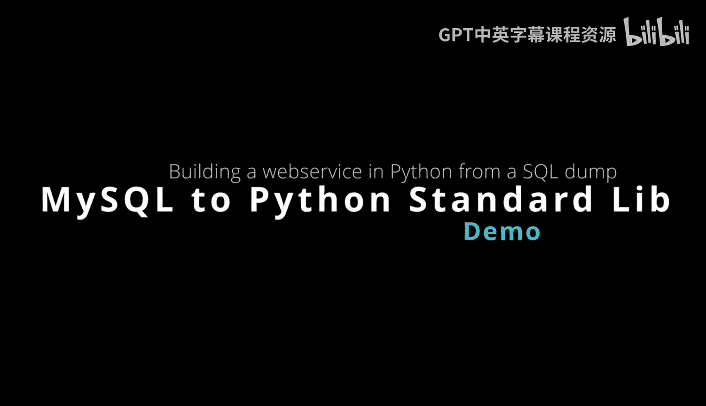
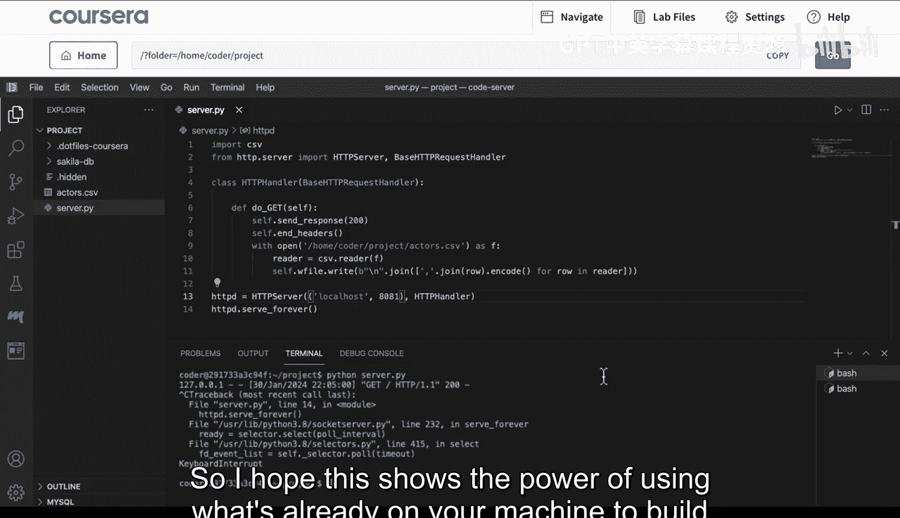
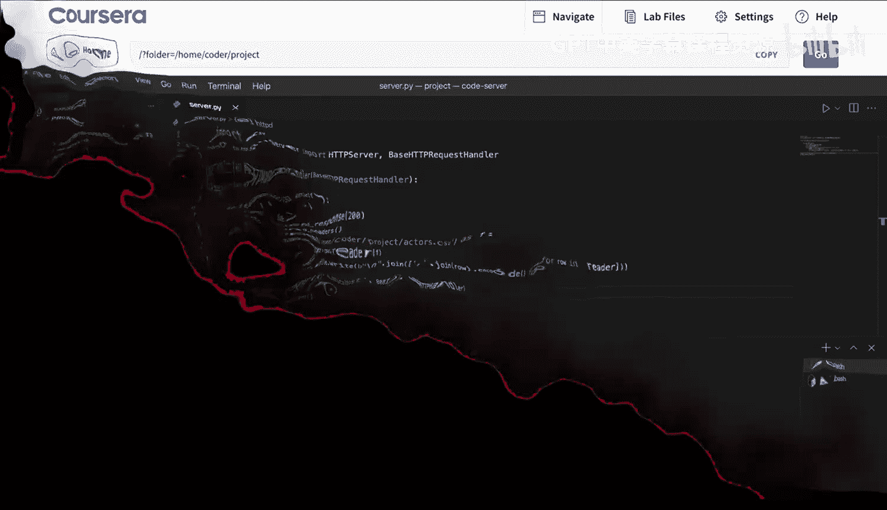

# 大型语言模型实践（高级数据工程、AWS、Databricks和本地LLM）：P22：MySQL到Python标准库Web服务器 🚀



在本节课中，我们将学习如何从MySQL数据库中提取数据，并将其转换为一个简单的Web服务。整个过程将仅使用命令行工具、SQL和Python标准库完成，无需任何第三方依赖。

---

## 连接到MySQL并导出数据

首先，我们需要连接到MySQL数据库，并从中查询数据。

上一节我们介绍了课程目标，本节中我们来看看如何操作MySQL。

在终端中，使用以下命令连接到MySQL服务器：
```bash
mysql -U root -p
```

连接成功后，我们可以查看可用的数据库。执行以下SQL命令：
```sql
SHOW DATABASES;
```
结果显示存在一个名为 `Sequila` 的数据库，其中包含电影数据。

接下来，我们选择使用这个数据库：
```sql
USE Sequila;
```

为了了解数据库中有哪些表，我们执行：
```sql
SHOW TABLES;
```
命令会列出数据库中的所有表。

为了进行后续操作，我们将执行一个预写好的SQL查询。这个查询会从 `actor` 表中选择所有数据，并进行一些数据清洗以确保格式正确，最后将结果导出到一个CSV文件中。

以下是执行的SQL命令：
```sql
SELECT * FROM actor INTO OUTFILE ‘/tmp/actors.csv‘ FIELDS TERMINATED BY ‘,‘ ENCLOSED BY ‘“‘ LINES TERMINATED BY ‘\n‘;
```
执行完毕后，我们可以退出MySQL：
```sql
EXIT;
```

---

## 验证数据并准备Python环境

退出MySQL后，我们回到终端，可以验证CSV文件是否已成功创建。

使用以下命令查看文件的前几行：
```bash
head /tmp/actors.csv
```
这可以确认数据已正确导出。

现在，我们将使用Python创建一个Web服务来提供这个CSV数据。为了编写代码，我们需要打开一个代码编辑器。

在终端中，我们可以创建一个新的Python文件：
```bash
touch server.py
```
然后，在编辑器中打开这个文件进行编辑。

---

## 创建Python Web服务器

我们将编写一个简单的Python脚本，利用其内置的 `http.server` 和 `csv` 模块来创建一个Web服务。

以下是 `server.py` 文件的内容：
```python
import http.server
import socketserver
import csv

PORT = 8080

class CSVHandler(http.server.SimpleHTTPRequestHandler):
    def do_GET(self):
        self.send_response(200)
        self.send_header(‘Content-type‘, ‘text/html‘)
        self.end_headers()
        # 读取并发送CSV文件内容
        with open(‘/tmp/actors.csv‘, ‘r‘) as file:
            csv_reader = csv.reader(file)
            for row in csv_reader:
                self.wfile.write(f“{‘,‘.join(row)}<br>“.encode())

with socketserver.TCPServer((““, PORT), CSVHandler) as httpd:
    print(f“Serving at port {PORT}“)
    httpd.serve_forever()
```

代码解释如下：
1.  我们导入了必要的模块：`http.server`、`socketserver` 和 `csv`。
2.  定义了一个自定义的请求处理类 `CSVHandler`，它重写了 `do_GET` 方法。
3.  在 `do_GET` 方法中，我们设置HTTP响应头，然后打开CSV文件，逐行读取并将其作为HTML内容发送回客户端。
4.  最后，我们启动一个TCP服务器在指定端口（例如8080）上永久运行。

保存文件后，在终端运行这个服务器：
```bash
python server.py
```
如果端口8080已被占用，服务器会报错。此时只需将脚本中的 `PORT` 变量改为其他值（如8081），然后重新运行即可。

服务器成功启动后，会打印类似 `Serving at port 8081` 的信息。

---

## 测试Web服务

服务器运行后，我们可以使用 `curl` 命令或浏览器来测试它。

在终端中，使用以下命令向服务器发送请求：
```bash
curl http://localhost:8081
```
命令会返回CSV文件的内容，格式化为HTML。

这个过程展示了Python标准库的强大功能。很多时候我们过于关注复杂的第三方库，但实际上，对于快速构建简单、高效的解决方案，使用Bash、SQL和Python标准库就足够了。



---



本节课中我们一起学习了如何将MySQL数据导出为CSV文件，并利用Python标准库快速构建一个轻量级的Web服务来提供这些数据。这演示了如何利用现有工具高效地完成数据工程任务。