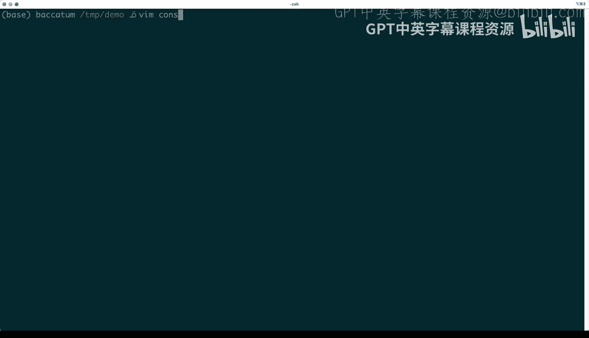
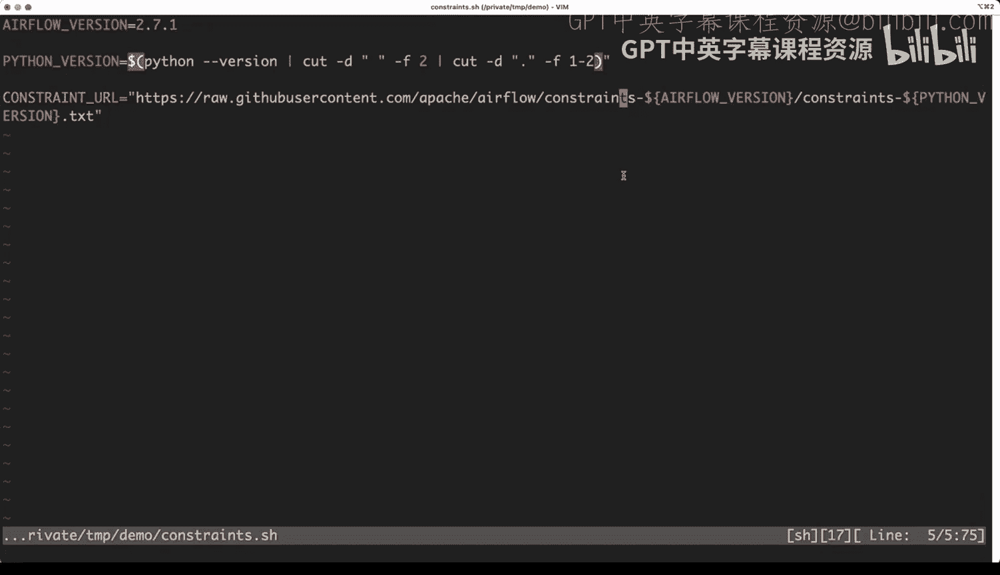
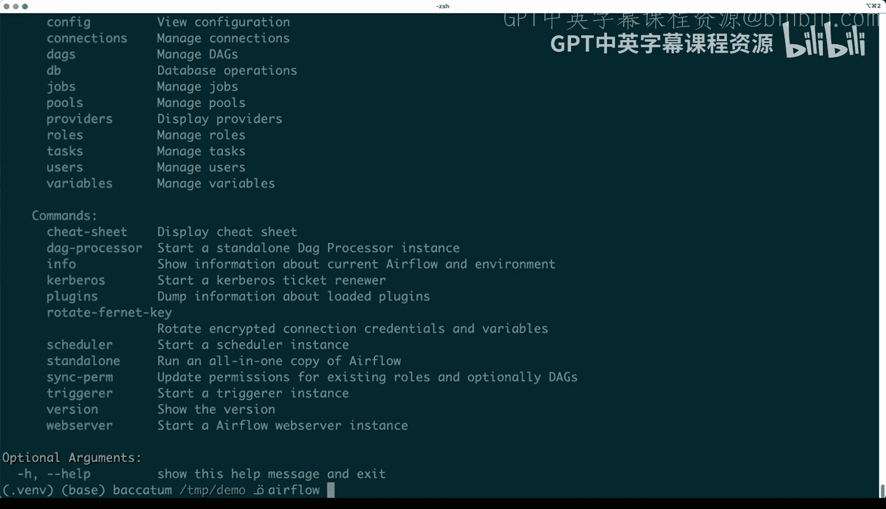
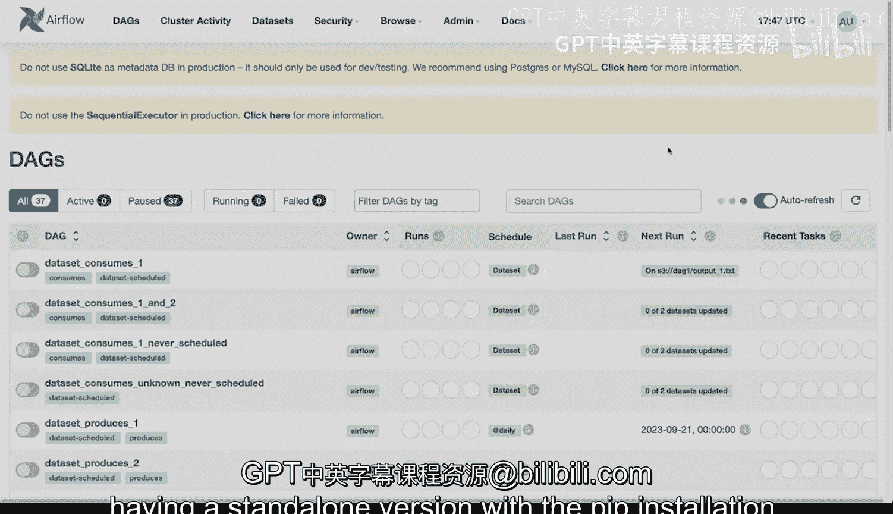

# 大型语言模型实践（高级数据工程、AWS、Databricks和本地LLM）：P25：从PyPI安装Apache Airflow 🚀

在本节课中，我们将学习如何通过Python的包管理工具Pip，从Python包索引（PyPI）安装Apache Airflow。我们将创建一个约束文件来管理依赖版本，并设置一个虚拟环境以确保安装的隔离性和可重复性。最后，我们将验证安装是否成功。

---

Apache Airflow有多种安装方式。我们将概述如何使用Pip和Python安装工具从Python包索引（PyPI）获取Apache Airflow。

首先，我们需要创建一个约束文件。

以下是创建约束文件的步骤。我们可以通过执行命令或编写文件来完成，这里我们选择编写一个文件。让我们快速浏览一下这个约束文件的内容。

我们有一个Apache Airflow版本，此处为2.7.1。然后，我通过一个命令获取Python版本，该命令将准确提供我所需的Python版本信息，并以此构建一个约束URL。

这个操作会获取一个约束文本文件。这意味着，如果我查看该文件，它会列出依赖关系。Pip可以利用这个文件来确保在安装某些组件时，对版本施加约束。

现在，让我快速退出并“source”这个文件。我将执行 `source constraints.txt`。

然后，我可以执行例如 `echo $PYTHON_VERSION` 来检查Python版本，这里显示为Python 3.9。如果我执行 `echo $CONSTRAINT_URL`，你会看到Apache Airflow版本和约束URL都已设置好。

如果我们想快速查看这个约束文件的内容，可以获取并查看它。你会发现它看起来很像一个 `requirements.txt` 文件，但这个约束文件基本上锁定了所有不同的依赖版本。Apache Airflow在这方面做得很好，努力确保所有组件都能协同工作。

接下来，我们可以先创建一个虚拟环境。我将执行 `python3 -m venv ./venv`。这意味着我将运行Python 3，使用 `venv` 模块，在 `./venv` 目录下创建一个虚拟环境。

创建完成后，我需要激活它。执行 `source ./venv/bin/activate`。激活后，你会看到我的命令行提示符发生了变化，出现了 `(venv)` 标识。

现在，我可以使用来自虚拟环境的Pip进行安装。执行 `pip install "apache-airflow==${AIRFLOW_VERSION}" --constraint "${CONSTRAINT_URL}"`。请注意，这里使用花括号 `${}` 来引用变量。

这个命令将安装依赖。运行它，安装过程会很快，因为我之前已经预先安装好了所有组件。

很好，所有内容都已安装完毕。现在，我们应该有一个Airflow二进制可执行文件。执行 `airflow --help` 来查看所有可用的命令，这可以确认Apache Airflow已成功安装。

现在，让我们看看如果运行 `airflow standalone` 会发生什么。它将运行数据库迁移，为我们设置好一切。大量日志信息会输出，并告诉我Airflow已准备就绪，管理员用户名为 `admin`，密码为终端中显示的一串字符。

一切看起来都正确，它将在本地主机的8080端口上运行。让我快速打开浏览器检查一下。访问 `localhost:8080`，它会提示输入用户名。我将粘贴从终端获得的密码，然后登录。登录后，所有功能都将准备就绪。

这就是不仅通过Pip安装Airflow，还通过运行独立版本来验证安装是否实际工作的方法。

---

本节课中，我们一起学习了如何从PyPI安装Apache Airflow。我们创建了约束文件来管理依赖版本，在虚拟环境中完成了安装，并通过启动Airflow的独立模式验证了安装成功。这为后续使用Airflow进行工作流编排奠定了基础。