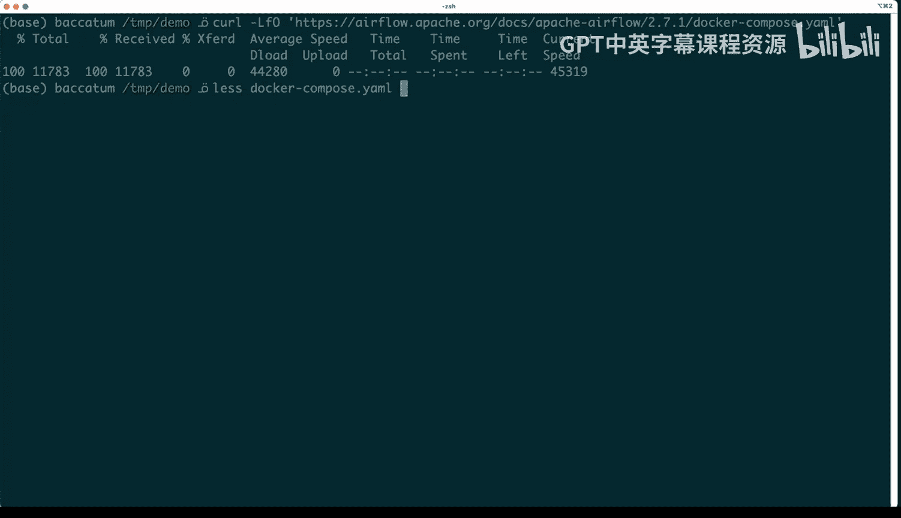
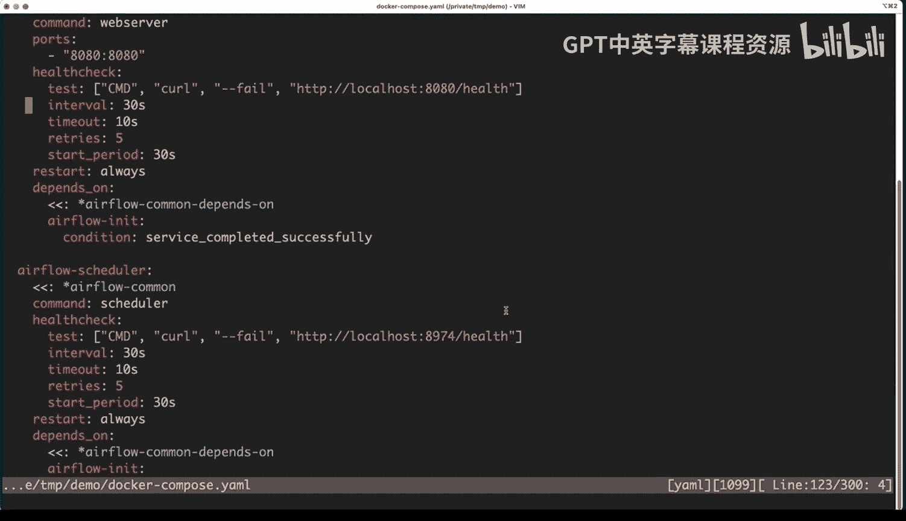
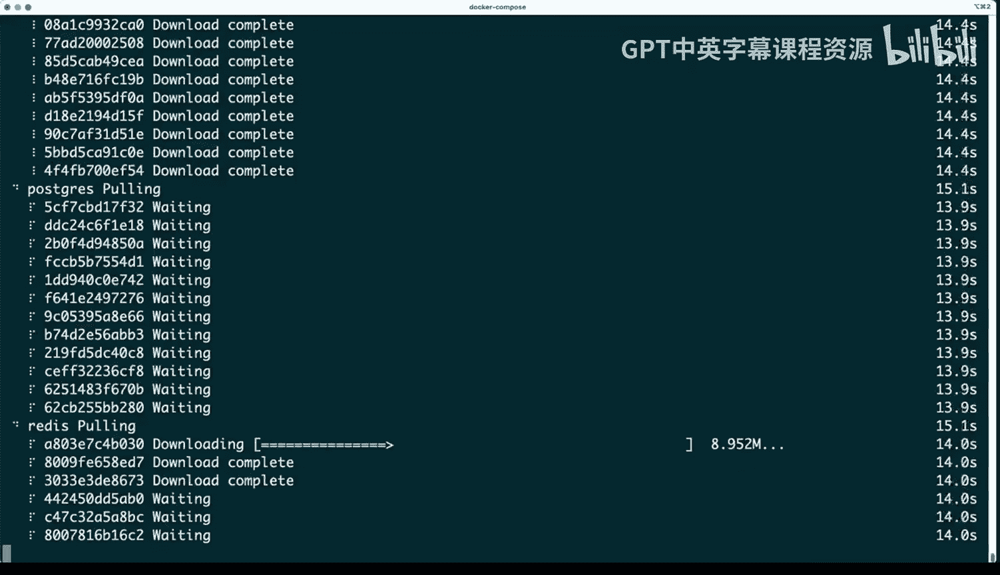
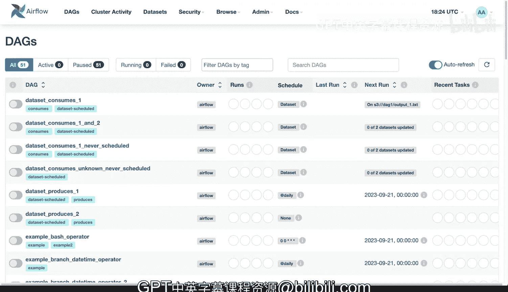

# 大型语言模型实践（高级数据工程、AWS、Databricks和本地LLM）：P26：在Docker中使用Apache Airflow 🐳


在本节课中，我们将学习如何使用 Docker Compose 来快速搭建一个 Apache Airflow 的本地开发与测试环境。我们将下载官方的 Docker Compose 配置文件，启动所有必要的服务，并验证 Airflow 的 Web 界面是否能够正常运行。

---

## 概述与准备工作

上一节我们介绍了 Apache Airflow 的基本概念。本节中，我们来看看如何使用 Docker 容器化技术来运行 Airflow。使用 Docker Compose 是尝试 Apache Airflow 的另一种方式。你可以围绕调度器进行一些操作，并拥有一个本地开发环境。同时，你也能借此机会深入研究，了解更多关于 Airflow 的强大功能。

我再次打开了终端。我将下载一个为我准备好的 Docker Compose 文件。值得注意的是，这个配置**不适用于生产环境**，而更像是为了尝试一个容器化的环境。当然，如果你的本地已经设置好了 Docker 工具，就可以直接运行它。

## 下载 Docker Compose 文件

首先，我将下载那个文件。以下是我将要使用的命令。我将使用 `curl` 命令从这个位置下载文件。这个位置是 `airflow.apache.org`，来自官方文档。你同样可以 100% 通过浏览器获取这个文件，但我选择在终端中完成所有操作。

这个文件将使用 Apache Airflow 版本 **2.7.1**。如果你想获取不同的版本，你需要能够更改那里的版本号。

以下是下载命令：
```bash
curl -LfO ‘https://airflow.apache.org/docs/apache-airflow/2.7.1/docker-compose.yaml‘
```
好的，让我们开始吧。很好，下载完成了。现在让我们看看我们的 Compose 文件。



## 解析 Docker Compose 文件

我们在这里拥有的基本上是我们需要的所有东西。你可以看到这里定义了很多内容。你拥有很大的灵活性来更改端口、密码和用户名等设置，这些你都可以 100% 自定义。

正如你所知，Apache Airflow 包含很多不同的组件。它有一个 UI 界面，但也有数据库连接。除了数据库连接，你还需要处理 SQLAlchemy。当你尝试在 Docker Compose 中定义这样的东西时，所有这些都被抽象化了，但你开始看到一点端倪，了解一切是如何组合在一起的。

因为你看到了 SQLAlchemy、PostgreSQL、`psycopg2`（这是让 Python 能与 PostgreSQL 通信的驱动）。让我们继续向下滚动。

你可以看到这里有一些 Celery，这是一个用于发送和消费消息的工具，它将使用 Redis 作为消息代理。后端将使用 PostgreSQL。所以这里有很多东西会为我们定义好。

这个文件实际上有 300 行长，所以我们不会逐行检查所有内容，但我们会查看将要实例化的服务。

以下是文件中定义的关键服务：
*   **PostgreSQL**：数据库服务，会挂载一个数据卷，并有健康检查确保一切就绪。
*   **Redis**：消息代理服务，同样有健康检查和一些超时设置。
*   **Web Server**：Airflow 的 Web 服务器，将运行在本地主机的 **8080** 端口。
*   **Scheduler**：Airflow 调度器，也运行在本地主机，但使用不同的端口，同样有 `/health` 健康检查端点。

## 启动 Airflow 环境



启动这些服务的常用方式是使用 `docker compose up` 命令。`docker compose up` 将允许你启动所有服务。

然而，对于 Apache Airflow，官方的实际指令推荐你先运行 `docker compose up airflow-init`。这个命令将确保所有数据库表被预先创建和初始化，一切准备就绪。

所以让我们先运行这个初始化命令。运行这个命令会产生大量输出。让我们花点时间，直到它完成拉取所有镜像层并实例化我们所需的一切。完成后我们会回来。

好的，Airflow 初始化完成了。现在我们可以看到“Airflow 已创建，用户为 admin”这样的消息。这正是你想看到的消息，它以退出代码 0 结束。

一旦初始化完成，你就可以运行 `docker compose up`，一切应该就能正常工作了。

完美，所有容器都在启动和运行，我们会看到大量的日志输出。稍后等它完成，我们再检查用户界面是否再次运行。



## 验证 Airflow 运行状态

现在启动已经完成，你会看到这里有很多日志。Web 服务器确实在正确运行。如果我非常快地滚动到顶部，也会看到 Redis 在那里，还有关于 Web 服务器的更多信息。你可以看到权限被添加了，这是一个非常完整的过程，很多东西被添加并开始运行。

现在，我将快速切换到我的网页浏览器。浏览器会告诉我一切是否就绪。我将访问 `localhost:8080`。登录用户名是 `airflow`，密码也是 `airflow`。然后登录。

你应该看到的界面，与你通过 Python 包索引（PyPI）全新安装并尝试时非常相似。但 Docker Compose 方式允许你拥有独立的容器来处理独立的工作和关注点，而不是一个“一体式”的应用。它实际上会使用 PostgreSQL 以及 Redis 和 Celery 等服务，这看起来和感觉上会更像生产环境。但这仍然不是生产就绪的配置，所以建议仍然如此。

我们暂时不会深入探讨 UI 的细节，但这只是一种验证一切是否正常工作的方式。

---

## 总结



本节课中我们一起学习了如何使用 Docker Compose 来搭建和运行 Apache Airflow。我们完成了从下载官方 Compose 文件、解析其服务构成、初始化数据库到最终启动全部服务并验证 Web 界面可访问的完整流程。这种方法为你提供了一个隔离的、模块化的本地环境，便于你体验 Airflow 的核心功能并进行开发测试。