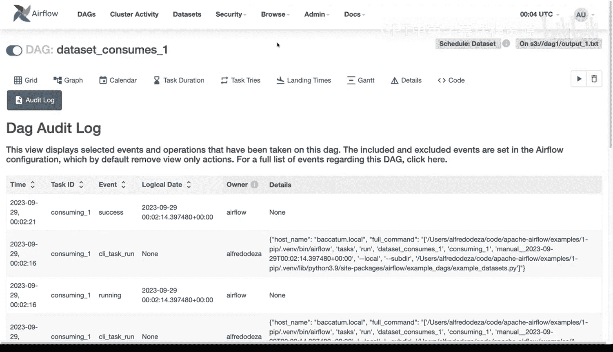

# 大型语言模型实践（高级数据工程、AWS、Databricks和本地LLM）：P27：探索Airflow用户界面 🖥️

在本节课中，我们将探索Apache Airflow的用户界面。我们将了解其核心功能、如何管理DAG（有向无环图）以及如何通过界面监控和操作任务。本节内容旨在帮助初学者快速熟悉Airflow UI的基本布局和常用操作。

---

## 本地环境与生产环境差异

上一节我们介绍了Airflow的基本概念，本节中我们来看看其用户界面。请注意，我当前使用的是本地运行环境，而非生产环境。

如果向上滚动，你会看到一些在生产环境中不应使用的组件提示。例如，我使用了SQLite。SQLite是一个嵌入式数据库，在文件系统中看起来像一个文件，本质上是一个允许交互的数据库。但这并非生产环境的理想选择。在生产中，通常会选择PostgreSQL或MySQL等数据库。同样，Sequential Executor也仅适用于尝试和测试。在浏览用户界面时，你会看到这些警告信息。

---

## 浏览与管理DAG

让我们快速查看可用的DAG。我已经启用了其中一个DAG。

“启用”一个DAG意味着什么？界面上有一个开关，允许你根据需要开启或关闭特定的DAG。一旦开启，计划的或手动触发的运行就可以开始。

在界面上，你可以看到DAG的所有者、运行状态等信息。将鼠标悬停在状态图标上，可以看到“已排队”、“运行中”、“成功”或“失败”等状态。目前，我没有失败或正在运行的任务，但之前手动触发了一个并成功运行了。了解这些空圆圈图标的含义非常有用。

界面上还显示了一些基本信息，例如上次运行的时间戳和下一次计划运行的时间。记住，某些DAG依赖于其他DAG的运行，界面会显示下一次计划运行的时间。

---

## 任务详情与操作

以下是关于近期任务的信息。为了让视图更清晰，我稍微调整了界面大小。

你可以看到近期任务列表，并可以对它们执行一些操作。例如，你可以触发一个任务运行，或者将其删除。

现在，让我们放大视图，仔细查看。将鼠标悬停在DAG上，你会看到“暂停”和“取消暂停”的选项，这与我之前解释的功能一致。目前，我只激活（即取消暂停）了名为 `dataset_consumes_1` 的DAG，其他DAG都处于暂停状态。正如所见，当前没有正在运行或失败的任务。

---

## 深入查看DAG详情

让我们点击 `data_consumes` 这个DAG来查看更多元数据和更详细的运行信息。

在这个详情页面，你可以看到更细粒度的数据，例如任务的最大运行时长、平均运行时间等计算指标。由于我只运行过一次，所以数据目前是静态的。但这里是你获取运行准确信息的地方。

页面提供了不同类型的可视化图表。虽然我这里没有太多数据，但其中一个有趣的功能是“代码”选项卡。

---

## 查看与审查DAG代码

“代码”选项卡允许你探索DAG的定义。我尝试向下滚动，你可以看到实际执行任务的代码。这是一个示例DAG，也是包含所有代码的Python文件。

这是一种查看和检查正在运行内容的简洁方式。我们尚未深入探讨DAG是如何构建的，或者界面上所有元素的含义，但如果你清楚自己在做什么，这是一个检查具体执行内容的好方法。这个DAG的代码量不小，大约有130行，你可以直接从UI快速审查它，这个功能我非常喜欢。

在详情页，你还可以看到任务运行时长图表，并且有“自动刷新”的选项。如果点击“触发”或“播放”按钮，自动刷新功能会启用。

---

## 触发与监控任务运行

让我们回到“网格”视图。如果我点击“触发”按钮，你可以看到任务开始运行。

现在自动刷新已开启，任务实际上已经在这里启动了。这是我的第一次运行，发生在稍早之前，而这是另一次运行。这里的任务并不复杂。

如果我带你回到代码视图，你会看到它只是运行一个Shell命令：在执行其他操作前先休眠几秒钟。

让我们实际看看它在做什么。是的，命令是 `sleep 5`，这正是它执行的内容，这个过程大约需要7秒。下一个任务实际上没有执行，但这没关系，因为它是这样配置的。

---

## 其他有用视图与功能

浏览界面时，还有一些我非常喜欢的功能。以下是其他有用的视图：

*   **任务尝试**：查看任务每次尝试执行的详细信息。
*   **着陆时间**：分析任务完成的时间点。
*   **日历**：日历视图尤其有用。你可以看到我有两次触发记录，并且所有记录都用颜色编码，提供了非常直观的日历可视化。这一切都是为了让你有能力准确了解正在发生的情况。
*   **审计日志**：审计日志会包含日志输出。在这里你可以看到我的用户名、触发操作等信息，所有者信息也会显示在这里。它提供了更详细的信息供你探索和进行更多操作。

界面上还有各种不同的配置项，例如启用插件、配置提供者、管理资源池等。这让你拥有完全的控制权。

本节内容主要是对Apache Airflow用户界面的快速概述，并非深入教程，但对于理解一些基础知识仍然非常有用。

---

## 总结

本节课中，我们一起探索了Apache Airflow的用户界面。我们了解了本地环境与生产环境的区别，学习了如何浏览、启用、暂停DAG，以及如何查看任务详情、运行状态和DAG代码。我们还实践了触发任务并利用日历、审计日志等视图进行监控。这些基础操作是使用Airflow进行工作流编排和管理的重要第一步。