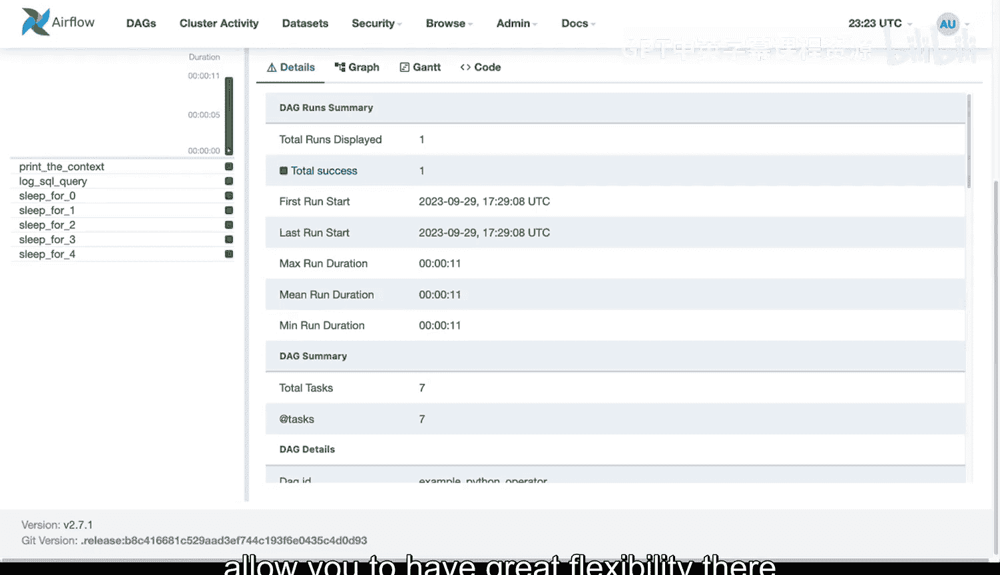

# 大型语言模型实践（高级数据工程、AWS、Databricks和本地LLM）：P29：29_02_03：探索有向无环图（DAG）🔍

在本节课中，我们将要学习Apache Airflow中的有向无环图（DAG）。我们将从Airflow自带的示例DAG入手，分析其结构和组件，并了解如何通过代码定义和配置一个DAG。通过本教程，你将掌握DAG的基本构建方法。

## 概述

我们将首先查看Apache Airflow内置的示例DAG，特别是“example_python_operator”示例。通过分析其代码，我们将理解DAG的构成要素、任务定义以及依赖关系。同时，我们也会参考官方文档中的教程DAG，以加深对核心概念的理解。

## 探索示例DAG

上一节我们介绍了本课程的目标，本节中我们来看看Apache Airflow中自带的示例DAG。我们将从“example_python_operator”开始，它已经成功运行过一次。

除了Python操作符示例，我们还需要了解官方文档提供的信息。因此，我们将转到文档部分，快速浏览“教程DAG”以获取更多背景知识。

以下是切换到文档网站后的步骤，我们将跳过许可证部分，直接关注将要处理的组件。

### DAG的构成要素

一个DAG文件通常包含以下部分：

*   **导入语句**：首先需要导入所有必需的模块。例如，`BashOperator`用于执行Bash命令，`DAG`类是创建DAG所必需的。
*   **DAG实例化**：使用`with`语句创建DAG对象，并传入各种配置参数。
*   **任务定义**：在DAG上下文中，定义各个任务（Task），并指定其操作符（如`BashOperator`、`PythonOperator`）和参数。
*   **依赖关系**：通过设置任务的上下游关系（如 `t1 >> [t2, t3]`）来定义执行顺序。

### 分析教程DAG

在教程DAG中，我们通过`with DAG(...)`语句实例化DAG。`with`语句是一个上下文管理器，它确保DAG在正确的上下文中创建和执行。

在创建DAG时，可以传递许多参数来精细控制其行为。例如：

*   `depends_on_past`：如果设置为`True`，则任务执行依赖于前一次执行的成功。
*   `email`：设置接收通知的邮箱地址。
*   `email_on_failure`：任务失败时是否发送邮件。
*   `end_date`：设置DAG的结束日期，避免无限期运行。

定义好DAG后，我们开始创建任务。在教程示例中，`t1`、`t2`、`t3`是任务变量，它们调用了`BashOperator`。

每个任务都需要一个唯一的`task_id`。例如，`t1`执行`date`命令，`t2`执行`sleep 5`命令。`t1`的`doc_md`参数用于添加Markdown格式的文档，这会在Airflow界面上以友好的方式呈现，但它是可选的。

任务还可以使用Jinja模板引擎，这提供了在任务中动态渲染内容的能力。

最后，通过 `t1 >> [t2, t3]` 这样的语法定义了依赖关系，表示`t1`完成后，`t2`和`t3`将并行执行。

## 深入Python操作符示例

了解了基础结构后，我们来看看“example_python_operator”的具体代码。这个示例展示了更多Python特有的功能。

以下是该示例DAG的主要组成部分：

*   **导入操作符**：导入了`ExternalPythonOperator`和`PythonVirtualenvOperator`。这些操作符对于管理Python依赖至关重要，尤其是在需要隔离环境或安装外部包时。
*   **DAG定义**：使用`with DAG(...)`定义DAG，并设置了`dag_id`、`schedule`（本例中为`None`）、`start_date`和`tags`等参数。
*   **任务函数与装饰器**：
    *   `print_context` 函数使用 `@task` 装饰器，它打印上下文信息并返回一个字符串，该字符串会输出到日志中。
    *   `log_sql_query` 是另一个被装饰的任务函数。
*   **动态生成任务**：通过一个`for`循环动态创建了5个睡眠任务（`sleeping_task`），这演示了如何以编程方式生成多个类似任务。
*   **虚拟环境管理**：`vm_installed`任务检查是否处于虚拟环境中。`vm_task`任务则使用`@task.virtualenv`装饰器，并指定了依赖项（如`colorama`），这确保了任务在包含所需包的独立虚拟环境中运行。
*   **外部Python任务**：`external_python_task`展示了如何调用一个指定路径的Python解释器来执行任务，而不依赖主Airflow环境。

在代码末尾，通过设置任务间的依赖关系（如 `run_this >> log_sql >> sleeping_tasks`）来定义整个工作流的执行图。

## 查看DAG运行图

当我们运行这个DAG时，可以在Airflow的图形视图（Graph View）中看到其结构。执行顺序将是：首先运行`print_context`，然后是`log_sql_query`，接着是动态生成的5个睡眠任务（`sleeping_task_0` 到 `sleeping_task_4`）。

这种可视化清晰地展示了任务之间的依赖关系和并行执行路径。通过检查每个任务的日志详情，我们可以验证其执行过程和输出。

## 总结

本节课中我们一起学习了Apache Airflow中有向无环图（DAG）的核心概念。我们从分析内置的示例DAG开始，理解了其基本结构，包括导入、DAG实例化、任务定义和依赖设置。我们重点剖析了`example_python_operator`，学习了如何使用Python装饰器定义任务、动态生成任务、以及管理Python虚拟环境依赖。最后，我们通过图形视图直观地看到了DAG的执行流程。这些知识为你构建灵活、可靠的数据管道奠定了坚实基础。