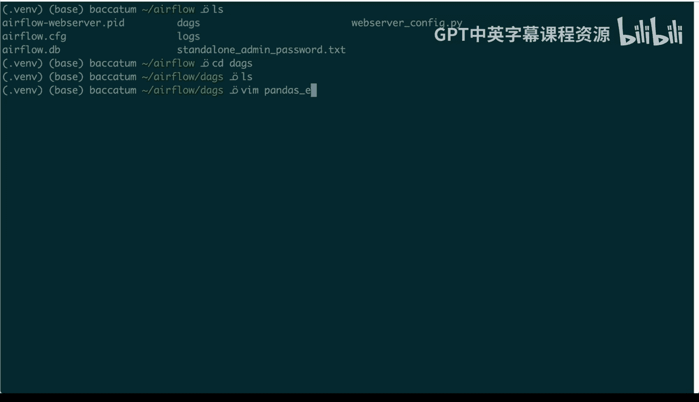
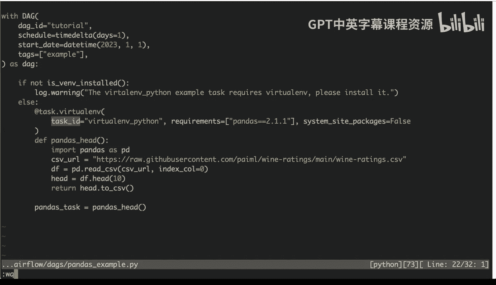
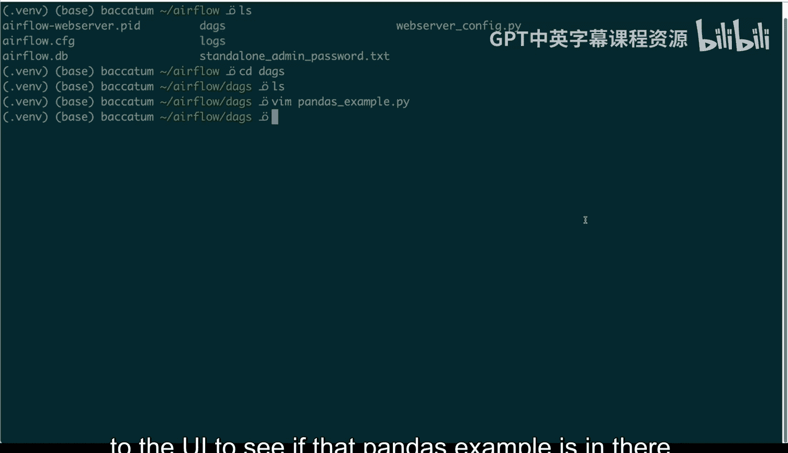
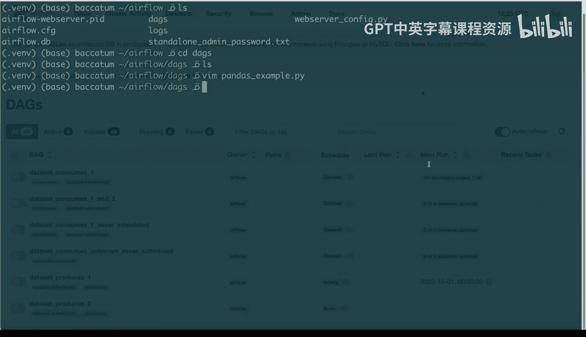
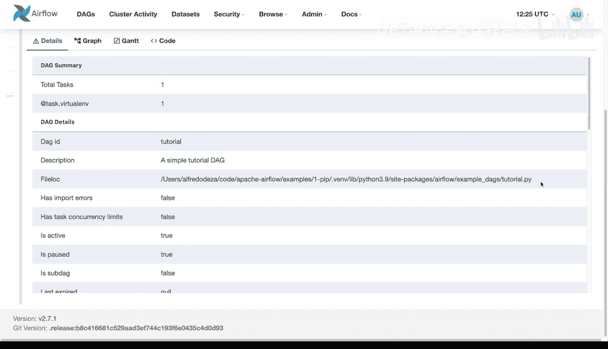
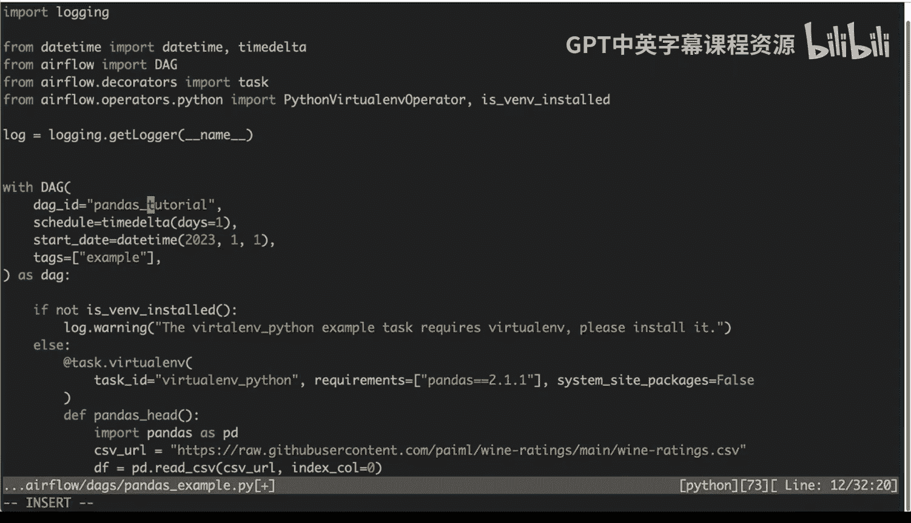
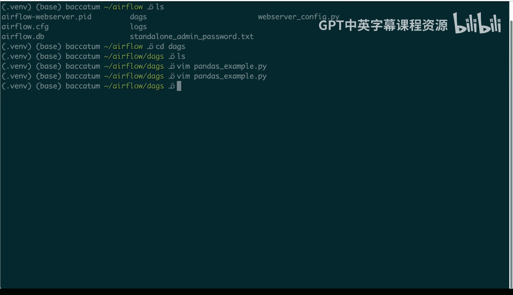
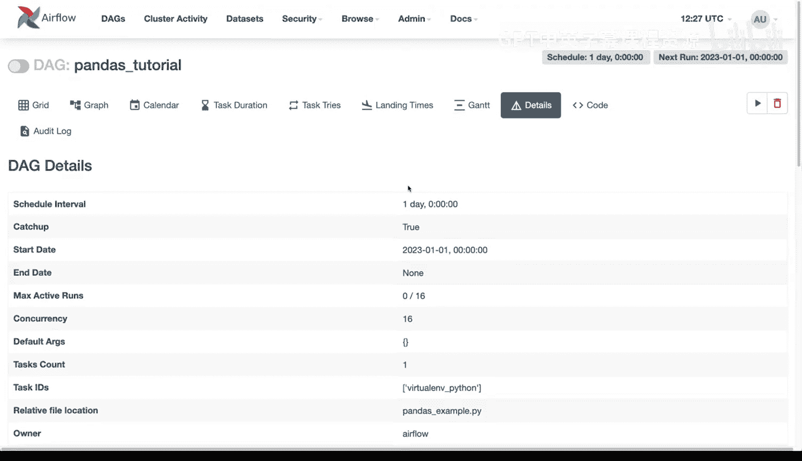

# 大型语言模型实践（高级数据工程、AWS、Databricks和本地LLM）：P30：30_02_05_创建DAG 📁


在本节课中，我们将学习如何在Apache Airflow中创建一个简单直接的DAG。我们将遵循Airflow提供的文件夹结构，并逐步构建一个使用Pandas库处理数据的示例任务。

---

## 理解Airflow目录结构

首先，我们需要了解Apache Airflow的默认目录结构。Airflow的配置和DAG文件通常位于用户主目录下的`airflow`文件夹中。这是一个非生产环境，因此我们使用SQLite嵌入式数据库。

在`airflow`目录下，有多个子目录和文件，例如数据库文件和管理员密码文件。我们的重点是`dags`子目录，这是存放所有DAG文件的地方。

## 创建DAG文件



接下来，我们进入`dags`子目录并创建一个新的Python文件。我们将这个文件命名为`pandas_example.py`。你可以使用任何文本编辑器来创建和编辑这个文件。

以下是创建DAG文件的具体步骤。

### 导入必要的库

在文件的开头，我们需要导入一些必要的Python库和Airflow模块。

```python
import logging
from datetime import timedelta
from airflow import DAG
from airflow.decorators import task
from airflow.operators.python import PythonVirtualenvOperator
```

### 定义DAG和任务

现在，我们开始定义DAG本身及其包含的任务。我们将设置DAG的ID、调度间隔、开始日期和标签。

```python
# 定义DAG
dag = DAG(
    dag_id='pandas_tutorial',  # DAG的唯一标识符
    schedule_interval=timedelta(days=1),  # 每天运行一次
    start_date=datetime(2023, 10, 1),  # 开始日期
    tags=['example'],  # 用于在UI中分类的标签
)

# 初始化日志记录器
logger = logging.getLogger(__name__)
```

### 使用PythonVirtualenvOperator

我们将使用`PythonVirtualenvOperator`来创建一个隔离的Python环境，并在其中运行我们的任务。这确保了依赖项不会与系统或其他任务冲突。





```python
# 定义任务函数
def process_csv():
    import pandas as pd
    # 假设的CSV数据URL
    csv_url = 'https://example.com/data.csv'
    df = pd.read_csv(csv_url)
    # 处理数据，例如返回前10行
    result = df.head(10)
    return result



# 创建任务实例
pandas_task = PythonVirtualenvOperator(
    task_id='process_csv_task',
    python_callable=process_csv,
    requirements=['pandas==2.1.1'],  # 指定Pandas版本
    system_site_packages=False,  # 不使用系统包
    dag=dag,
)
```

### 保存并检查DAG

保存文件后，Airflow会自动检测`dags`目录中的新文件并将其导入。我们可以在Airflow的Web UI中查看新添加的DAG。

## 在Airflow UI中验证DAG

打开Apache Airflow的Web界面，我们可以通过标签搜索我们的DAG。例如，搜索“example”标签，应该能看到我们刚创建的`pandas_tutorial` DAG。

点击DAG名称，可以查看其代码、日志和运行状态。确保DAG的ID是唯一的，以避免与其他DAG冲突。



## 调试与注意事项





如果在UI中没有看到新创建的DAG，可能是由于ID冲突或语法错误。检查DAG的ID是否唯一，并确保代码没有错误。Airflow会自动重新加载`dags`目录中的文件，但有时可能需要手动刷新。

---



本节课中，我们一起学习了如何在Apache Airflow中创建和配置一个简单的DAG。我们了解了Airflow的目录结构，编写了一个使用Pandas处理数据的任务，并在Airflow UI中验证了DAG的正确性。记住，保持DAG ID的唯一性和代码的正确性是成功运行工作流的关键。