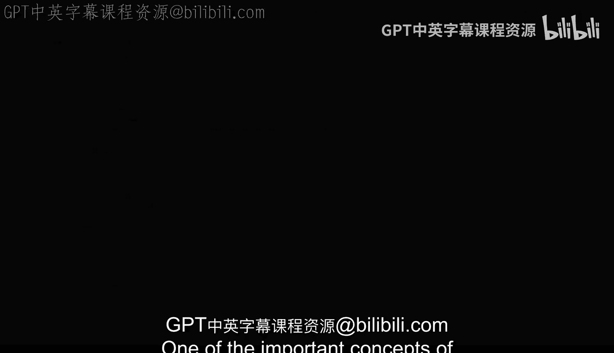
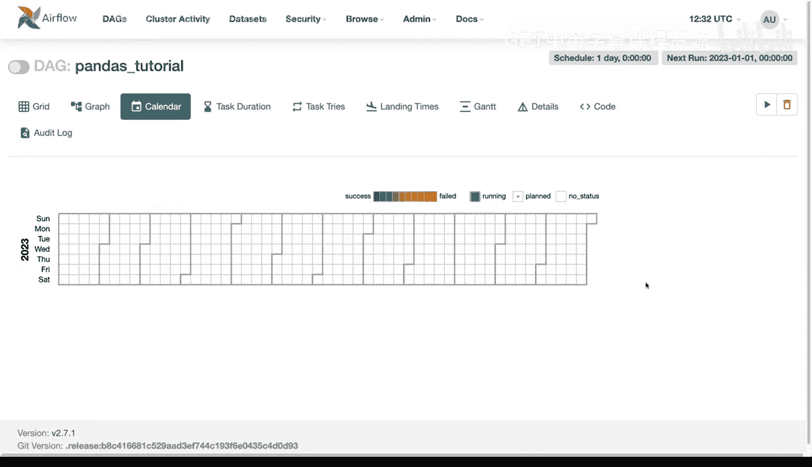
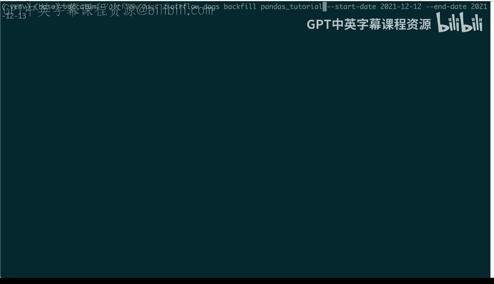
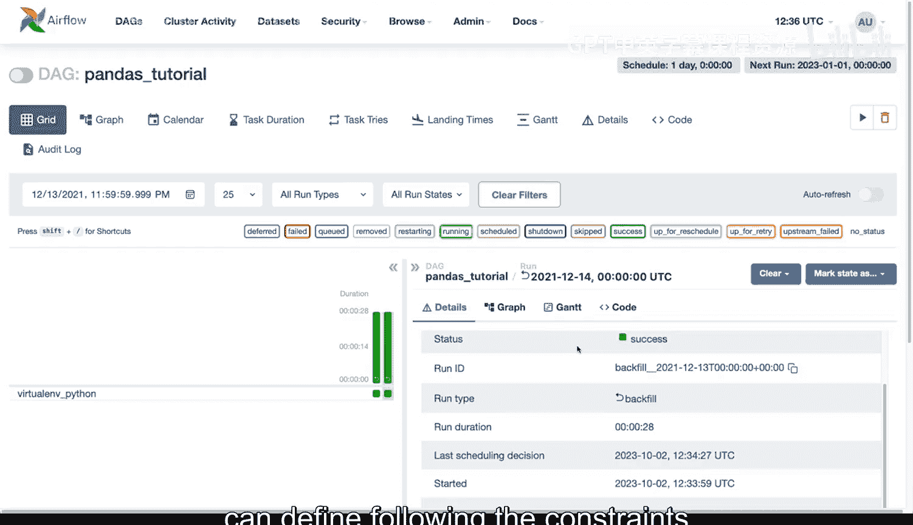

# 大型语言模型实践（高级数据工程、AWS、Databricks和本地LLM）：P31：运行回填 🚀

在本节课中，我们将要学习 Apache Airflow 中的一个重要概念——回填。我们将了解任务调度中日期部分的含义，并通过实际操作演示如何使用命令行界面执行回填操作，以处理过去特定时间段内的任务。

## 任务调度与日期的概念

上一节我们介绍了 Airflow 的基本任务调度。本节中我们来看看任务调度中“开始日期”和“计划”的具体含义。

Apache Airflow 的一个重要概念是调度，以及在我们处理任务时如何理解日期部分。这里的开始日期和调度，并不一定意味着在某个特定日期开始运行，而是指**为某个特定日期开始**执行任务。这意味着你可以让任务的执行遵循一个日历视图。例如，如果你指定某个任务为 2023 年 4 月执行，即使我们现在已经不在 2023 年 4 月，你仍然可以运行任务来“填补”那个时间段。




你可以指定需要在 4 月发生的那些天运行这些任务。每当一个任务定义了这些日期和调度（例如，每天运行多少次或间隔时间），你实际上就定义了一个需要执行这些操作的时间线。执行这类操作的方式就是通过**回填**。

## 什么是回填？ 🔄

上一节我们明确了日期调度的含义，本节中我们来看看实现它的具体工具——回填。

回填是一种指令 Airflow DAG（在本例中是 `pandas_tutorial`）在给定时间范围内按照给定调度运行的方式。它允许你“回到过去”执行任务。

以下是执行回填的核心命令结构：
```bash
airflow dags backfill -s <开始日期> -e <结束日期> <DAG_ID>
```



## 执行回填操作 💻

了解了回填的概念后，接下来我们通过终端实际操作一遍。

让我们回到终端，看看具体如何操作。我这里有一个实际的命令。我将运行 `airflow` 这个 Apache Airflow 的命令行界面工具。我会使用 `dags` 子命令，然后是 `backfill` 子命令。我将指定 `pandas_tutorial` 作为我的 DAG 的唯一 ID，并传入开始日期 `2021-12-12` 和结束日期 `2021-12-13`。

```bash
airflow dags backfill -s 2021-12-12 -e 2021-12-13 pandas_tutorial
```



执行时可能会遇到错误，例如 DAG ID 不唯一。看到这些错误和跟踪信息是有用的，因为它能让我们在事情不按预期发展时感到更从容。修正 DAG ID 后，我们再次尝试运行。


现在，我们将看到一些输出。因为 Apache Airflow 会尝试理清所有正在发生的事情，我们可能会看到其他任务的输出。但我们会看到 `pandas_tutorial` 开始运行。即使其他任务可能因无法导入 pandas 而失败，但我们关注的 `pandas_example` 任务会正确运行。

关于 DAG 文件夹路径（如 `~/airflow/dags`），Airflow 使用它来定位 DAG 文件，这个位置是可配置的。

## 验证回填结果 ✅

任务执行完成后，我们需要到 Web UI 界面查看结果。

回填完成后，让我们转到 Web UI 查看结果。我切换到日历视图并刷新页面。



现在你可以看到，因为我指定了 2021 年的日期，所以 2021 年的调度出现了。由于我指定了两天且每天运行一次，这里有两个运行实例。你可以看到 2021年12月12日和12月13日各有一个成功的运行。点击其中一个，你会看到它确实成功了。运行类型显示为“回填”。

通过这种方式，你可以在 DAG 定义的约束条件下，为你能定义的非常具体的时间框架执行回填操作。

## 总结 📝


本节课中我们一起学习了 Apache Airflow 中的回填操作。我们首先理解了任务调度中“为特定日期执行”的含义，然后明确了回填是一种用于在历史时间范围内按计划执行 DAG 的机制。接着，我们通过命令行演示了执行回填的具体步骤和命令格式，并最终在 Web UI 中验证了回填任务的执行结果。掌握回填功能，使你能够灵活地处理过去遗漏的任务或测试历史数据流水线。