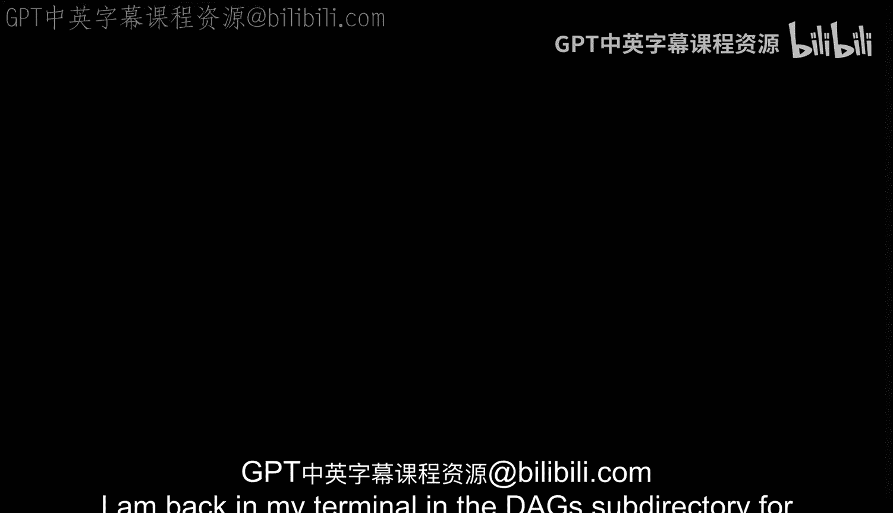
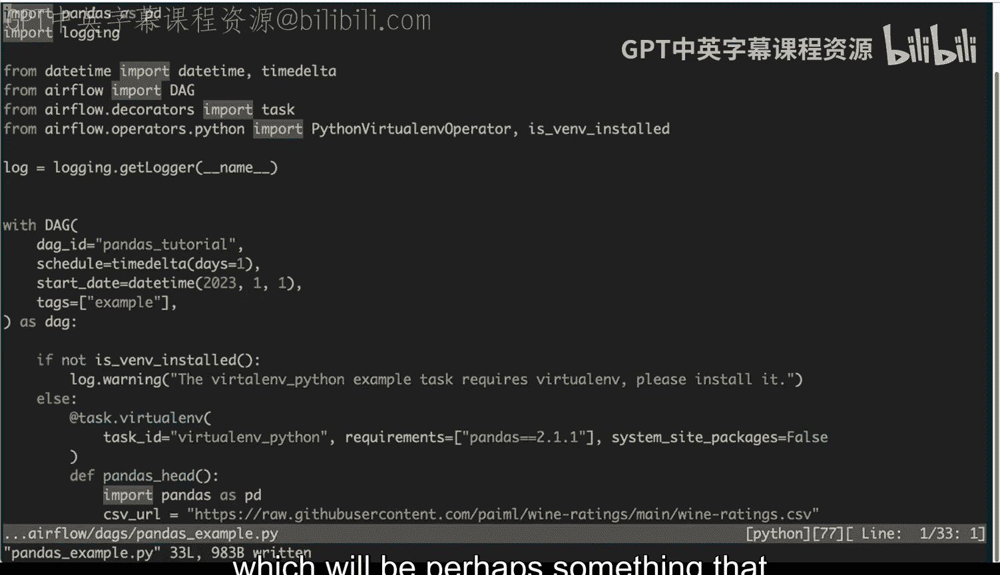
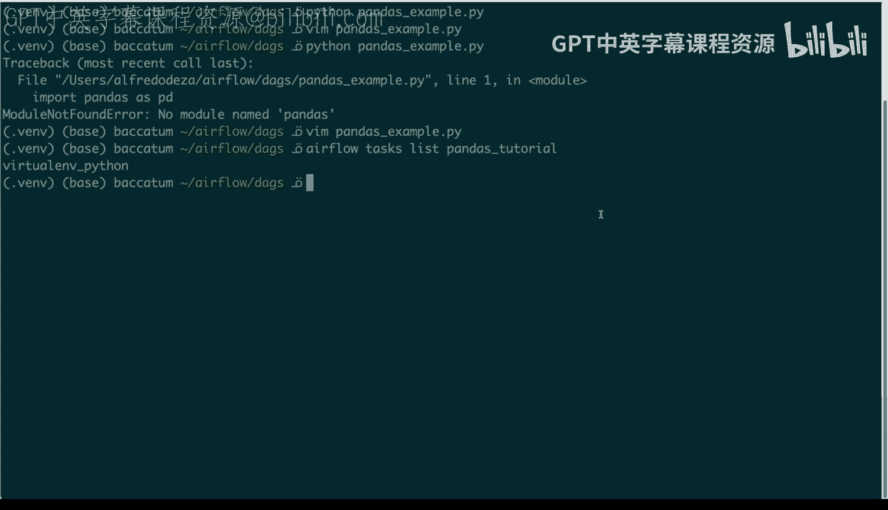
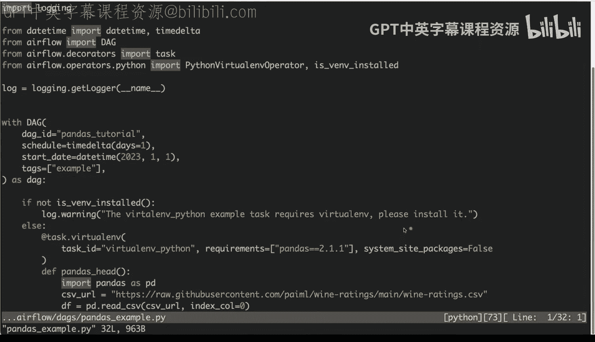
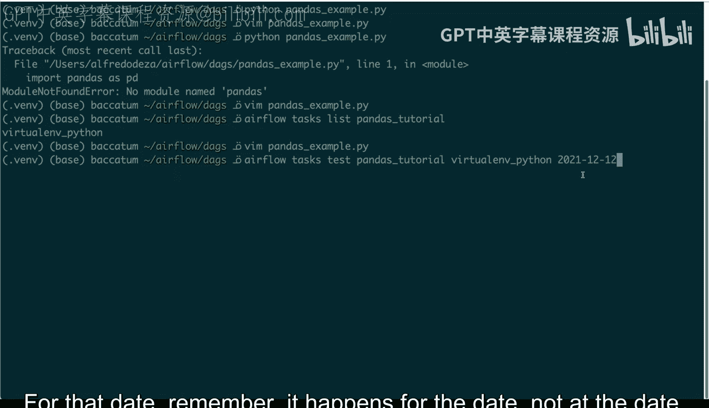
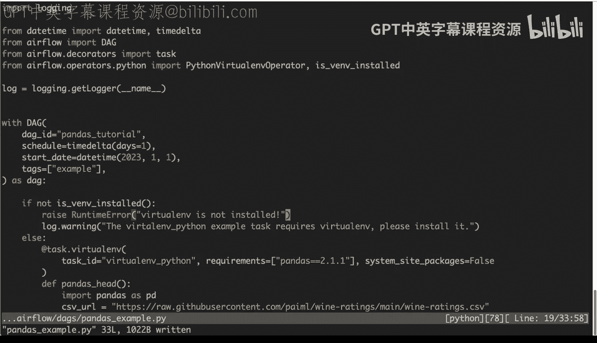
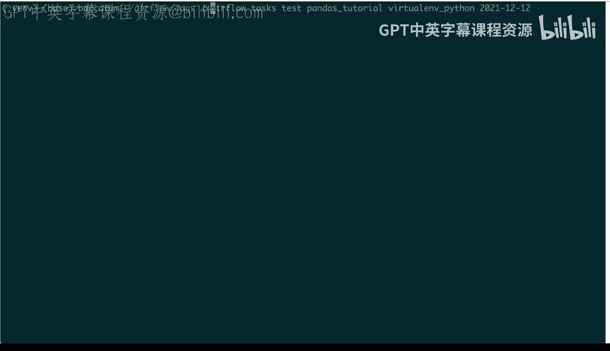

# 大型语言模型实践（高级数据工程、AWS、Databricks和本地LLM）：P32：测试与验证 🧪



在本节课中，我们将学习如何对创建的Airflow DAG进行测试与验证，确保其功能正确且运行稳定。我们将通过一系列命令行操作来检查DAG的语法、任务列表，并执行任务测试。

## 概述

我们将进入Airflow的DAGs子目录，针对之前创建的`pandas_example.py` DAG文件进行测试。测试内容包括检查DAG ID与文件名的对应关系、使用Python直接执行文件以验证语法、使用Airflow命令列出任务，以及直接测试特定任务。这些步骤有助于在部署前发现潜在问题。

## DAG ID与文件名的对应关系

首先，需要注意DAG ID与存放文件的名称可能不一致。在我们的例子中，DAG文件名为`pandas_example.py`，但DAG ID在代码中被定义为`pandas_tutorial`。

**代码示例：**
```python
# 在pandas_example.py文件中
with DAG(
    dag_id="pandas_tutorial",  # 这是DAG ID
    schedule_interval="@daily",
    start_date=datetime(2021, 1, 1),
    catchup=False,
    tags=["example"],
) as dag:
    # ... 任务定义
```

这种不一致可能导致混淆。为了便于管理，建议将DAG ID与文件名保持一致，例如将文件命名为`pandas_tutorial.py`。规范化命名能使工作流更清晰易懂。

## 使用Python进行语法验证

一个推荐的验证方法是直接使用Python解释器执行DAG文件。这能快速检查文件是否存在语法错误或导入模块缺失等问题。




**操作命令：**
```bash
python pandas_example.py
```

如果文件中存在未安装的依赖（例如尝试导入`pandas`但未安装），执行此命令会抛出`ModuleNotFoundError`。这有助于在将DAG提交给Airflow调度器之前发现环境配置问题。

## 使用Airflow列出DAG任务

确认文件语法无误后，可以使用Airflow命令行工具验证DAG及其任务是否被正确识别。





**操作命令：**
```bash
airflow tasks list pandas_tutorial
```

此命令会列出`pandas_tutorial`这个DAG中定义的所有任务。在我们的例子中，应该只看到一个名为`virtualenv_python`的任务。这验证了任务定义已成功加载到Airflow中。

## 直接测试Airflow任务

最核心的测试是直接运行一个任务。Airflow允许我们为特定执行日期测试某个任务，而无需触发整个DAG。

**操作命令：**
```bash
airflow tasks test pandas_tutorial virtualenv_python 2021-12-12
```

以下是执行此测试时会发生的事情：



1.  **创建虚拟环境**：任务会首先创建一个独立的Python虚拟环境。
2.  **安装依赖**：在虚拟环境中安装任务所需的依赖包（例如`pandas==2.0.1`）。
3.  **执行任务逻辑**：运行任务中定义的Python函数，处理数据。
4.  **输出日志**：任务的所有输出（例如我们代码中打印的CSV数据）都会显示在日志中。
5.  **标记状态**：任务完成后，会被标记为成功或失败。

通过观察测试输出的完整日志，可以清晰地了解任务每一步的执行情况，确认其行为符合预期。

## 错误处理与验证技巧

在测试过程中，主动验证错误处理机制同样重要。例如，在我们的任务中，我们检查了`virtualenv`是否已安装。

**原始警告代码：**
```python
if not is_virtualenv_installed:
    log.warning("Virtualenv is not installed. Please install it.")
```

然而，仅记录警告可能不够明显。更好的做法是直接抛出异常，使错误在测试时更醒目。

**改进后的错误处理代码：**
```python
if not is_virtualenv_installed:
    raise RuntimeError("Virtualenv is not installed. Please install it.")
```

当`virtualenv`未安装时，再次运行任务测试会收到一个显眼的红色错误异常信息，这比在日志中寻找警告更有利于快速定位问题。

## 总结





本节课我们一起学习了Airflow DAG的测试与验证流程。我们首先探讨了保持DAG ID与文件名一致性的最佳实践。接着，我们使用`python`命令进行基础语法验证，使用`airflow tasks list`确认任务加载。最后，我们深入使用`airflow tasks test`命令执行了单任务测试，观察了从环境搭建到任务执行的完整过程，并学习了如何通过抛出异常来改进错误处理的可见性。这些技巧是开发可靠数据管道的重要保障。