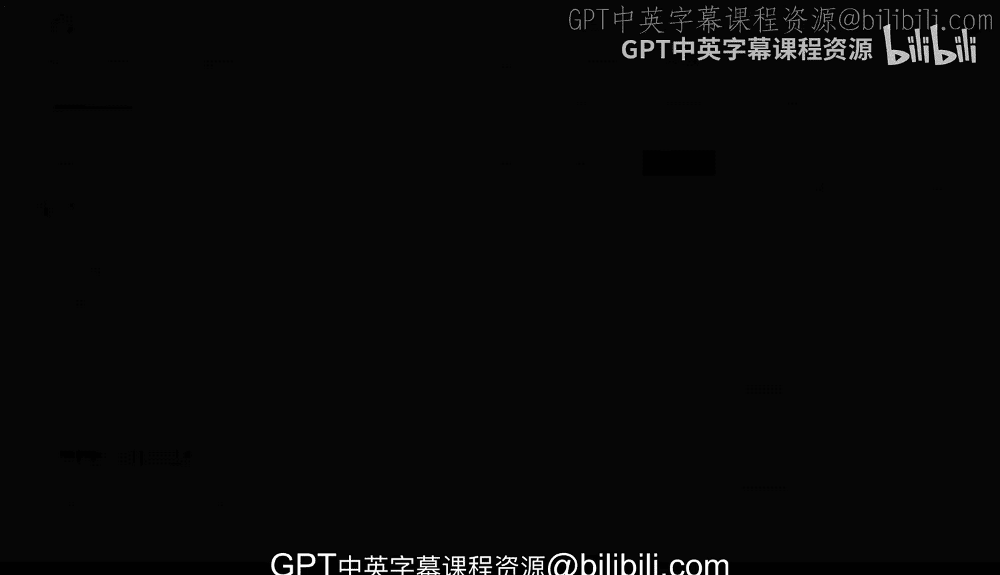
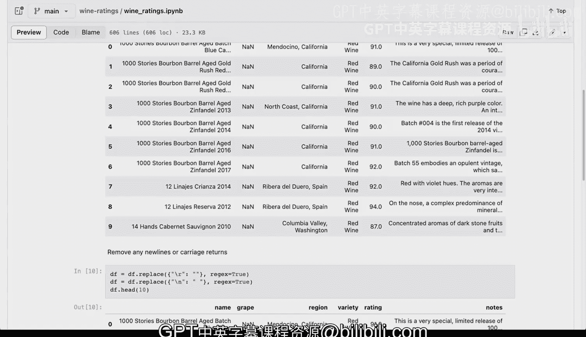

# 大型语言模型实践（高级数据工程、AWS、Databricks和本地LLM）：P35：识别构建DAG的任务 🧩

在本节课中，我们将学习如何识别适合使用Apache Airflow构建数据管道的任务。我们将通过一个具体的示例仓库，分析在确定哪些数据处理步骤可以转化为Airflow任务时需要考虑的关键因素。

## 概述

Apache Airflow是一个用于编排复杂工作流的平台。要有效地使用它，首先需要识别出可以编排为有向无环图（DAG）的独立任务。本节我们将通过一个葡萄酒评分数据集的分析，来学习如何识别这些任务。

## 分析示例数据仓库

我们首先查看一个示例仓库，它包含一个葡萄酒评分数据集（`wine_ratings.csv`文件）和一个Jupyter笔记本。这个案例能帮助我们理解，在决定使用Apache Airflow处理什么任务时，哪些方面是值得关注的。

`ratings.csv`文件结构相对简单，但由于其大小（13MB），无法在GitHub上完整显示。其核心数据列包括：`name`（名称）、`grape`（葡萄品种）、`region`（产区）、`variety`（类型）、`rating`（评分）和`notes`（品酒笔记）。每一行代表一款葡萄酒的评分信息。

然而，仅仅了解数据结构还不够。我们需要深入分析，以判断它是否适合用Airflow管道处理。

## 在Jupyter笔记本中识别数据处理任务

打开配套的Jupyter笔记本，我们可以看到它加载并分析了CSV文件，这为我们提供了一个发现潜在数据处理任务的好机会。

以下是分析过程中识别出的几个关键任务：

**1. 处理缺失数据**
在初步查看数据时，我们发现`grape`（葡萄品种）列存在大量`NaN`（非数字）值。一个可能的处理任务是直接删除这一列，或者根据其他信息填充缺失值。

**2. 正确处理索引**
使用pandas读取CSV时，如果不指定`index_col`参数（本例中应为0），pandas会自动生成一个行索引列。我们需要确保现有的索引列被正确识别和使用，避免产生重复或错误的索引。

**3. 清洗文本数据（关键任务）**
数据清洗中一个至关重要的任务是移除`notes`（品酒笔记）字段中的换行符（`\n`）或回车符（`\r`）。这是因为，当数据被导入某些服务或系统时，这些特殊字符可能会被错误地解释为新行的开始，从而破坏原本整齐的结构化数据格式，导致列数据无法对齐。因此，将这些换行符替换为空格或直接删除，是一个必要的数据预处理步骤。

## 为何这些任务适合Apache Airflow

以上这些任务都非常适合纳入一个Apache Airflow管道。虽然你可以在Jupyter笔记本或普通脚本中手动执行它们，但Airflow提供了更强大的优势：
*   **可编排与可视化**：将这些步骤定义为独立的Airflow任务，可以构建一个清晰、可视化的数据处理管道。
*   **自动化与调度**：管道可以按计划自动运行，确保数据处理的及时性和一致性。
*   **依赖管理与错误处理**：Airflow能自动处理任务间的依赖关系，并提供完善的重试和错误处理机制。

## 如何识别Airflow任务

那么，我们如何系统地识别这些任务呢？关键在于观察数据处理流程：当我们有一组需要应用于某个数据集的特定操作或转换，目的是从初始数据得到最终结果时，这些操作通常就是潜在的Airflow任务。它们通常具有“输入 -> 处理 -> 输出”的明确模式。

在接下来的课程中，我们将学习如何把这里识别出的任务（如删除列、清洗文本）具体实现为一个Apache Airflow的DAG管道。

## 总结

本节课中，我们一起学习了如何识别适合用Apache Airflow构建DAG的任务。我们通过分析一个葡萄酒评分数据集，实践了从数据中发现问题（如缺失值、索引问题、脏数据），并将这些问题的解决方案转化为明确的数据处理任务。核心在于寻找那些可以独立定义、具有明确输入输出、并且需要按特定顺序或条件执行的操作步骤。