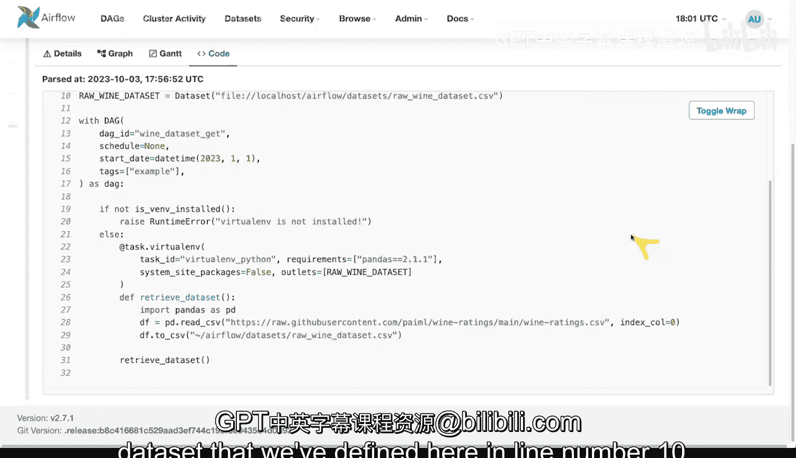

# 大型语言模型实践（高级数据工程、AWS、Databricks和本地LLM）：P36：检索远程数据 📡

在本节课中，我们将学习如何从远程数据源检索数据，并将其整合到我们的数据处理流程中。具体来说，我们将通过一个实际的例子，了解如何获取葡萄酒相关的CSV数据，并理解Apache Airflow中数据集（Dataset）和出口（Outlet）的概念。

---

上一节我们介绍了数据处理流程的概览，本节中我们来看看如何具体实现远程数据的检索。


为了创建我们之前浏览的CSV所需的葡萄酒相关数据，我们需要先获取这些数据。让我们看看这是如何工作的。我们将在Web界面上向下滚动，找到名为 `wine_data_get` 的任务。这个任务目前没有设置调度计划，我们将点击它来检查代码，以理解其具体执行过程。


这里的代码与我们之前看到的略有不同。我们定义了一个数据集（Dataset），这个数据集将成为我们工作流程中的一个关键部分。

现在，当我们像这样调用一个数据集时，其内容可以是任何东西。你实际上可以在其中放入任何类型的字符串。它主要作为一个标识符。例如，我使用的 `file://localhost/...` 这个字符串本身除了对我有含义外，对系统并无实际意义。我是在表明，这将是一个存储在本地数据集，该字符串代表了我想要显示的位置。

定义这个 `raw_wine` 数据集之所以重要，是因为通过它，我为其他需要使用此数据的任务设定了预期。

第一步是获取数据。那么我们要做什么呢？首先，我们有一个唯一的任务ID。这个 `get` 任务将代表我们尝试执行的操作。它目前没有调度计划，因此我们可以手动触发它。此任务依赖于一个虚拟环境（virtual environment），如果未安装虚拟环境，运行时将会出错。如果已安装，我们将使用 `pandas 2.1.1`。

这里还有一个我们之前未见过的新概念：**出口（outlets）**。代码如下所示：

```python
outlets=[raw_wine]
```

`outlets` 参数是一个列表，包含单个项目，即我们在线10定义的 `raw_wine` 数据集。这是一个对我们数据的引用。

为什么这很重要？因为如果任务正确完成，我们就可以声明 `raw_wine` 数据集已被更新。这是Apache Airflow的一个约定，用于确定一个出口何时被修改或变更，以便其他任务可以依赖于此来触发后续操作。虽然我们现在还看不到具体的后续操作，但你可以想象我们将进行一些数据处理。

在实际的函数内部，我们将读取远程的CSV文件。请注意，我使用了完整的URL来获取该CSV文件，然后将其保存到文件系统中。我在这里使用了一个规范化的路径，它将保存在我的主目录下的 `airflow/datasets` 目录中。在生产环境中，你可能不会以这种方式保存数据集。我建议使用云服务提供商，以便通过网络将数据传输到其他指定位置。

但就演示而言，我们只需要检索数据集并将其存储在本地，以便后续处理。这就是我构建此远程数据处理第一步的方式。最重要的是定义出口，在本例中，就是我们在第10行定义的 `raw_wine` 数据。



---


本节课中我们一起学习了如何从远程源检索数据，在Apache Airflow中定义数据集和出口，以及如何将数据保存到本地文件系统以备后续处理。理解出口的概念是构建依赖关系和数据驱动工作流的关键。