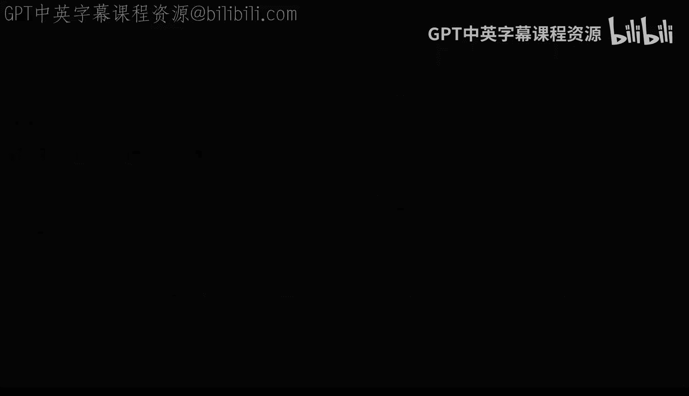
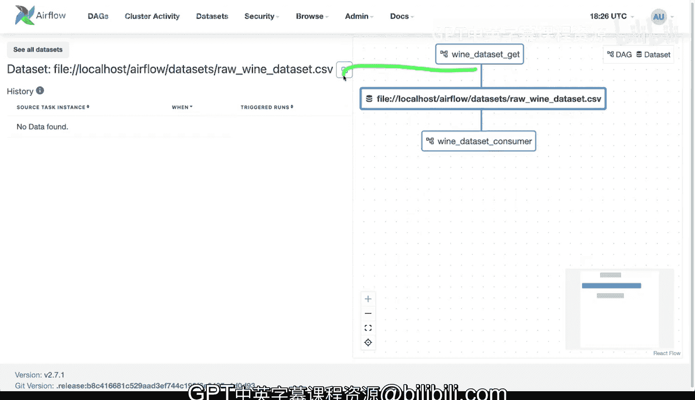

# 大型语言模型实践（高级数据工程、AWS、Databricks和本地LLM）：P37：清洗与规范化数据

在本节课中，我们将学习如何在Apache Airflow中构建一个数据消费者任务。这个任务将依赖于上游生产者任务生成的数据集，并在数据更新时自动触发执行。我们将重点讲解如何配置基于数据集的调度、执行数据清洗与规范化操作，以及如何在Airflow界面中可视化任务间的依赖关系。

## 返回Airflow用户界面

上一节我们介绍了数据生产者任务，本节中我们来看看数据消费者任务。

我们向下滚动到名为 `wine_consumer` 的DAG。之前我们查看的是 `wine_dataset_get` 任务，现在我们将关注 `wine_consumer` 任务。这个任务有一个明显的不同：它有一个自动应用的“数据”标签。将鼠标悬停在标签上会显示“由数据触发的调度”。接下来，我们将探究其工作原理及其重要性。



## 解析消费者任务代码

点击任务并进入代码视图，让我们详细查看其内容。

首先，在第10行，我们定义了此任务所依赖的数据集。这与之前的调度定义方式略有不同。此处的调度被定义为一个列表，其中包含 `raw_wine_dataset`。

```python
schedule = [raw_wine_dataset]
```

这意味着，每当 `raw_wine_dataset` 这个数据集发生变化时，当前任务就会自动被触发执行。这非常完美，它使得我们可以依赖数据生产者的动作：一旦数据就绪，消费者任务便能可靠地启动。

## 任务执行环境与处理逻辑

与生产者任务类似，我们将继续依赖虚拟环境，并安装pandas库以进行数据处理。

以下是任务将要执行的核心处理步骤：

1.  **数据来源变更**：我们不再从网络位置获取原始的葡萄酒数据。因为可以确信 `raw_wine_dataset` 已被成功获取并存于本地，所以我们将直接从本地文件系统读取。
2.  **数据清洗**：我们将对数据进行两项主要的清洗操作。
    *   移除回车符和换行符等特殊字符。
    *   删除“grape”列，因为该列充满了“非数字”值。
3.  **数据保存**：清洗完成后，数据将被保存到本地文件系统，路径为 `clean_data.csv`。
4.  **数据集注册**：在任务最后，我们需要调用相应方法，将生成的新数据集正确注册到Airflow中，以便可能触发下游的其他任务。

## 理解数据集与可视化依赖

最后，我想展示Airflow中数据集的可视化管理功能。

在Airflow界面中点击“Datasets”菜单。这里的关键在于，`raw_wine_dataset` 这样的字符串主要是一个标识符。最重要的功能是Airflow提供的可视化视图。

这个视图清晰地展示了任务间的数据依赖关系：
*   `wine_dataset_get` 任务生产了 `raw_wine_dataset` 数据集。
*   `wine_consumer` 任务消费了 `raw_wine_dataset` 数据集。

你可以点击数据集图标查看其生产者与消费者，也可以点击任务图标查看其依赖的DAG图。这为理解和监控数据流水线提供了极大的便利。

## 总结



本节课中我们一起学习了如何在Apache Airflow中创建基于数据集触发的数据消费者任务。我们了解了如何通过定义 `schedule=[dataset]` 来实现任务间的数据驱动依赖，探讨了在消费者任务中进行数据清洗（如移除特殊字符、删除无效列）和保存的流程，并学会了在Airflow的Datasets界面可视化地查看任务与数据集之间的生产-消费关系。这种模式是实现可靠、自动化数据流水线的核心机制之一。