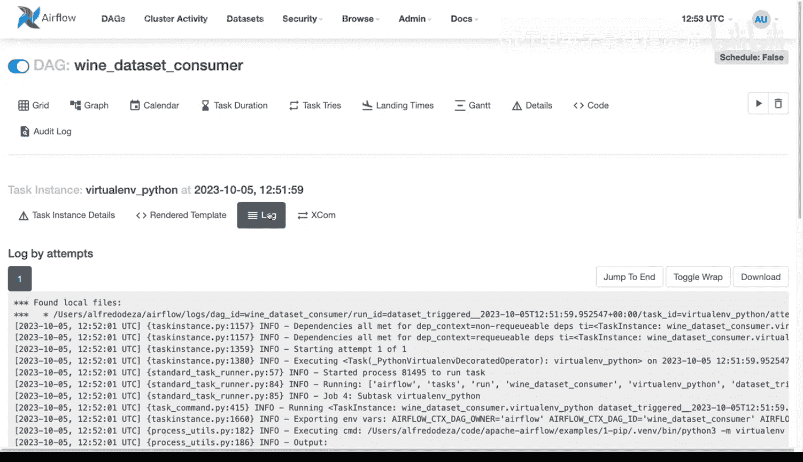
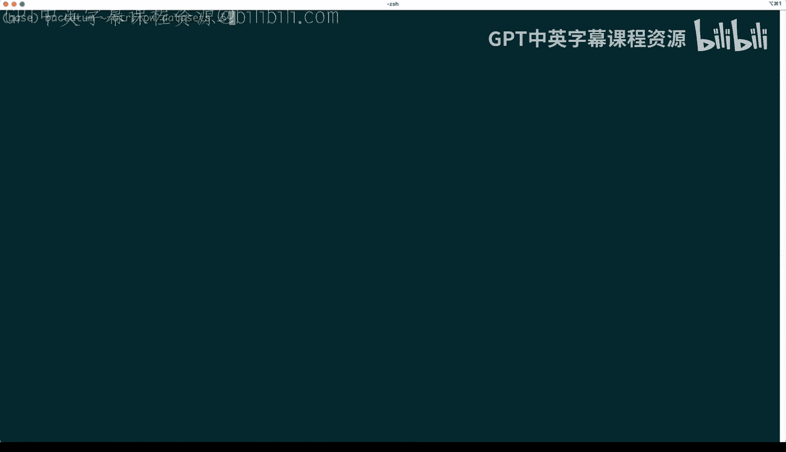

# 大型语言模型实践（高级数据工程、AWS、Databricks和本地LLM）：P38：在用户界面中检查结果 🧐

在本节课中，我们将学习如何触发并运行之前构建的数据处理流程，并在Airflow的用户界面中检查任务的执行结果与输出数据。

上一节我们完成了数据处理DAG的构建，本节中我们来看看如何实际运行它并验证结果。

---

现在，我们已经将所有组件整合在一起，可以开始触发流程了。

我们将再次使用数据生产者和消费者。数据生产者（有时也称为生产者）将生成我们要处理的数据，而消费者则会处理数据生产者的输出。

首先，我们需要启用消费者任务。它不会自动触发，因为它的触发器依赖于一个数据集。因此，我们先启用它。

接着，我们转到`wine_dataset`任务并启用它。


然后，我们在此处手动触发这个DAG。这是它的首次运行。


任务正在运行。我们可以点击此处查看状态，显示运行成功。

现在，我们应该能够查看其他DAG的运行情况。我们快速向下滚动，可以看到消费者任务已被触发，并且状态从“运行中”变为“已完成”。

本质上，这里发生的过程是：我们触发了数据获取任务，而`wine_dataset`消费者任务基于我们之前定义的数据集依赖关系被成功触发。

接下来，让我们详细检查`wine_dataset`消费者任务。它运行正确。

我们查看任务详情。状态为成功，一切运行正常。

我们再尝试查看审计日志。日志看起来也没问题。

这表明任务已正确完成。要查看实际的执行日志，需要进入具体的任务实例。一个DAG可能包含多个任务，在本例中，我想检查这个任务。

如果我点击这里的“日志”按钮。



我将看到完整的日志输出。日志显示正在收集pandas数据，这表明我们在检查任务是否正确执行。

在这个案例中，任务没有返回任何输出，这看起来是正确的。

为了检查生成的文件，我将快速切换到终端。在我的终端中，我将列出Airflow工作目录下的内容。根据之前的设置，输出文件将保存在此。

我将进入`datasets`目录，并列出其内容。

现在，我将看到两个CSV文件。一个是清洗后的数据集，另一个是原始的葡萄酒数据集。两个文件内容相似。

为了查看原始数据集的前几行，我使用以下命令：

```bash
head -n 20 raw_wine_dataset.csv
```


原始数据集中，某些字段可能为空。例如，在两个逗号之间没有任何内容，代表该字段值为空（NaN）。

现在，让我们查看清洗后的数据集。



使用命令查看清洗后的数据：


```bash
head -n 20 clean_wine_dataset.csv
```

我们将看到，清洗后的数据集中，`grape`（葡萄品种）字段已被删除。如果我们滚动到原始文件的顶部，会发现`grape`字段是存在的。

这验证了我们之前定义的数据清洗逻辑：`grape`字段在清洗过程中被成功移除了。

---

以上就是在用户界面中检查结果的基本方法。你通过UI检查任务状态、日志，并通过检查生成的文件来验证数据处理逻辑。

需要记住的是，在本演示中，我们将结果数据集保存在了本地磁盘上。**在生产环境中，你很可能需要将这些数据集注册到云端环境（如AWS S3、Databricks等）或其他远程存储中，而不是像这里一样保存在本地文件系统。**

---

本节课中我们一起学习了如何触发Airflow DAG、在Web UI中监控任务执行状态、查看日志，并通过检查生成的输出文件来验证数据处理流程的正确性。这是确保数据流水线按预期工作的重要步骤。