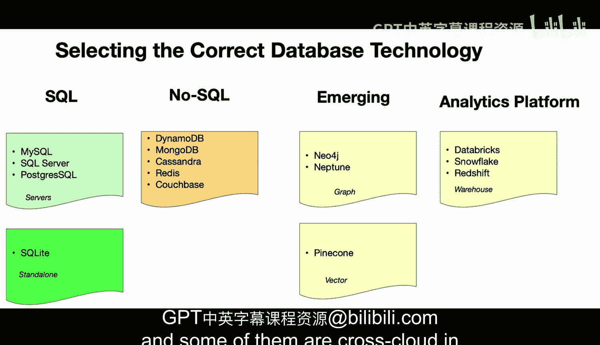

# 大型语言模型实践（高级数据工程、AWS、Databricks和本地LLM）：P40：选择合适数据库 🗄️

在本节课中，我们将学习如何为构建在大型语言模型之上的系统选择合适的数据库技术。数据库的选择是系统架构中的关键决策，直接影响应用的性能、可扩展性和开发效率。

## 概述

构建新系统时，最重要的事项之一是考虑正确的数据库技术。数据库有多种不同的类别，从SQL到NoSQL，再到新兴数据库和分析平台。我们将逐一探讨它们的特点和适用场景。

## SQL数据库

上一节我们概述了数据库的重要性，本节中我们首先来看看SQL数据库。SQL数据库采用具有固定模式的关系模型，支持ACID事务。这意味着你关心数据的一致性，并且需要进行复杂的连接和聚合操作。

以下是SQL数据库的一些关键特性：
*   **关系模型与固定模式**：数据以表格形式组织，结构预先定义。
*   **ACID事务**：保证原子性、一致性、隔离性和持久性。
*   **复杂查询**：擅长处理涉及多表连接和聚合的复杂查询。

一些常见的SQL数据库示例包括MySQL、PostgreSQL和SQL Server。

这里有一个特例是SQLite。它是一个独立的数据库，能够处理高达三分之一PB的海量数据。它常用于移动应用程序，对于数据科学家进行独立项目也非常有用。

## NoSQL数据库

了解了强调一致性的SQL数据库后，我们来看看NoSQL数据库。NoSQL数据库非常灵活，你无需担心模式问题。它们更侧重于可用性和可扩展性。

在CAP定理中，我们需要在一致性和可用性之间做出权衡。对于NoSQL数据库，我们更关心可用性。因此，这些数据库通常是最终一致性的数据源。

NoSQL数据库有多种数据模型，具体取决于所选数据库。以下是其主要数据模型：
*   **键值模型**：如Redis。
*   **文档模型**：如MongoDB。
*   **列式模型**：如Cassandra。

一些NoSQL数据库的示例包括MongoDB、Cassandra和Redis。

## 新兴数据库

除了传统分类，我们还拥有一些非常有趣的新兴数据库，它们提供了新的特性。这些数据库为解决特定类型的问题提供了更优的方案。

### 图数据库

图数据库是新兴数据库的一种形式。你可以将数据存储在由边连接的节点中。它能够对社交网络等关联数据进行优化，并支持非常强大的遍历查询。

一些图数据库的示例是Neo4j和Neptune。我个人认为它们非常令人兴奋的一点是能够提供诸如中心性、PageRank等新型描述性统计。因为数据以图的形式存在，你可以用不同于传统数据（如中位数）的方式来理解和沟通数据。

### 向量数据库

向量数据库也很有趣，它们能够深入处理不同类型的数据集。例如，如果你想构建推荐引擎，向量数据库可能是一个绝佳选择，因为它可以即时找出所有特征之间的相关性。

此外，对于任何类型的机器学习问题，你都可以使用向量数据库来优化某些工作流程。因此，它们也是许多新兴机器学习用例的一个新兴选择。

## 分析平台

最后，我们来看分析工作流平台。在这个领域，主要有两大竞争者：Databricks和Snowflake。

它们提供针对分析优化的列式存储、内存缓存以加速查询，以及高级分析函数。再次举例，Snowflake、BigQuery和Redshift都具备将分析作为平台服务的能力，其中一些（如Databricks和Snowflake）还支持跨云部署。

## 总结

本节课中，我们一起学习了如何为LLM应用选择合适的数据库。我们探讨了SQL数据库（强调一致性和复杂查询）、NoSQL数据库（侧重灵活性和可扩展性）、新兴数据库（如图数据库和向量数据库，为特定问题提供新特性）以及分析平台（为大规模数据分析优化）。理解这些数据库类别的特点和适用场景，是设计高效、可扩展系统架构的基础。