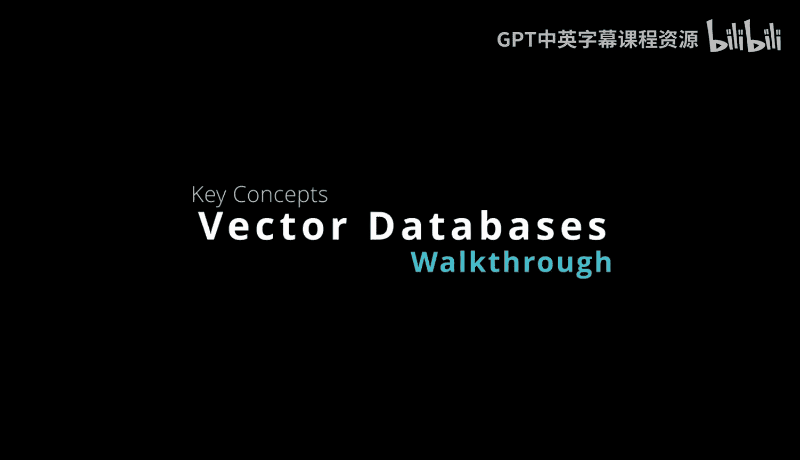
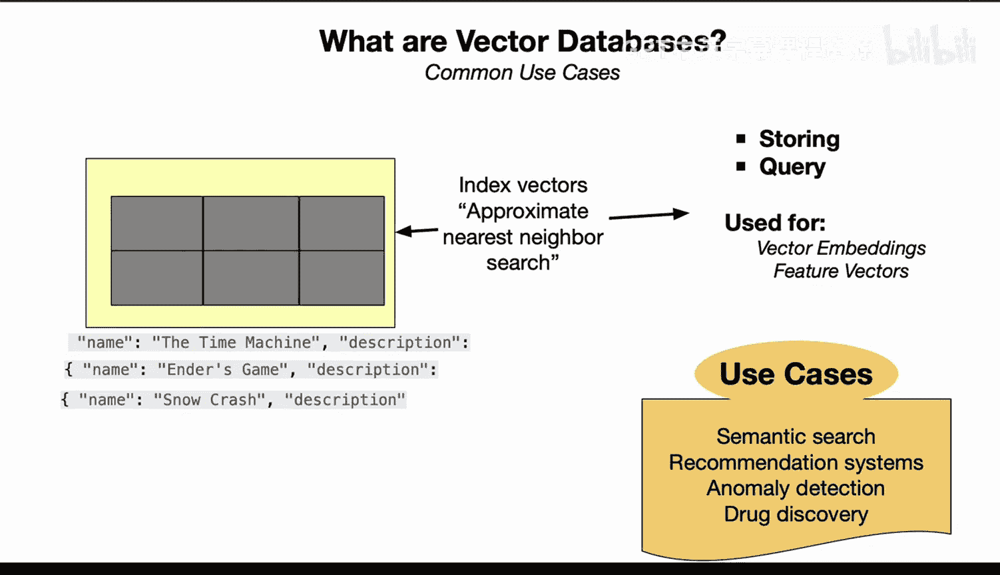
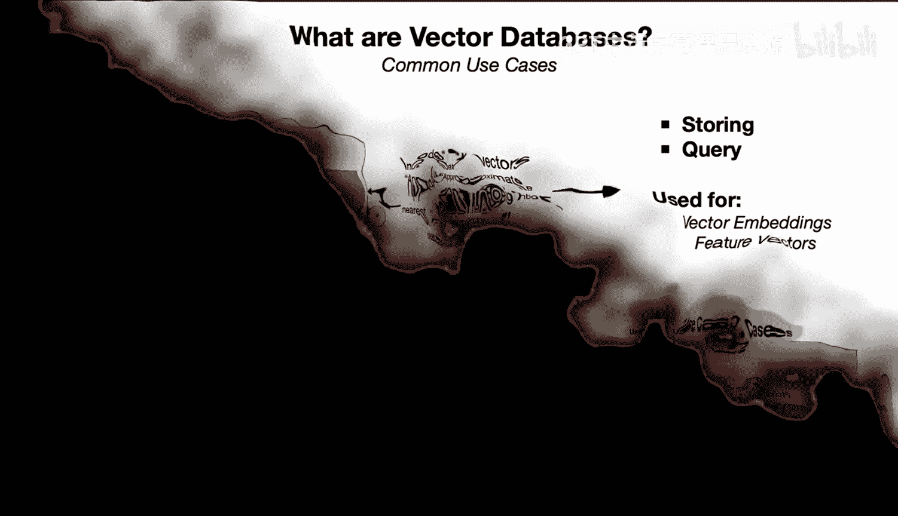

# 大型语言模型实践：P41：什么是向量数据库及其工作原理 🧠

在本节课中，我们将学习向量数据库的基本概念、工作原理以及它的常见应用场景。向量数据库是处理高维数据（如文本、图像嵌入）的核心工具，尤其在语义搜索、推荐系统和生成式AI等领域发挥着关键作用。

## 向量数据库的定义与核心功能

向量数据库的核心功能是存储和查询向量索引。具体而言，你可以对向量数据库中的内容执行**近似最近邻搜索**。

执行此操作的原因是，你可以根据**余弦相似度**或**内积**等度量标准，找出与查询向量最相似的向量。其公式可以表示为：

**相似度 = 查询向量 · 数据库向量 / (||查询向量|| * ||数据库向量||)**

这允许在存储向量的同时存储元数据，并赋予你过滤结果的能力。这种数据库能够处理高维度和大规模数据，并且可以利用分布式存储和处理技术。

## 向量数据库的常见应用场景

基于其向量处理能力，向量数据库催生了许多新型应用。以下是其主要应用场景：

*   **语义搜索**：使用自然语言进行查询，然后返回相关的文档或特定产品。这基于查询和文档嵌入向量的语义相似性。
*   **推荐引擎**：基于用户行为或物品属性的学习到的向量表示，寻找相似的用户或物品。
*   **异常检测**：根据向量空间中与最近邻的偏差来识别异常值。
*   **药物发现**：为候选药物寻找具有相似向量表示的分子。
*   **图像搜索**：基于视觉向量嵌入返回相似的图像。
*   **聊天机器人**：存储对话历史以实现个性化交互。

## 向量数据库生态与发展

随着大型语言模型和生成式AI的兴起，向量数据库领域变得异常活跃。市场上涌现了许多专门的向量数据库，例如 Pinecone、Quadrant、Milvus 等，它们都在为高效处理向量数据提供解决方案。

---

本节课中，我们一起学习了向量数据库的核心原理及其在语义搜索、推荐系统等多个领域的应用。理解向量数据库是掌握现代AI数据工程，特别是处理非结构化数据和构建智能应用的重要基础。