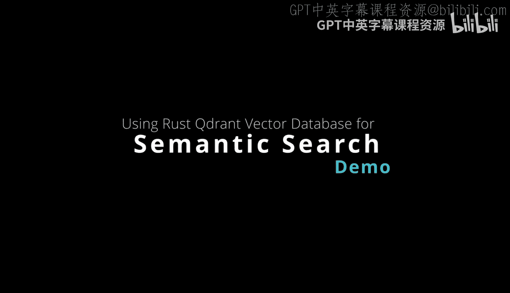
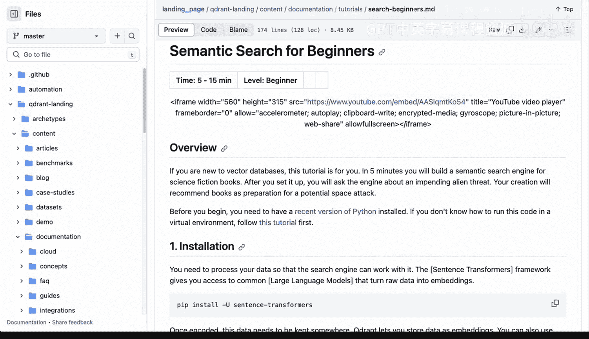
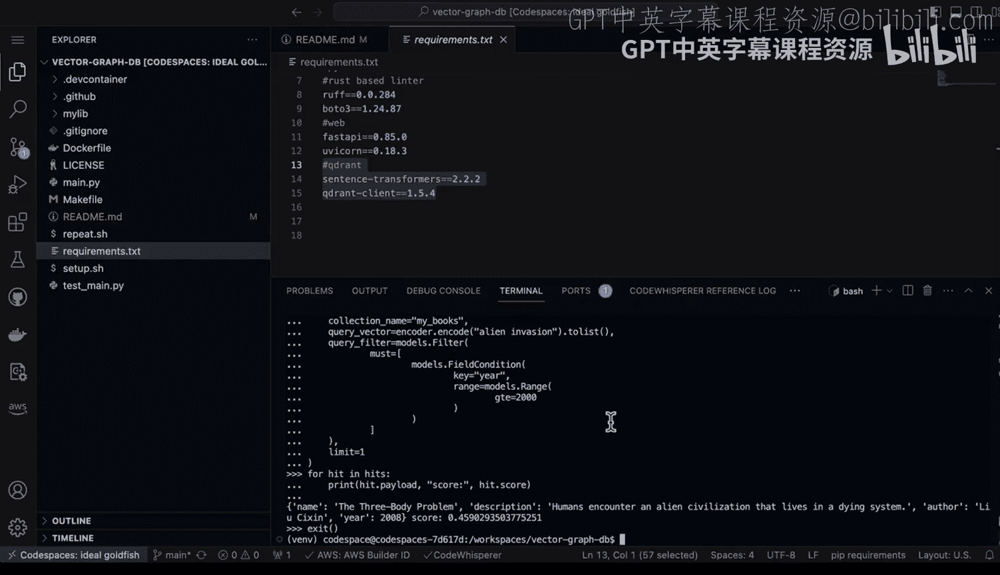

# 大型语言模型实践（高级数据工程、AWS、Databricks和本地LLM）：P42：42_03_04：实现语义搜索 🧠🔍



在本节课中，我们将要学习如何为初学者实现一个简单的语义搜索系统。我们将使用Quadrant向量数据库，通过一个具体的例子来演示如何存储文本数据、生成向量嵌入，并基于语义相似性进行查询。

---

## 环境准备与安装 📦

首先，我们需要确保拥有运行本教程所需的所有软件包。以下步骤将指导你完成环境设置。

以下是安装所需依赖的步骤：

1.  确保你有一个类似Codespaces的代码环境。
2.  项目通常包含一个 `requirements.txt` 文件来列出所有依赖。
3.  运行 `make install` 命令来安装所有被锁定的依赖包。

安装完成后，我们就可以在Python环境中开始工作了。

---

## 导入必要的库与模型 🤖

上一节我们准备好了环境，本节中我们来看看需要导入哪些核心库和模型来启动我们的语义搜索项目。

首先，我们需要导入Quadrant的客户端以及用于生成文本嵌入的模型。

```python
# 导入Quadrant客户端
from qdrant_client import QdrantClient
# 导入用于生成句子嵌入的模型
from sentence_transformers import SentenceTransformer
```

---

## 准备数据与嵌入模型 📚

现在，我们将准备要存入数据库的数据，并初始化用于将文本转换为向量的嵌入模型。



我们需要一个包含书籍信息的列表，每本书都有元数据，如名称、作者、出版年份和简短描述。

```python
# 定义书籍数据
book_metadata = [
    {
        "name": "The Hitchhiker's Guide to the Galaxy",
        "author": "Douglas Adams",
        "publication_year": 1979,
        "description": "A comedy science fiction series."
    },
    {
        "name": "Dune",
        "author": "Frank Herbert",
        "publication_year": 1965,
        "description": "A epic science fiction novel about desert planet."
    },
    {
        "name": "The Three-Body Problem",
        "author": "Liu Cixin",
        "publication_year": 2008,
        "description": "A hard science fiction novel about alien invasion."
    }
]

# 初始化嵌入模型
embedding_model = SentenceTransformer('all-MiniLM-L6-v2')
```

---

## 创建向量数据库集合 🗃️

在将数据存入向量数据库之前，我们需要创建一个“集合”（Collection）来组织这些数据。集合是Quadrant中组织数据的基本单位。

以下是创建集合的关键步骤：

1.  指定存储位置。对于本交互式演示，我们使用内存存储。
2.  调用 `recreate_collection` 函数来创建或重置名为“my_books”的集合。
3.  定义向量维度和用于计算向量间距离的度量方法。

```python
# 创建Qdrant客户端（使用内存存储）
client = QdrantClient(":memory:")

# 创建或重新创建集合
client.recreate_collection(
    collection_name="my_books",
    vectors_config={"size": 384, "distance": "Cosine"} # 向量大小和距离度量
)
```

**说明**：
*   `recreate_collection` 在多次运行脚本进行实验时非常有用，它会尝试删除已存在的同名集合。
*   `vectors_config` 中的 `size` 参数定义了集合中向量的维度。
*   `distance` 参数指定了用于衡量两个向量点之间距离的函数，这是向量数据库的核心优势之一。

---

## 上传数据到集合 ⬆️

集合创建好后，接下来我们需要将准备好的书籍数据转换为向量并上传到数据库中。

我们将遍历书籍列表，使用嵌入模型为每本书的描述生成向量，然后将向量和对应的元数据（载荷）一起上传。

```python
# 上传数据到集合
for book in book_metadata:
    # 为书籍描述生成向量嵌入
    vector = embedding_model.encode(book["description"]).tolist()
    # 准备载荷（即原始的元数据）
    payload = book
    # 将向量和载荷上传到集合中
    client.upsert(
        collection_name="my_books",
        points=[{"id": id(book), "vector": vector, "payload": payload}]
    )
```

---

## 执行语义搜索查询 ❓

数据上传完毕，现在我们可以进行语义搜索了。我们将把一个查询语句转换为向量，然后在数据库中查找与之最相似的书籍向量。

让我们首先搜索与“外星人入侵”相关的书籍。

```python
# 定义搜索查询
query = "alien invasion"
# 将查询文本转换为向量
query_vector = embedding_model.encode(query).tolist()

# 在集合中搜索最相似的向量
hits = client.search(
    collection_name="my_books",
    query_vector=query_vector,
    limit=3  # 返回最相似的3个结果
)
```

---

## 解析与展示搜索结果 📊

上一节我们执行了搜索查询，本节中我们来看看如何解析返回的结果并理解其含义。

搜索返回的结果列表（`hits`）中包含了最相似的条目，每个条目都有其关联的元数据（载荷）和一个相似度分数。

以下是遍历和打印搜索结果的代码：

```python
# 遍历并打印搜索结果
print(f"查询: '{query}'")
for hit in hits:
    print(f"书名: {hit.payload['name']}")
    print(f"描述: {hit.payload['description']}")
    print(f"相似度分数: {hit.score:.4f}")
    print("-" * 30)
```

**结果分析**：
搜索引擎会返回与原始查询最相关的几个响应。每个响应都附有一个分数，用以表明该响应与原始查询的接近程度。例如，对于“外星人入侵”这个查询，最相关的结果很可能是《三体》这类书籍。

---

## 进行更精确的过滤搜索 🎯

向量数据库的强大之处在于可以结合向量搜索和元数据过滤。例如，我们想查找“2000年代初期出版的、与未来科技相关”的书籍。

我们可以构建一个同时包含向量查询和过滤条件的搜索。

```python
# 新的查询：关注2000年代早期的书籍
query_2 = "future technology"
query_vector_2 = embedding_model.encode(query_2).tolist()

# 执行带过滤条件的搜索
hits_2 = client.search(
    collection_name="my_books",
    query_vector=query_vector_2,
    query_filter={"must": [{"key": "publication_year", "range": {"gte": 2000}}]}, # 过滤2000年之后出版的书籍
    limit=3
)

# 打印结果
print(f"查询: '{query_2}' (过滤: 2000年后出版)")
for hit in hits_2:
    print(f"书名: {hit.payload['name']} ({hit.payload['publication_year']})")
    print(f"描述: {hit.payload['description']}")
    print(f"相似度分数: {hit.score:.4f}")
    print("-" * 30)
```

这次，结果可能会更精确地指向像《三体》（2008年出版）这样的书籍。

---

## 总结 🎓



本节课中我们一起学习了语义搜索的基本实现流程。我们从环境配置开始，逐步完成了数据准备、向量数据库集合创建、数据上传，并最终执行了简单的语义搜索和结合元数据的过滤搜索。通过这个使用Quadrant数据库的示例，你可以看到，向量数据库能够高效地根据语义相似性查找信息，并且由于其底层使用Rust编写，具备非常快的速度。你可以尝试使用其提供的Python或Rust客户端，继续探索和构建更复杂的搜索应用。