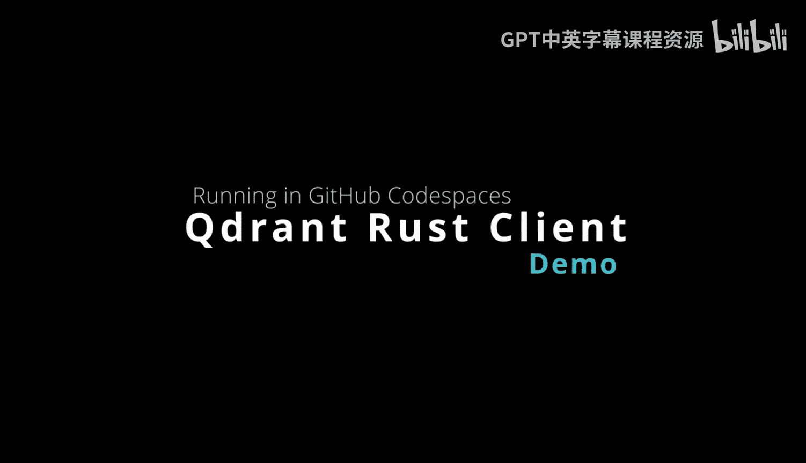
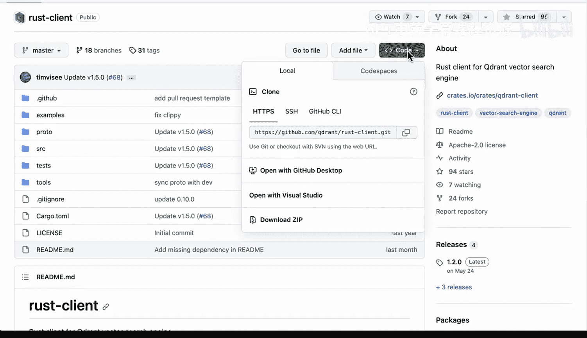
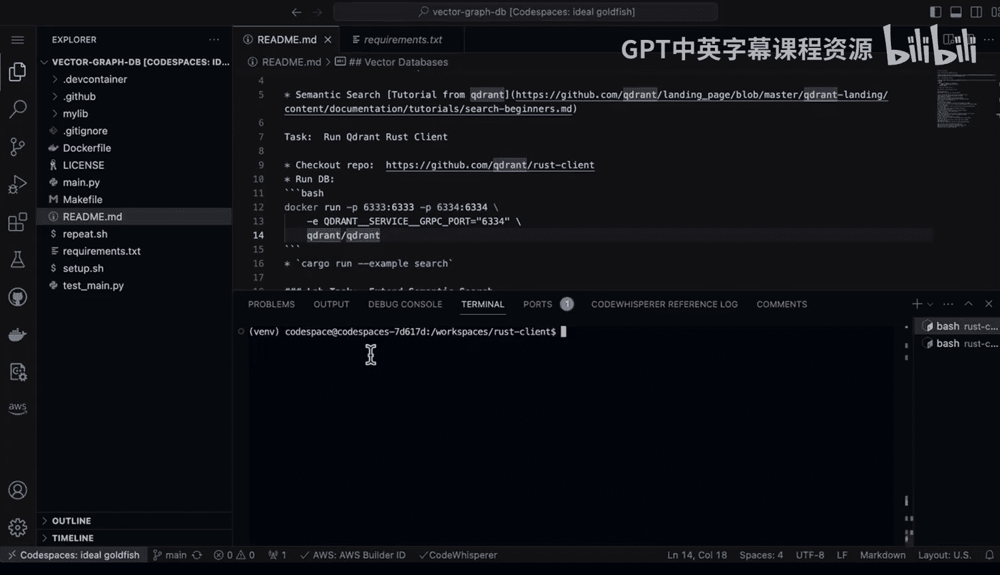
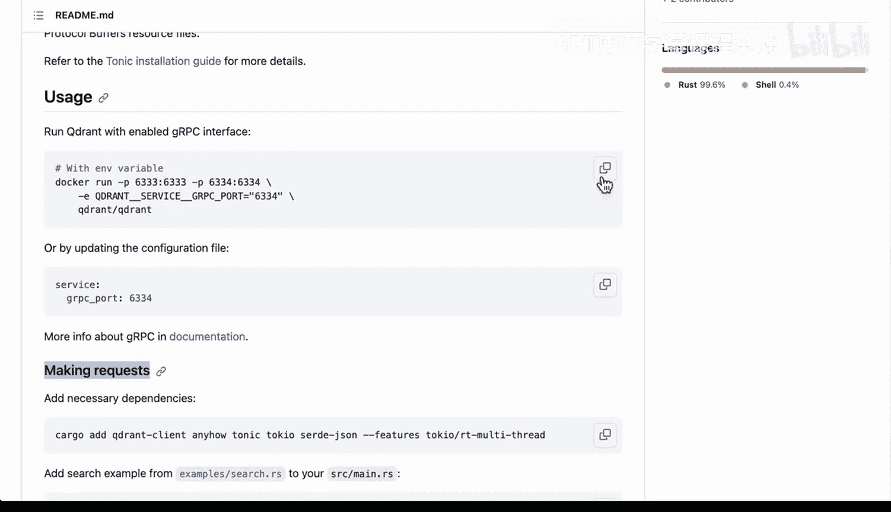
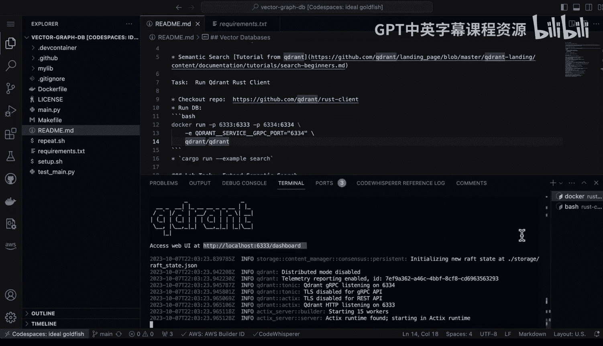
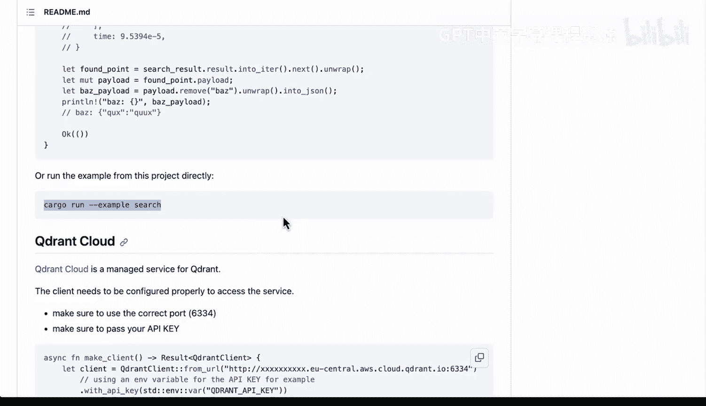
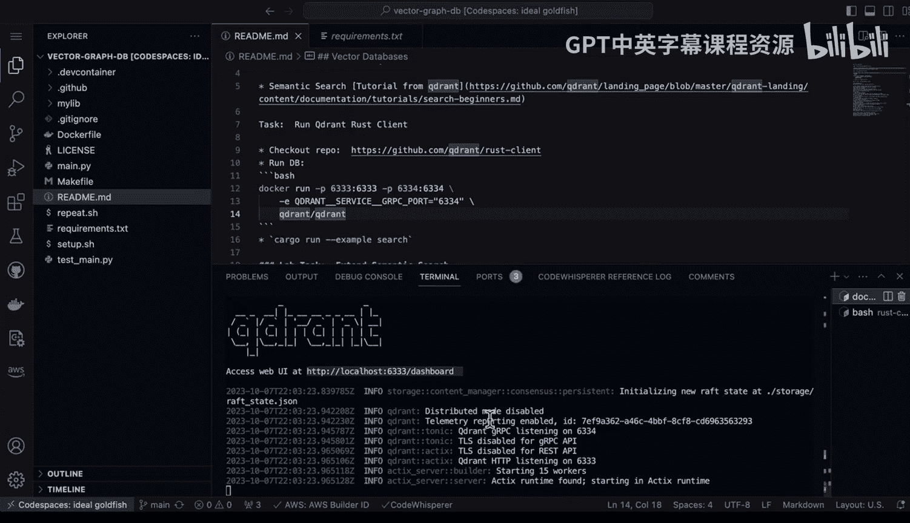

# 大型语言模型实践（高级数据工程、AWS、Databricks和本地LLM）：P43：43_03_05_Qdrant快速入门




在本节课程中，我们将学习如何为向量搜索引擎Qdrant配置和使用Rust客户端。我们将从克隆代码库开始，启动本地数据库，并运行一个示例查询程序来验证整个流程。

## 介绍Qdrant Rust客户端

上一节我们介绍了向量数据库的基本概念，本节中我们来看看如何实际操作一个具体的向量搜索引擎——Qdrant。Qdrant是一个向量搜索引擎，幸运的是，由于它是用Rust语言编写的，因此对Rust客户端有很好的支持。



要使用这个客户端，你只需要执行以下命令来添加依赖：
```bash
cargo add qdrant-client
```
如果我们查看项目的依赖，会发现它只依赖了很少的库，例如`tonic`库。

## 准备开发环境



为了开始使用，我们需要先克隆代码库，然后运行后端服务。



以下是准备步骤：
1.  首先，确认你已经获取了代码库的路径。
2.  克隆HPS代码库。我已经将其克隆到本地。
3.  进入Rust客户端目录，可以使用`git remote -v`命令确认。

进入目录后，因为这是一个Cargo项目，我们可以轻松地运行示例程序。

## 启动Qdrant数据库

在运行客户端之前，我们需要先启动Qdrant数据库服务。

我们将使用Docker来启动数据库。执行以下命令：
```bash
docker run -p 6333:6333 qdrant/qdrant
```
这个命令会在本地启动Qdrant数据库。在GitHub Codespaces环境中运行这类服务非常方便，你可以直接在这里启动它。如果需要，你还可以查看仪表板以获取更多信息。

## 运行Rust客户端示例

对于Rust项目，运行示例程序非常简单。我们首先可以查看示例代码`examples/search.rs`。这个文件包含了一个主函数，由于使用了Tokio运行时，它被标记为`async`。该函数会对一个集合执行搜索操作。



运行Rust示例的标准方法是使用Cargo命令。



以下是运行示例的具体命令：
```bash
cargo run --example search
```
我们回到终端，粘贴并执行这个命令。请注意，Docker容器正在前台运行，我们需要打开另一个终端来执行客户端命令。

现在，我们将能够运行查询。你可以看到程序在反复执行查询。它实际上使用的是本地的Docker接口，并且配置了Actix运行时，监听在HTTP端口上。

## 总结



本节课中我们一起学习了为Qdrant配置Rust客户端的完整流程。整个过程非常直接：克隆代码库、运行Docker容器、使用Cargo运行示例程序，之后你就可以顺利开始使用了。通过这个实践，我们掌握了在本地环境中快速搭建和测试向量搜索服务的基本方法。