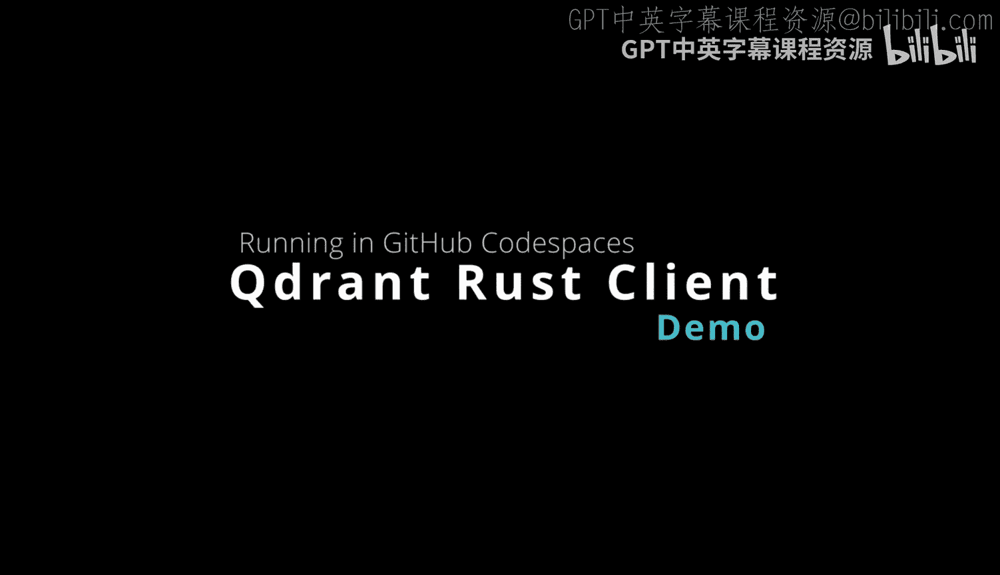
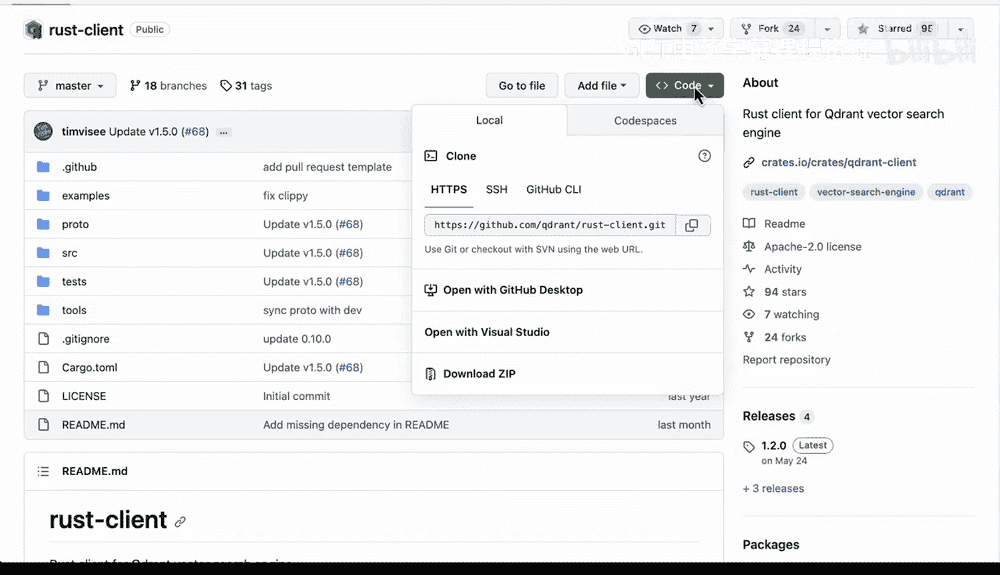
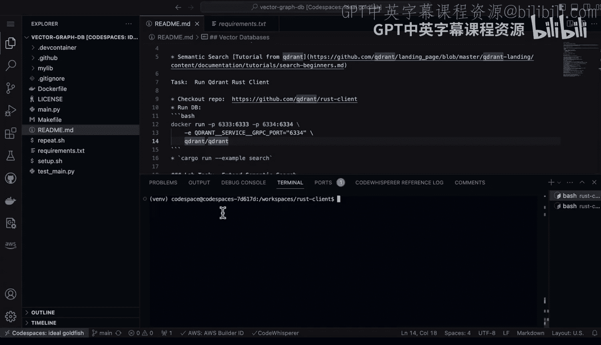
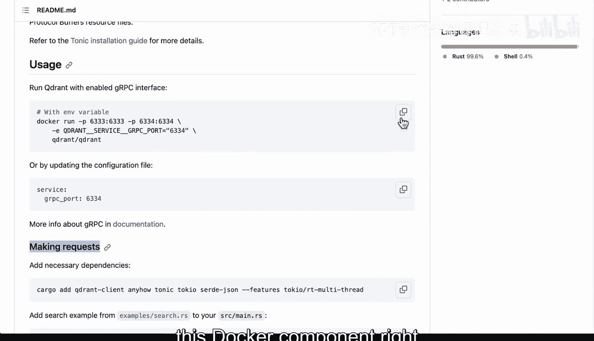
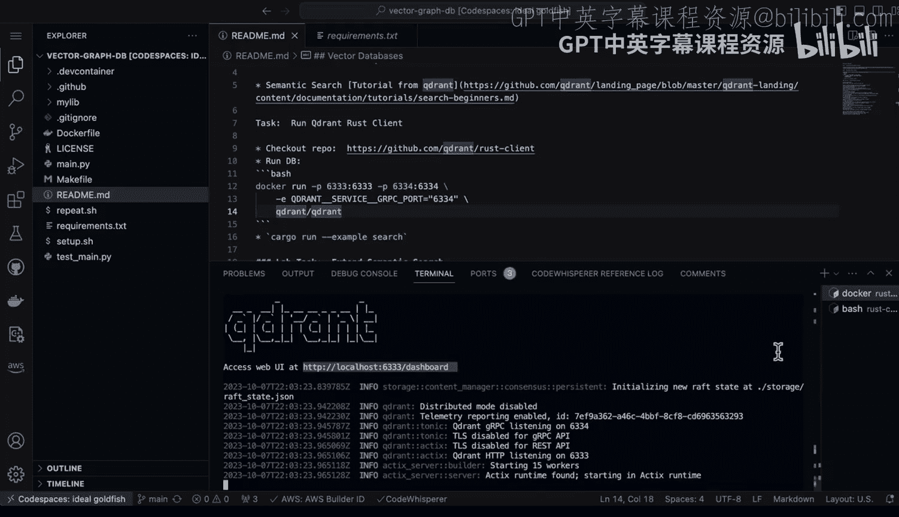
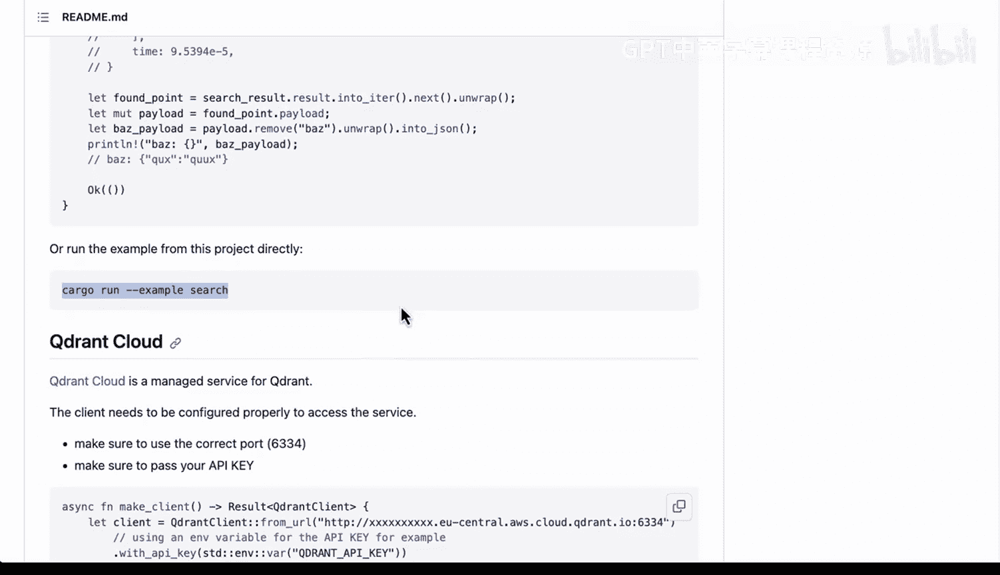
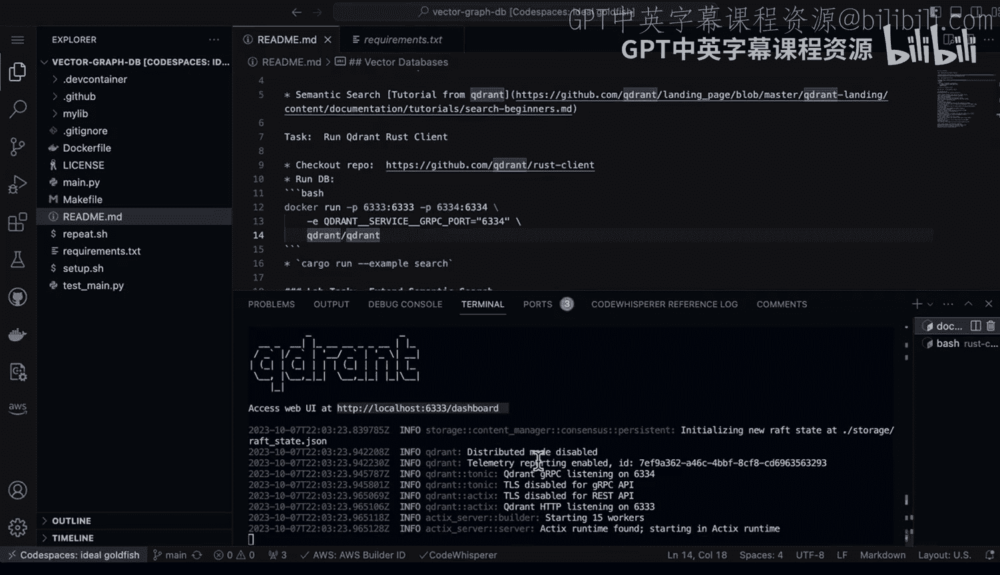

# 大型语言模型实践（高级数据工程、AWS、Databricks和本地LLM）：P44：44_03_06_Qdrant Rust客户端 🦀



在本节课中，我们将学习如何使用 Rust 客户端连接和操作 Qdrant 向量搜索引擎。Qdrant 是一个高效的向量相似性搜索数据库，而 Rust 客户端因其原生支持而性能优异。

## 概述

我们将从安装 Rust 客户端依赖开始，然后启动 Qdrant 服务的 Docker 容器，最后运行一个示例程序来执行向量搜索查询。整个过程旨在展示 Rust 生态系统中集成向量数据库的便捷性。

## 安装与依赖管理



上一节我们介绍了 Qdrant 的基本概念，本节中我们来看看如何为其设置 Rust 客户端。

首先，我们需要将 `qdrant-client` 添加为项目的依赖。这可以通过 Cargo 包管理器轻松完成。





以下是添加依赖的命令：
```bash
cargo add qdrant-client
```

观察项目的 `Cargo.toml` 文件，你会发现依赖项数量很少，主要包含了 `tonic` 等库。这表明客户端设计得轻量且高效。

## 获取代码并启动服务

为了运行示例，我们需要先克隆包含示例代码的仓库，并启动 Qdrant 后端服务。

以下是必要的步骤：
1.  克隆 GitHub 仓库。
2.  进入项目目录。
3.  使用 Docker 运行 Qdrant 服务。

我们将使用以下 Docker 命令在本地启动 Qdrant 数据库：
```bash
docker run -p 6333:6333 qdrant/qdrant
```
在 GitHub Codespaces 这类环境中，你可以直接运行此命令来启动服务，这非常方便。

## 运行示例程序



现在 Qdrant 服务已在后台运行，我们可以专注于 Rust 客户端了。Rust 项目的一个优点是，可以轻松地运行特定的示例文件。



我们的目标是运行 `examples/search.rs` 文件。该文件包含一个异步的 `main` 函数，它使用 Tokio 运行时来连接 Qdrant 并对一个集合执行搜索查询。

以下是运行示例的命令：
```bash
cargo run --example search
```
执行此命令后，客户端将通过本地 Docker 容器的 gRPC 接口（默认位于 `http://localhost:6333`）与 Qdrant 通信，并反复执行预设的搜索查询。

## 总结



本节课中我们一起学习了 Qdrant Rust 客户端的完整使用流程。整个过程非常直接：克隆仓库、用 Docker 启动服务、然后通过 Cargo 运行示例程序。这充分展示了在 Rust 项目中集成向量搜索功能的便捷性。