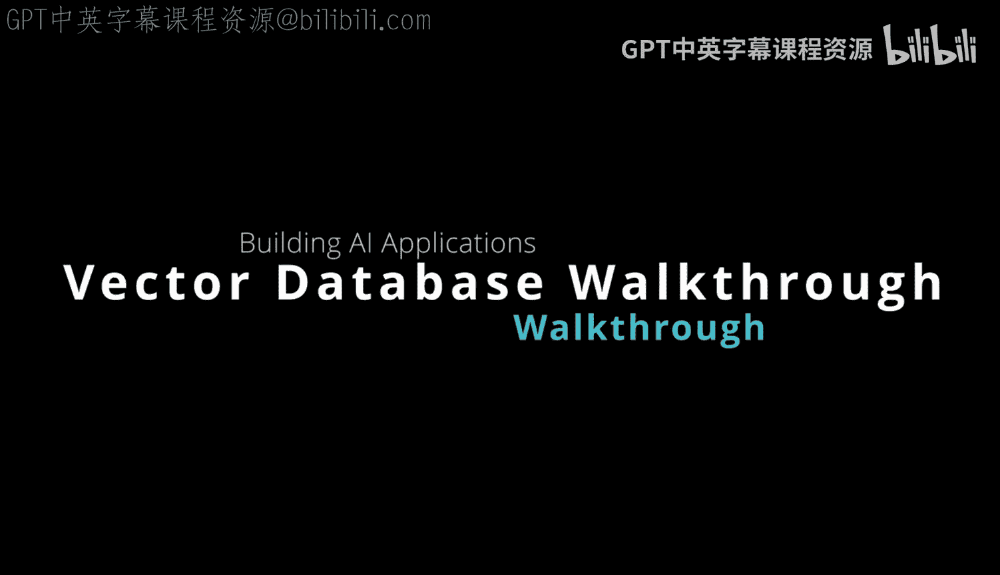
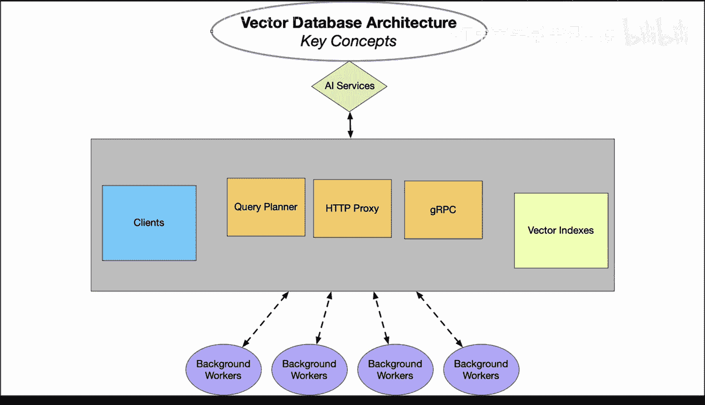
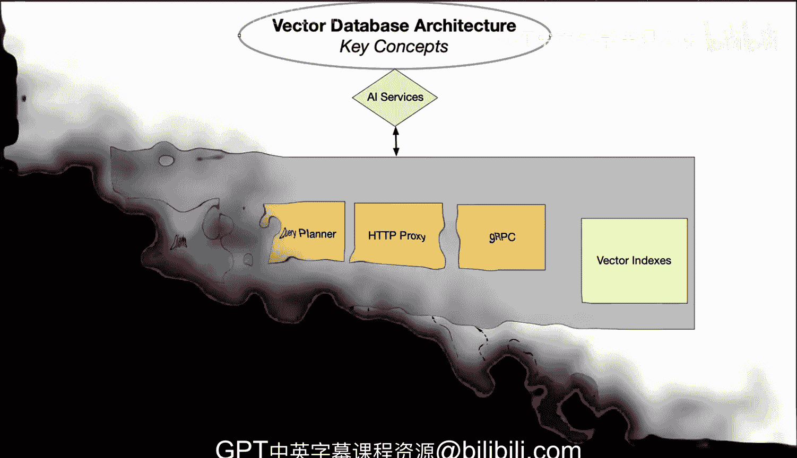

# 大型语言模型实践（高级数据工程、AWS、Databricks和本地LLM）：P45：向量数据库架构 🏗️



在本节课中，我们将学习向量数据库的核心架构。我们将了解其各个关键组件如何协同工作，以实现高效、可扩展的相似性搜索，这对于AI服务、推荐引擎和检索增强生成（RAG）应用至关重要。

## 架构概览

向量数据库的架构旨在处理大规模向量数据的存储与检索。其设计核心是支持快速的相似性搜索，并具备水平扩展、高可用性和容错能力。

## 核心组件详解

上一节我们介绍了架构的整体概览，本节中我们将逐一深入解析每个核心组件。

### 客户端应用层

用户通过多种客户端应用与向量数据库进行交互。这些客户端提供了访问数据库功能的接口。

以下是主要的客户端类型：

*   **SDK**： 为不同编程语言提供的软件开发工具包，例如 `Python`、`Go`、`Rust`。
*   **CLI**： 命令行界面，便于管理员进行脚本化操作和系统管理。
*   **WebUI**： 图形化网页界面，为用户提供直观的操作和管理体验。

### 代理与API服务层

客户端发出的请求首先到达一个HTTP代理层。该层负责请求的路由和转发。

代理将API请求导向gRPC服务。这个gRPC服务是整个系统的核心API端点，它通过gRPC协议暴露向量数据库的所有核心功能。

gRPC服务处理诸如创建集合、插入向量、执行搜索等操作。其核心逻辑可以概括为：
```python
# 伪代码示例：gRPC服务处理搜索请求
def handle_search_request(query_vector):
    # 1. 接收查询向量
    # 2. 调用查询规划器
    # 3. 执行搜索并返回结果
    pass
```

### 查询处理与索引层

当一个搜索请求抵达gRPC服务后，服务会调用**查询规划器**。查询规划器负责优化查询策略，并将搜索任务分发到所有相关的向量索引和数据分片上。

**向量索引**是实现超高速相似性搜索的关键。它采用了高效的算法来组织向量数据。

以下是两种常见的索引算法：

*   **HNSW (Hierarchical Navigable Small World)**： 一种基于图结构的近似最近邻搜索算法，在精度和速度之间取得了良好平衡。
*   **PQ (Product Quantization)**： 一种量化方法，通过压缩向量来减少内存占用和加速距离计算。

### 存储与分布式协调层

为了支持海量数据，索引本身会被**分片**，并分布到多个节点上。分片机制使得索引能够随着数据增长而水平扩展。

每个索引分片需要可靠的底层存储，通常会依赖如 **RocksDB** 这样的高性能嵌入式键值存储引擎。

后台工作进程负责数据的摄取、索引的构建以及在节点间的分片复制。

最后，为了确保所有节点状态的一致性，系统会采用一种**共识协议**，例如 **Raft**。Raft协议保证了数据的最终一致性，使得数据在节点间复制，从而实现了高可用性和容错性。即使部分节点发生故障，整个系统也能保持运行。



## 总结



本节课中我们一起学习了向量数据库的完整架构。我们从用户交互的客户端开始，经过负责路由的代理层和核心的gRPC API服务，深入到了执行高效搜索的查询规划器与向量索引（如HNSW、PQ）。接着，我们了解了支撑可扩展性的数据分片、用于持久化存储的RocksDB，以及确保系统高可用与最终一致性的后台复制流程与Raft共识协议。这种专为AI时代设计的系统架构，是构建推荐引擎、RAG应用等服务的坚实基础。理解这些关键概念，有助于你在自己的组织中有效地部署和应用向量数据库。