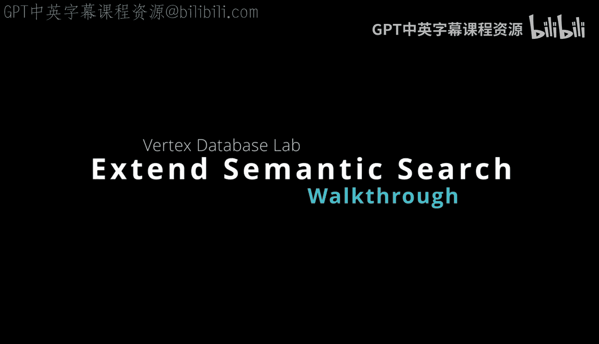
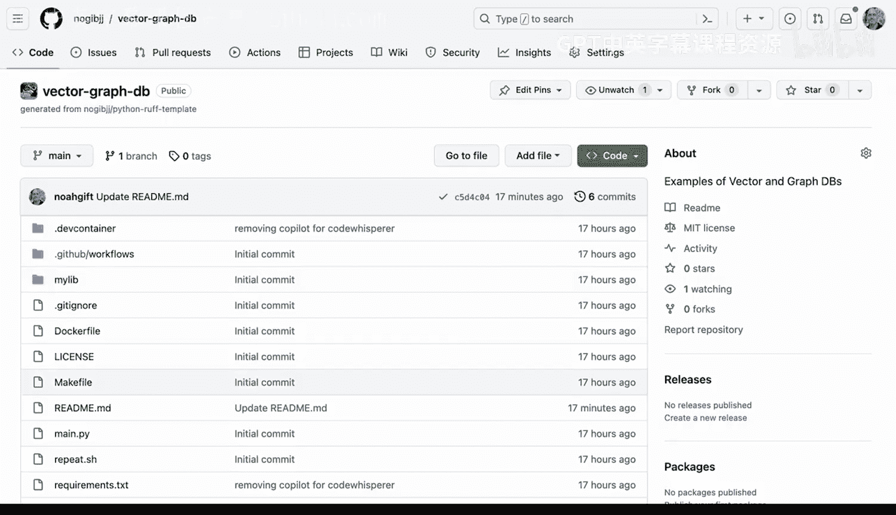

# 大型语言模型实践：P46：动手实验：增强语义搜索 🔍

在本节课中，我们将学习如何扩展向量数据库的语义搜索功能。我们将通过一个动手实验，在预配置的环境中安装必要的工具、加载数据、创建向量索引，并执行带过滤条件的语义查询。

## 概述 📋

上一节我们介绍了向量数据库的基本概念。本节中，我们将通过一个具体的实验来实践增强语义搜索。实验将引导我们完成从环境搭建到执行复杂查询的全过程。

## 实验步骤详解

### 第一步：启动代码空间

首先，我们需要启动一个Github Codespace，这是一个预配置了实验环境的在线开发容器。

以下是启动步骤：
*   点击提供的链接，在Github上启动Codespace。
*   该环境包含一个开发容器配置文件（`devcontainer.json`）和一个Dockerfile。
*   Dockerfile已配置好Python虚拟环境，这意味着环境已准备就绪，无需额外设置。

### 第二步：安装依赖包

环境启动后，我们需要安装实验所需的Python包。

以下是安装方法：
*   实验的依赖项已定义在`requirements.txt`文件中。
*   通过运行`make install`命令，可以一键安装所有必要的包，包括`quadrant`和`sentence-transformers`。

### 第三步：准备数据

接下来，我们需要准备用于语义搜索的示例数据。

以下是数据准备方法：
*   根据官方教程，我们需要创建一个`books.py`文件。
*   在该文件中，定义一个包含多本图书元数据的字典列表。每个字典代表一本书，包含如标题、描述、出版年份等信息。

### 第四步：创建向量集合与索引

数据准备好后，我们将在向量数据库中创建集合并构建索引。

以下是关键操作：
*   按照教程指示，初始化一个内存中的`quadrant`数据库实例。
*   使用`sentence-transformers`模型将图书描述文本转换为向量。
*   将这些向量及其元数据（如图书标题、年份）插入到创建的集合中，并建立向量索引以支持快速检索。

### 第五步：执行语义查询与过滤

最后，我们将利用构建好的向量数据库执行语义搜索。

以下是查询过程：
*   **执行语义查询**：输入一段关于图书内容的自然语言描述，系统将返回语义上最相关的图书。
*   **添加元数据过滤**：修改查询，使其在语义匹配的基础上，增加对元数据（如“仅返回近年出版的书籍”）的过滤条件，从而得到更精确的结果。

## 进阶挑战 🚀

完成基础实验后，你可以尝试以下挑战来深化理解：
*   **使用更大数据集**：例如，尝试使用维基百科文章摘要作为数据源。
*   **性能基准测试**：比较不同向量维度大小对搜索性能和精度的影响。
*   **应用多重过滤**：在查询中同时添加多个元数据过滤条件，例如按作者和年份组合筛选。
*   **可视化向量**：使用主成分分析（PCA）等降维技术，将高维向量可视化，直观观察语义空间的分布情况。

## 总结

本节课中，我们一起学习了如何增强向量数据库的语义搜索功能。我们从启动预配置的实验室环境开始，逐步完成了依赖安装、数据准备、向量索引构建，最终实现了支持元数据过滤的语义查询。这个实验环境配置完善，为你进一步探索和优化向量数据库应用提供了良好的起点。