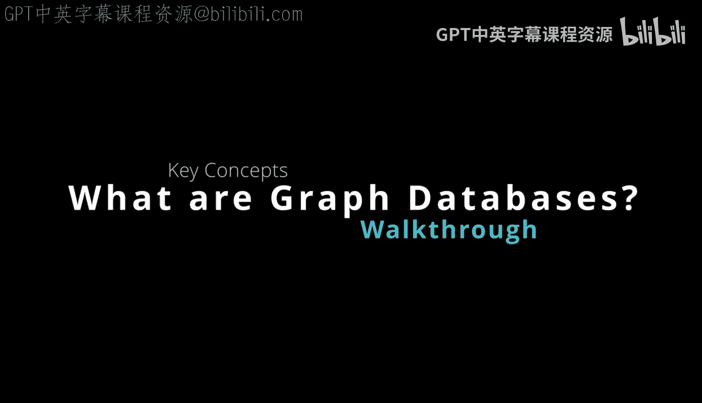
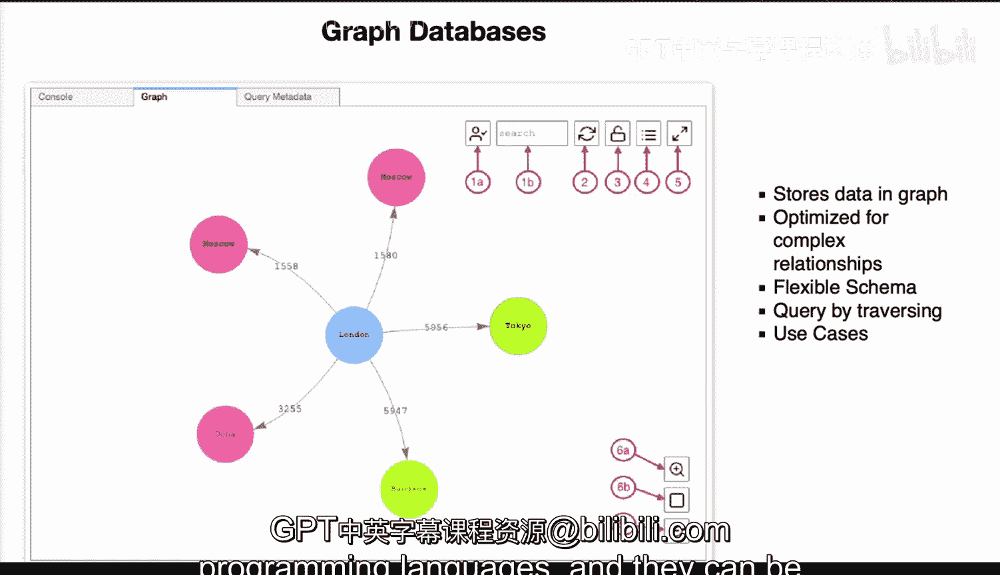

# 大型语言模型实践（高级数据工程、AWS、Databricks和本地LLM）：P47：图数据模型与数据库概念

在本节课中，我们将要学习图数据库的核心概念。我们将探讨图数据库的定义、关键特性、组成部分以及典型应用场景，帮助你理解为何以及何时应选择图数据库来处理数据。

## 图数据库概述

图数据库是一种专门用于存储和处理图结构数据的数据库。它擅长揭示数据点之间复杂的关系和模式，这是传统关系型数据库难以高效完成的。

上一节我们介绍了图数据库的基本概念，本节中我们来看看图数据库的五个关键特性。

以下是评估图数据库时需要关注的五个关键点：

1.  **以图格式存储数据**：图结构由**节点**、**边**和**属性**组成。这种结构支持进行传统数据难以实现的描述性统计分析，例如**中心性分析**、**最短路径查找**或**PageRank算法**（常用于搜索引擎排名）。
2.  **为高度互联的数据和复杂关系优化**：图数据库非常适合提出涉及多重关系的复杂问题，例如“与这个人关联的第二层联系人中，谁最有可能执行某个特定操作？”
3.  **灵活的架构**：与需要预先定义完整结构的SQL数据库不同，图数据库的架构是灵活的。你可以动态地更改结构，并根据要执行的查询进行优化。
4.  **通过遍历关系进行查询**：查询通过遍历节点之间的关系来执行，这再次使我们能够获得各种强大的描述性统计结果。
5.  **支持特定查询语言和API**：图数据库通常使用专门的查询语言（如**Cypher**）和面向编程语言的API，可以以独立或分布式方式部署。

## 为何使用图数据库？

了解了图数据库的特性后，我们来看看它的典型应用场景。图数据库在需要深入分析实体间关系的领域尤为强大。

图数据库的传统用例包括分析社交网络、构建知识图谱以及实现推荐系统。

## 图数据库的核心组件

为了更深入地理解图数据库的工作原理，我们需要明确其基本构成要素。

以下是图数据库的三个核心组件：

*   **节点**：代表实体，例如**人**、**地点**和**事物**。
*   **边**：代表节点之间的关系。
*   **属性**：节点和边都可以拥有属性，用于存储具体的数据。

在查询时，我们使用**图遍历**来收集相关联的数据，这正是图数据库强大分析能力的基础。

本节课中我们一起学习了图数据模型与数据库的概念。我们了解了图数据库以节点、边和属性存储数据，擅长处理高度互联的关系，并拥有灵活的架构。其典型应用包括社交网络分析、知识图谱和推荐系统。掌握这些概念是理解和运用图数据库进行高级数据分析的第一步。