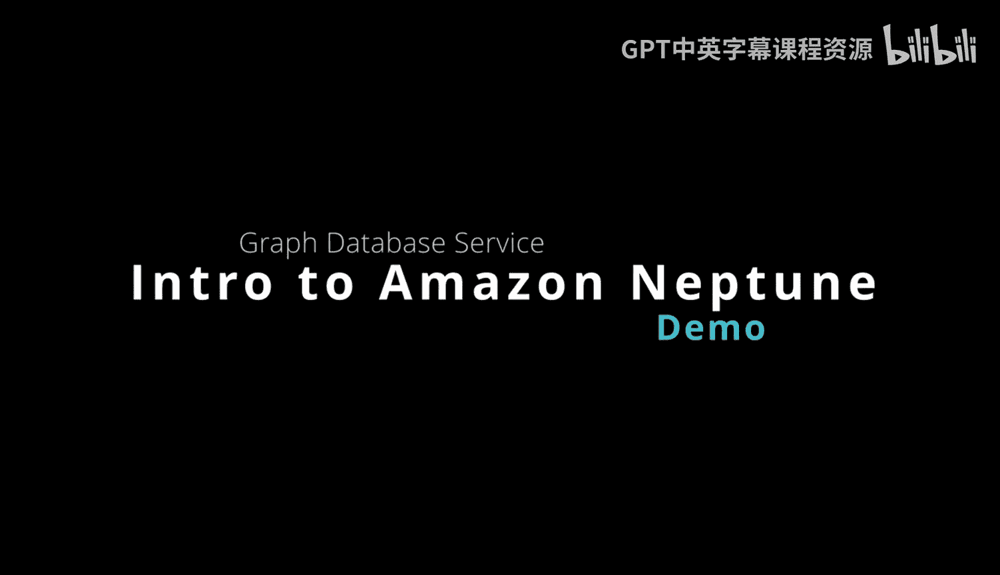
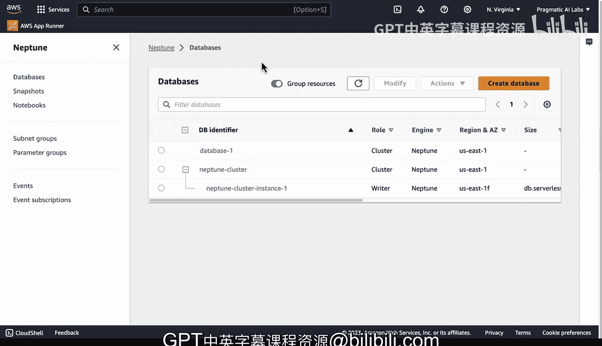

# 大型语言模型实践（高级数据工程、AWS、Databricks和本地LLM）：P48：Amazon Neptune简介 🗄️

在本节课中，我们将要学习Amazon Neptune，这是AWS生态系统内构建的一个快速、可靠的图数据库服务。我们将了解其核心特性、如何启动实例，以及如何通过不同的工具与其进行交互。

## 什么是Amazon Neptune？

Amazon Neptune是AWS提供的一项完全托管的图数据库服务。它专为处理高度互联的数据而设计，支持流行的图查询语言，并深度集成在AWS生态系统中。

上一节我们介绍了图数据库的概念，本节中我们来看看Amazon Neptune的具体实现和操作方法。

## 启动Neptune实例

首先，我们需要在AWS控制台中启动一个Neptune实例。启动界面提供了两种主要选项：预置型（Provisioned）和无服务器型（Serverless）。

以下是启动时需要考虑的关键配置选项列表：

*   **数据库类型**：选择“预置型”或“无服务器型”。无服务器模式无需自行管理集群，是一个巨大的优势。
*   **使用场景**：选择“开发测试”或“生产”。在生产环境中，系统默认会在不同可用区创建读副本以保障高可用性。如果仅是测试，则无需此配置。
*   **网络连接**：选择要连接的VPC（虚拟私有云）。
*   **安全组**：可以选择使用现有的VPC安全组或创建新的安全组来管理访问权限。

完成所有配置并启动实例后，下一步就是探索如何与数据库进行交互。

## 使用Notebook进行交互

Neptune提供了Notebook功能，允许你连接并操作图数据库。这些Notebook运行在独立的生态系统中，并深度集成于Amazon SageMaker。

打开Notebook后，你会看到几种不同的界面选项：

*   **Jupyter**：传统的Jupyter Notebook界面。
*   **JupyterLab**：功能更丰富的下一代Jupyter界面。
*   **Graph Explorer**：专用于图数据库可视化的工具。

让我们首先点击Jupyter。进入后，导航到`Neptune`目录，这里提供了一系列入门教程Notebook。

以下是入门Notebook提供的一些核心学习路径：

*   **入门示例**：“hello world”通常是第一个要运行的示例。
*   **查询方式**：教程展示了如何使用多种方式与数据库通信，包括**Spark**、**Gremlin**和**openCypher**。
*   **状态检查**：你可以执行状态调用来查看集群的运行状态。
*   **图查询实践**：甚至可以运行**Gremlin**查询来操作图数据。

## 使用Graph Explorer进行可视化

除了Notebook，另一个强大的工具是Graph Explorer。它提供了一个独特的视角来观察数据。

回到Neptune主界面，点击打开Graph Explorer。它的优势在于能够对连接到数据库中的图数据进行可视化展示。这对于理解和分析复杂的数据关系非常有帮助。

## 总结

本节课中我们一起学习了Amazon Neptune。总而言之，Neptune是托管在AWS上的一个图数据库服务。它提供了像Jupyter Notebook和Graph Explorer这样的传统工具，是在AWS平台上开始使用图数据库的一个绝佳方式。