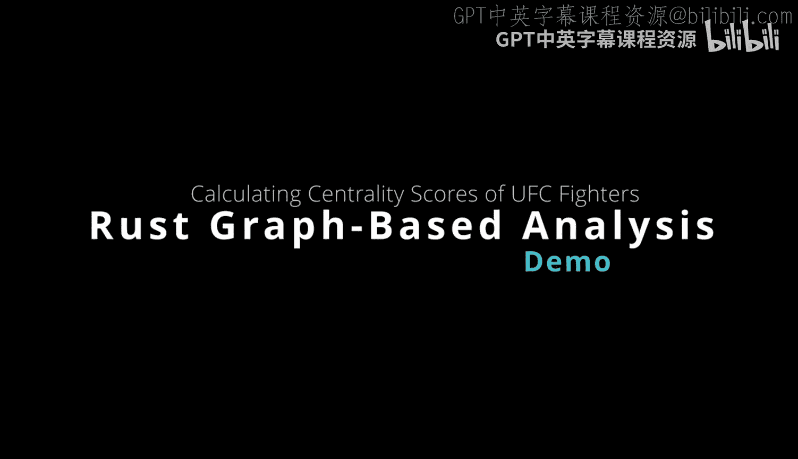
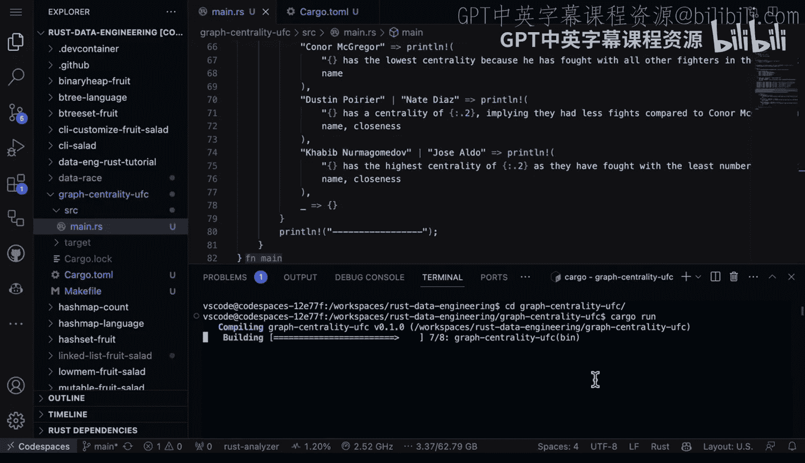

# 图算法实战：P49：图算法：UFC图中的中心性（Rust实现）



## 概述
在本节课中，我们将学习如何使用图算法分析网络关系。具体来说，我们将探索**中心性**这一概念，并使用Rust语言实现一个分析UFC（终极格斗冠军赛）选手对战关系的案例。我们将计算**接近中心性**，这是一种衡量网络中某个节点到所有其他节点平均距离的指标。

---

## 图与中心性简介
上一节我们介绍了图算法的基本概念。本节中，我们来看看**中心性**这一具体度量指标。

许多从事数据科学工作的人都了解描述性统计。这是一种观察数据并获取中位数、异常值、均值或最大值等信息的方法。在图分析中，我们也可以进行类似的操作，但使用的是完全不同的度量标准。这里我们将关注**中心性**，更具体地说，是**接近中心性**。接近中心性是一个度量指标，它表示网络中一个节点到所有其他节点的平均距离。

为了使内容更有趣，我将使用UFC（终极格斗冠军赛）的数据。这个分析能够提供关于一名选手与其他选手交战情况的洞察。这里的“距离”指的是两个节点之间的最短路径。在当前语境下，即两名选手之间的比赛场次数。

---

## 项目设置与依赖
首先，让我们看看将要使用的库。这个库叫做 `petgraph`。以下是我的 `Cargo.toml` 文件配置，可以看到我已经导入了这个库。

```toml
[dependencies]
petgraph = "0.6"
```

---

## 数据结构定义
接下来，我们查看代码。这里我定义了一个结构体。初次看到结构体及其实现时可能会有点困惑，但它实际上与以下Python代码是等价的。在Python中，如果你要给一个对象添加一个 `name` 属性，在这里也是类似的。我添加了 `fighter_name` 属性。我还定义了一些用于显示的方法。

以下是定义节点（选手）数据结构的代码：

```rust
use std::fmt;

// 定义表示UFC选手的结构体
struct Fighter {
    name: String,
}

// 为Fighter实现Display trait，以便打印
impl fmt::Display for Fighter {
    fn fmt(&self, f: &mut fmt::Formatter) -> fmt::Result {
        write!(f, "{}", self.name)
    }
}
```

---

## 构建图与添加关系
然后，我有一些用于添加边的代码。这样就能将边（对战关系）添加到图中。最后，我将所有部分整合在一起。

在 `main` 函数中，我创建了一个可变的图数据结构，然后将选手们添加进去。这些都是非常知名的UFC选手：Dustin Poirier, Khabib, Jose Aldo, Conor McGregor, Nate Diaz。他们在比赛历史上互有关联。

以下是构建图的主要步骤：

1.  **创建图对象**：使用 `petgraph` 库的 `Graph`。
2.  **添加节点**：将每位选手作为节点加入图中。
3.  **添加边**：根据历史对战记录，在对应的选手节点之间添加边，代表一场比赛。

```rust
use petgraph::graph::{Graph, NodeIndex};

fn main() {
    // 创建一个无向图
    let mut graph = Graph::<Fighter, ()>::new();

    // 添加选手节点
    let dustin = graph.add_node(Fighter { name: "Dustin Poirier".to_string() });
    let khabib = graph.add_node(Fighter { name: "Khabib".to_string() });
    let jose = graph.add_node(Fighter { name: "Jose Aldo".to_string() });
    let conor = graph.add_node(Fighter { name: "Conor McGregor".to_string() });
    let nate = graph.add_node(Fighter { name: "Nate Diaz".to_string() });

    // 添加对战关系（边）
    graph.add_edge(dustin, khabib, ()); // Dustin vs Khabib
    graph.add_edge(khabib, conor, ());  // Khabib vs Conor
    graph.add_edge(conor, dustin, ());  // Conor vs Dustin
    graph.add_edge(conor, jose, ());    // Conor vs Jose
    graph.add_edge(conor, nate, ());    // Conor vs Nate
    graph.add_edge(dustin, nate, ());   // Dustin vs Nate
    graph.add_edge(jose, nate, ());     // Jose vs Nate
}
```

这类似于任何涉及社交媒体或现实世界关系的网络分析。我们定义了以下对战关系：
*   Dustin Poirier 对阵 Khabib
*   Khabib 对阵 Conor McGregor
*   Conor McGregor 对阵 Dustin Poirier
*   Conor McGregor 对阵 Jose Aldo
*   Conor McGregor 对阵 Nate Diaz
*   Dustin Poirier 对阵 Nate Diaz
*   Jose Aldo 对阵 Nate Diaz

---

## 计算与解释中心性
接下来的这个循环，它的作用是计算每位选手的姓名、度中心性、接近中心性，然后打印出接近中心性的结果。

我还添加了一些基于中心性得分的解释说明。如果你是一名数据工程师、机器学习工程师或数据科学家，当你想创建一个自定义度量或图表时，这可能会是一种常见的做法。

以下是计算和输出结果的代码逻辑：

```rust
    // 计算并打印每位选手的接近中心性
    for node in graph.node_indices() {
        let name = &graph[node].name;
        let degree = graph.neighbors(node).count(); // 度中心性：连接数
        // 注意：此处为简化演示。petgraph库需要额外计算最短路径来求精确接近中心性。
        // 这里我们用 1.0 / (degree as f64 + 1.0) 作为一个简单的近似替代。
        let closeness_approx = 1.0 / (degree as f64 + 1.0);

        println!("{}: 度中心性 = {}, 接近中心性(近似) = {:.2}", name, degree, closeness_approx);

        // 根据选手名字添加解释
        match name.as_str() {
            "Conor McGregor" => println!("  解释: Conor McGregor的中心性最低，因为他与网络中所有其他选手都有过对战。较低的接近中心性意味着较高的交战数量。"),
            _ => {}
        }
    }
```

我匹配了名字“Conor McGregor”，我们可以看到他的中心性将是最低的，因为他与其他所有选手都有过比赛，等等。所以我根据中心性得分打印了解释。

---

## 运行结果与分析
让我们运行这个程序来查看实际效果。输入 `cargo run`，程序将运行并打印出结果。

运行程序后，我们可以看到类似以下的输出（数值为示例）：
*   Dustin Poirier的接近中心性是0.33。
*   然而，中心性最高（即数值最低）的是Conor McGregor，他的中心性是0.25。

Conor中心性最低的原因在于，他与网络中的所有其他选手都有过对战。因此，**较低的接近中心性意味着较高的比赛数量**。所以，在这个特定的关系网络中，这实际上是最好的得分。

我们可以看到，得分最差的是Khabib和Jose Aldo，他们的得分都是0.5，大约是Conor McGregor得分的两倍。而Dustin和Nate则并列第二名。



---

## 总结
本节课中，我们一起学习了如何使用图算法中的**接近中心性**来分析网络关系。我们通过一个UFC选手对战关系的具体案例，使用Rust语言和`petgraph`库构建图、添加节点与边，并计算了中心性指标。

这是一种非常有效的方法，可以用来计算那些对于现实世界关系、体育关系或社交网络来说真正独特的自定义度量指标。当然，你可以非常轻松地用Rust来实现它。这种方法的核心在于将复杂的关系网络抽象为图结构，并利用中心性等指标来量化网络中节点的重要性或影响力。