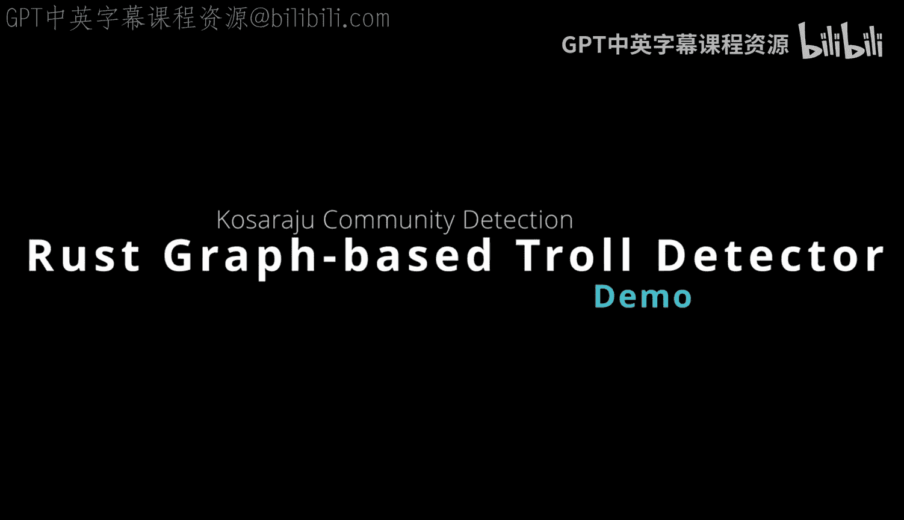
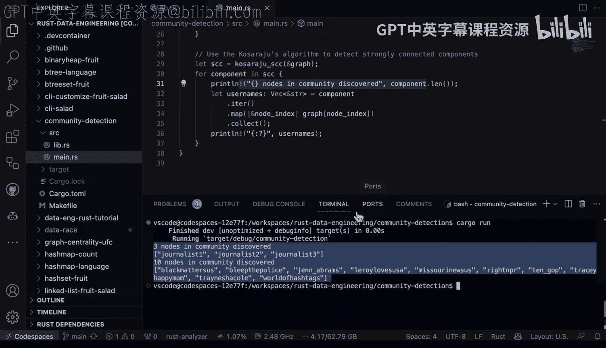

# 大型语言模型实践（高级数据工程、AWS、Databricks和本地LLM）：P50：Kosaraju图社区检测 🕸️



在本节课中，我们将学习如何使用图算法进行社区检测。具体来说，我们将探索如何利用Kosaraju算法在社交网络数据中识别紧密关联的用户群体，例如在推特数据中发现“水军”社区。

上一节我们介绍了图数据库Neo4j在社区检测中的应用。本节中我们来看看如何用纯Rust代码实现一个高效的社区检测模块。

## 概述与背景

Neo4j图数据库曾用于检测2016年美国总统大选期间推特上的“水军”账号。我们基于这个想法，使用真实的推特数据混合部分假设数据，在Rust中实现了一个社区检测模块。

## 核心算法与数据结构

我们将使用**Kosaraju算法**来检测图中的强连通分量。这是本教程的核心技巧，它能有效识别图中紧密连接的节点群。

以下是算法依赖的关键库和数据结构：


```rust
use petgraph::algo::kosaraju_scc;
use petgraph::graph::DiGraph;
use std::collections::HashMap;
```

我们使用`petgraph`库来处理图结构和算法，并用`HashMap`来存储“谁与谁互动”的关系。

## 实现步骤详解

以下是构建和运行社区检测程序的主要步骤。

首先，我们创建图结构并存储节点索引。

```rust
let mut graph = DiGraph::<&str, ()>::new();
let mut node_indices = HashMap::new();
```

接着，我们迭代处理包含用户名数据的文件。文件格式是“用户”后跟着“提及的用户”。

```rust
for line in data_lines {
    let parts: Vec<&str> = line.split(',').collect();
    let user = parts[0];
    let mention = parts[1];
    // 添加节点到图和哈希映射中
}
```

然后，我们在代表“转发”关系的两个用户节点之间添加边。

```rust
graph.add_edge(user_idx, mention_idx, ());
```

最后，我们运行Kosaraju算法来发现强连通分量，即检测到的社区。

```rust
let scc = kosaraju_scc(&graph);
```

## 运行与结果分析

运行程序非常简单。进入项目目录后执行以下命令：

```bash
cd community_detection
cargo run
```

程序输出会显示发现的社区。例如，它可能识别出三个记者账号（journalist1, journalist2, journalist3）因频繁相互转发而形成一个社区。同时，它也能找出2016年发现的真实“水军”账号群。我们额外添加的假社区数据则用于展示不同社区之间的区别。

对于每个发现的社区，我们可以打印其成员。你还可以添加更多描述性统计，例如节点数量，甚至为发现的社区动态生成名称。

```rust
for component in scc {
    println!("Discovered community: {:?}", component);
}
```

## 应用与优势

这种方法可以成为一个高效的运行时算法，适用于社交网络或拥有大量客户/用户的公司。你可以完全从零开始用Rust构建它，获得极佳的性能，甚至可以将其打包成二进制工具部署到生产环境中。



本节课中我们一起学习了如何利用Kosaraju算法进行图社区检测。我们从概念入手，逐步实现了数据读取、图构建、算法应用和结果分析的全过程。你掌握了使用Rust和`petgraph`库来识别复杂网络中紧密关联群体的实用技能。