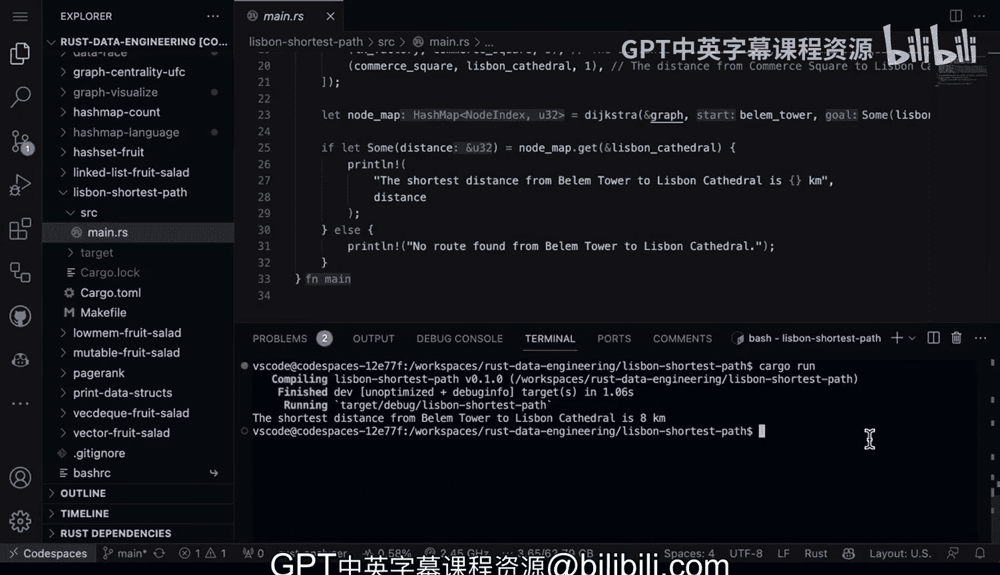

# 大型语言模型实践（高级数据工程、AWS、Databricks和本地LLM）：P51：51_03_06_图的最短路径 🗺️


在本节课中，我们将学习如何使用 Rust 语言和 `petgraph` 库，通过 **Dijkstra 算法** 来寻找图中两个节点之间的最短路径。我们将以葡萄牙里斯本的两个地标为例进行演示。

---

## 概述

我们将使用一个名为 `petgraph` 的 Rust 图库，它内置了 Dijkstra 算法的实现。Dijkstra 算法是一种经典的图遍历算法，用于寻找从单个源节点到图中所有其他节点的最短路径。这意味着，如果我们有许多可以到达的不同位置，该算法可以找出需要遍历的最短节点序列及其实际距离。

## 构建图结构

首先，我们需要创建一个图并添加节点。我们将创建一个**无向图**，这意味着边没有方向，两个节点之间的连接是双向的。

以下是创建图并添加节点的代码：

```rust
use petgraph::graph::UnGraph;


let mut graph = UnGraph::<&str, i32>::new_undirected();

let belem_tower = graph.add_node("Belem Tower");
let monastery = graph.add_node("Monastery");
let lisbon_cathedral = graph.add_node("Lisbon Cathedral");
```

在上面的代码中，我们初始化了一个无向图，并添加了三个节点，分别代表里斯本的三个地标。

## 添加边与权重

接下来，我们需要在节点之间添加边，并为每条边分配一个权重（在本例中代表距离）。这定义了节点之间的连接关系。

以下是添加边和权重的代码：

```rust
graph.extend_with_edges(&[
    (belem_tower, monastery, 1),
    (belem_tower, lisbon_cathedral, 8),
    (monastery, lisbon_cathedral, 7),
]);
```

这段代码创建了三条边：
- `Belem Tower` 到 `Monastery`，距离为 1。
- `Belem Tower` 到 `Lisbon Cathedral`，距离为 8。
- `Monastery` 到 `Lisbon Cathedral`，距离为 7。

## 应用 Dijkstra 算法

现在图已经构建完成，我们可以使用 `petgraph` 库内置的 `dijkstra` 函数来计算最短路径。该函数会返回从源节点到所有其他节点的最短距离。

以下是计算最短路径的代码：

```rust
use petgraph::algo::dijkstra;

let node_map = dijkstra(&graph, belem_tower, Some(lisbon_cathedral), |e| *e.weight());
```

在这段代码中，我们调用了 `dijkstra` 函数，传入了图、起始节点（`belem_tower`）、目标节点（`lisbon_cathedral`）以及一个获取边权重的闭包。

## 获取并输出结果

最后，我们可以从结果映射中提取并打印出从 `Belem Tower` 到 `Lisbon Cathedral` 的最短距离。

以下是输出结果的代码：

```rust
if let Some(distance) = node_map.get(&lisbon_cathedral) {
    println!("The shortest distance from Belem Tower to Lisbon Cathedral is {} km.", distance);
} else {
    println!("No path found.");
}
```

运行程序后，输出结果将是：
`The shortest distance from Belem Tower to Lisbon Cathedral is 8 km.`

## 总结

本节课中，我们一起学习了如何使用 Rust 和 `petgraph` 库解决图的最短路径问题。我们首先构建了一个代表里斯本地标的无向图，然后为节点之间的连接添加了权重。接着，我们利用库中内置的 Dijkstra 算法高效地计算出了两个地标之间的最短距离。

这种方法的优势在于：
1.  **性能优异**：Rust 能提供接近 C 语言级别的高性能。
2.  **内存安全**：Rust 的所有权系统保证了内存安全，避免了常见错误。
3.  **部署简单**：编译后的二进制文件可以轻松部署，资源占用极低。



通过解决这类经典问题，数据工程师或机器学习工程师可以将其应用于物流、路径规划等众多现实场景中，构建出既高效又可靠的解决方案。