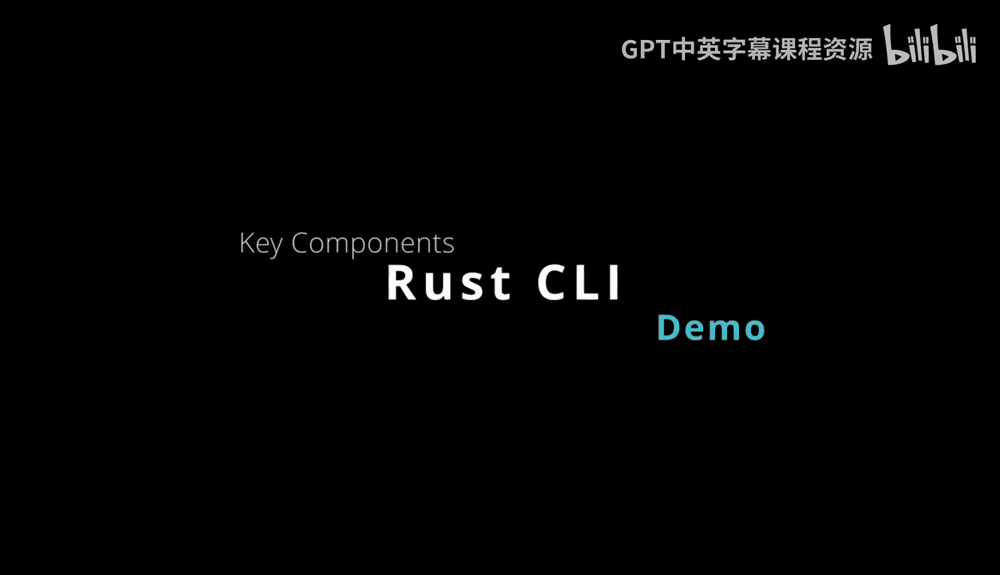
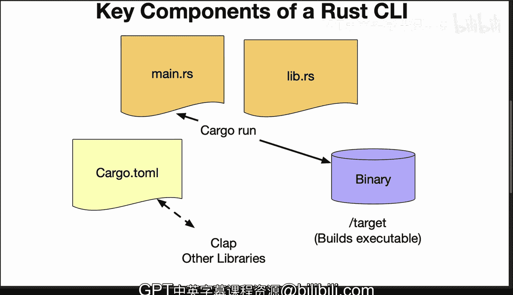

# 大型语言模型实践（高级数据工程、AWS、Databricks和本地LLM）：P52：52_03_07_Rust CLI工具的关键组件

在本节课中，我们将学习如何使用 Rust 语言中的 `clap` 库来构建命令行界面工具。我们将了解 `clap` 如何简化参数解析、帮助信息生成和错误检查，从而使开发者能够专注于应用程序的核心逻辑。

## 概述

`clap` 是一个用于 Rust 的库，它提供了一种简单的方式来定义程序将接受的命令、参数和选项。通过 Rust 代码设置 `clap`，可以将命令行定义编译到最终的用户可执行程序中。当用户运行该程序并传入文本形式的命令和选项时，`clap` 会解析这些输入，并将其转换为代码可以使用的结构化数据。

## CLI 应用与 `clap` 的作用

命令行界面应用程序允许用户运行命令并传递选项。`clap` 库的核心作用是移除通常解析文本输入、处理帮助消息和进行错误检查所需的大量样板代码。最终结果是，用户可以通过终端获得一个良好的界面来控制应用程序，而 Rust 代码则可以专注于核心逻辑，而不是命令行解析。

上一节我们介绍了 `clap` 的基本概念，本节中我们来看看它的具体工作流程。

## `clap` 的工作流程

下图展示了一个简单的工作流程。

以下是该流程的关键步骤：

1.  **定义阶段**：开发者使用 Rust 代码设置 `clap`，定义程序接受的命令、参数和选项。
2.  **编译阶段**：这个 CLI 定义会被编译到最终的程序可执行文件中。
3.  **运行与解析阶段**：用户运行 CLI 应用程序，并传入文本形式的命令和选项。`clap` 解析这些输入。
4.  **逻辑执行阶段**：你的主 Rust 代码从 `clap` 获取解析后的参数，并根据用户传入的内容执行预期的操作。

## `clap` 的高级功能

事实上，`clap` 提供了丰富的选项。开发者不仅可以构建基本的命令和选项，还可以构建子命令和嵌套选项，以创建更复杂、功能更强大的命令行工具。

最后，构建在 `target` 目录中的二进制文件可以分发给用户使用。

## 总结

本节课中我们一起学习了 Rust `clap` 库在构建命令行界面工具中的关键作用。我们了解到，`clap` 通过将命令行定义集成到 Rust 代码中，自动化了参数解析、帮助生成和错误处理，极大地提升了开发效率。最终，它帮助开发者构建出用户友好、功能强大的终端应用程序，同时让代码逻辑更加清晰和专注。