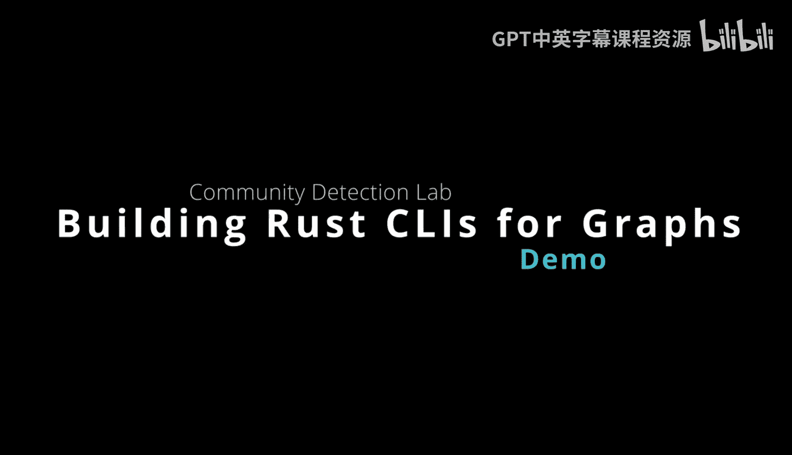
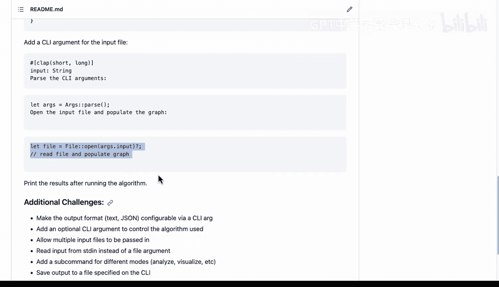
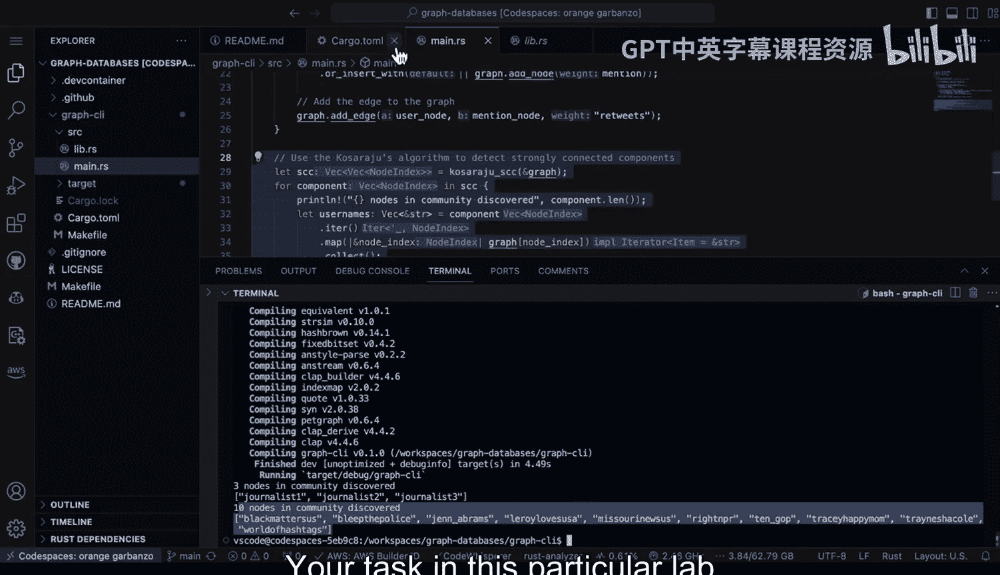
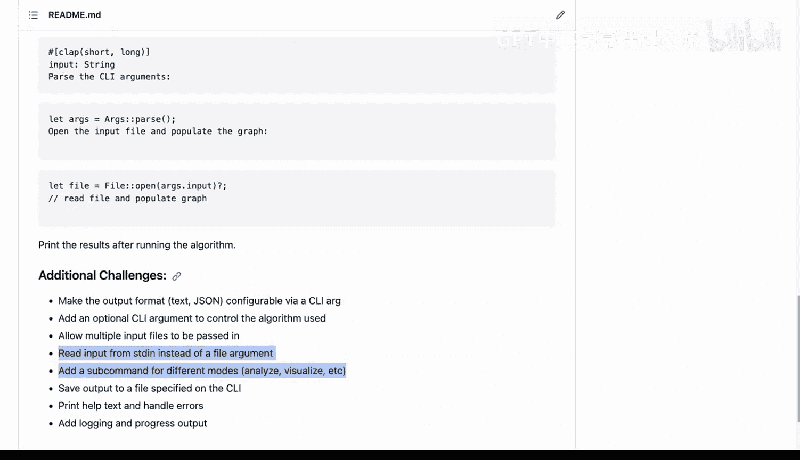

# 大型语言模型实践（高级数据工程、AWS、Databricks和本地LLM）：P53：53_03_08_实验演练：构建Rust图CLI工具 🛠️

在本节课程中，我们将学习如何将一个现有的Rust图数据库项目，转换成一个功能更强大、更灵活的命令行界面工具。我们将通过添加参数解析、文件读取和结果输出等功能，使核心算法能够以更便携的方式被使用。

## 项目概述与目标 🎯

我们当前有一个图数据库项目。该项目包含一个用于检测社区的良好算法。

在这个特定的代码仓库中，我们的任务是将此项目转换为一个命令行工具。

这在用包括Rust在内的其他语言进行项目开发时非常常见。你通常希望将核心算法变得更便携、更灵活，方法是在其之上添加一些命令行工具接口。

## 现有代码结构分析 🔍

如果我们查看这里的代码，我们需要完成以下步骤：添加`clap`工具库、添加解析器、添加一些参数、解析参数，然后读取文件并填充图数据。

这可以是任何外部图数据，你将在其中寻找某种类型的社区。

让我们看看这在`Lib`目录中是如何工作的。

我们有一些来自Twitter上一个知名实际“水军”接口的数据。我们能够识别出一组特定人群，并希望围绕他们创建一个社区。

下一步，在代码内部，我们实际上有能力创建一个新的有向图，其结构为`HashMap`。然后遍历数据以填充图，将用户添加到图中，最后找出如何检测强连通组件。

重申一下，这可以是任何你想要填充到此处的数据集，这就是为什么命令行工具会非常有用。

## 如何运行当前项目 🚀

首先，我们需要进入该目录。

然后我们可以使用`cargo`，只需输入`cargo run`。这将进行编译，并在最后打印出此代码的一个静态版本。

我们可以看到输出：“3个节点在社区中发现：journalist1, Journal2, Journal3”，以及“10个节点在社区中发现”。这表明它能够在这里找出两种不同类型的社区，并将所有结果排序输出。

## 实验任务：增强工具功能 📝

你在这个特定实验中的任务是，通过以下方式使其更具便携性，以便你能灵活地使用不同种类的选项。

以下是你可以实现的功能列表：

*   你可以尝试加入新的算法。
*   你也可以研究如何输入新的数据。
*   最后，当你完成后，可以定制输出格式，例如文本或JSON。
*   添加一个可选的`CI`参数。
*   允许接受多个输入。
*   支持从标准输入读取数据。
*   添加子命令，例如`analyze`（分析）、`visualize`（可视化）等。
*   将输出保存到特定文件。
*   甚至可以在处理过程中添加日志输出。

祝你好运。

## 本节总结 📋

本节课我们一起学习了如何将一个Rust图分析项目改造为命令行工具。我们分析了现有代码的结构和运行方式，并明确了实验任务：通过集成`clap`库解析参数、支持多种数据输入输出方式以及添加子命令等功能，来提升核心算法的便携性和灵活性。掌握这项技能有助于你将任何核心算法封装成易于使用的工具。