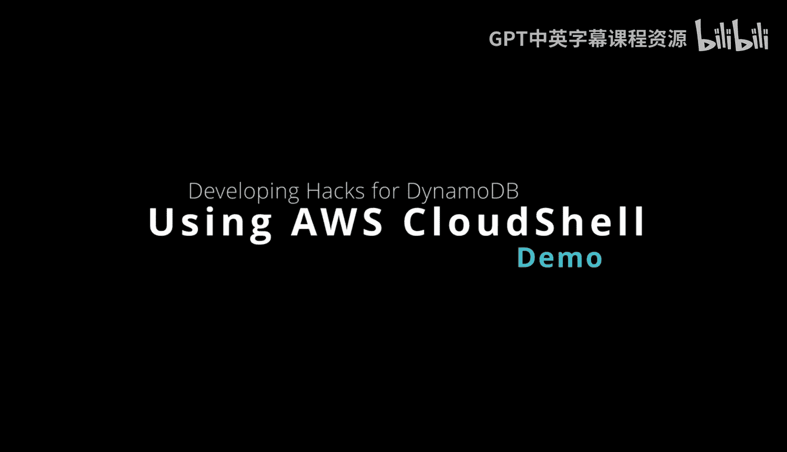
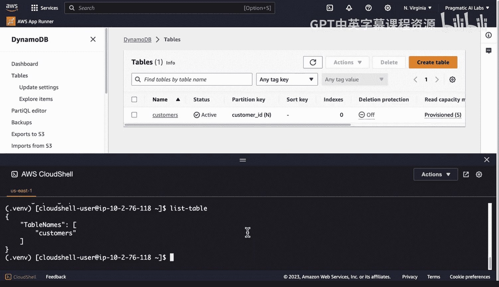

# 大型语言模型实践（高级数据工程、AWS、Databricks和本地LLM）：P54：学习用于DynamoDB开发的AWS CloudShell 🐚

在本节课中，我们将要学习AWS CloudShell，这是一个在开发和配置工作中常被忽视但功能强大的工具。我们将探索如何利用它来高效地管理Python环境、以编程方式操作AWS服务（如DynamoDB），并通过自定义别名来优化工作流程。

---

AWS CloudShell是AWS控制台内嵌的一个被严重低估的开发和配置资源。你可以在任何控制台用户界面中开启或关闭它。

接下来，让我们看看它的一些有趣功能。你可以看到，我停用了一个Python虚拟环境。例如，如果你想在每次登录Shell时自动加载特定的Python代码集，你可以使用这里的VI编辑器。

你可以查看你的`.bashrc`文件，并设置每次登录Shell时自动激活一个Python虚拟环境。这非常有用。例如，如果我在这里输入`source ~/.bashrc`，你会看到它现在加载了这个Python虚拟环境。

这意味着，如果我想安装例如Boto3，我可以轻松地安装它并开始基于它进行开发。这本身已经相当酷了。

但还有另一件基于Shell可以做的事情。让我们先停用这个环境。那就是我还可以以编程方式与其他资源交互，例如DynamoDB。

我可以在这里做的一件事是创建一个新表。你可以看到，如果我想以编程方式创建一个表，目前这里没有表。让我们粘贴命令进去，我们可以看到`aws dynamodb create-table`命令。我创建了一个名为`customers`的表，然后我只需要执行它。

这将允许我通过这个CloudShell环境以编程方式开始构建东西。因此，这是一种非常方便的快速编程控制方式，因为AWS也提供了基于命令和工具的SDK。

然后，如果我想做一些事情，比如列出所有表，我可以输入`aws dynamodb list-tables`。这在开发时是一种非常高效的入门方式，你可以来回切换，将这些东西放入CloudShell中测试你的想法。在许多情况下，这比在图形界面中点击操作要快得多，甚至比在代码中开发还要快。

现在，让我们看看另一个技巧作为结尾。如果我们回到`.bashrc`文件，如果你发现自己反复执行很多命令，你可能想在这个文件中输入一些别名。

这样，每次你打开Shell时，它们都会自动加载。我们可以在这里设置一个别名。

我们创建一个名为`listtables`的别名。我们可以输入这个命令：`aws dynamodb list-tables`。实际上，我们想把它改成不是扫描表，而是列出表。

让我们保存这个文件。然后在这里刷新一下，输入`source ~/.bashrc`。现在，如果我们输入`listtables`，注意它会自动显示并补全。同样，如果我输入`alias`，它也会在这里显示出来，作为可用的别名之一。

如果我们运行它，我们现在就可以自动列出表了。因此，通过在CloudShell环境中创建别名，你可以在工作流程中引入许多关键的创新。对于开发者来说，在某些场景下，这可能是针对AWS服务进行开发最高效的方式。

---

本节课中我们一起学习了AWS CloudShell的核心用法。我们了解了如何将其用作一个快速的编程环境，包括管理Python虚拟环境、通过AWS CLI以编程方式操作DynamoDB等服务，以及通过自定义`.bashrc`文件中的别名来显著提升日常开发效率。掌握这些技巧，能让你的AWS开发和测试工作变得更加流畅和高效。