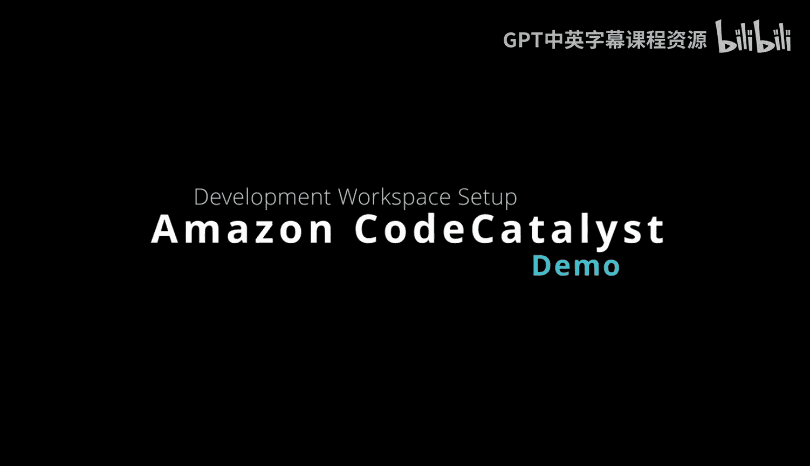
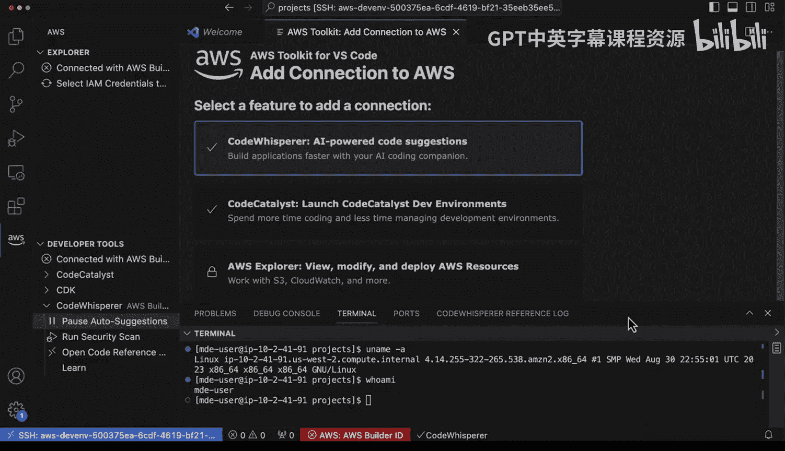
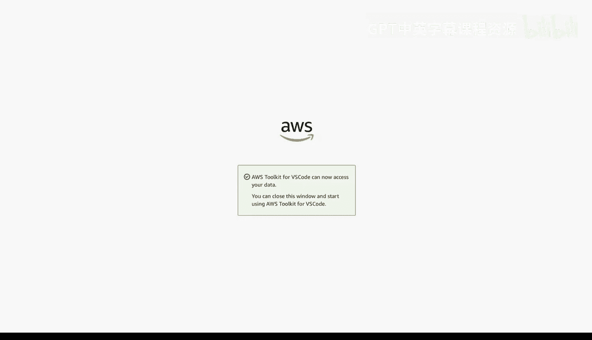
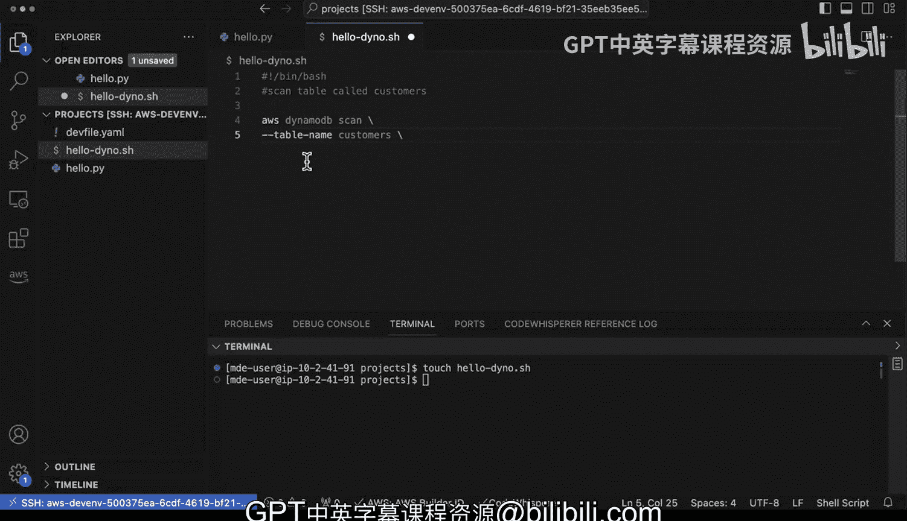

# 大型语言模型实践（高级数据工程、AWS、Databricks和本地LLM）：P55：55_04_04：学习用于Dynamo开发的AWS CodeCatalyst 🚀

在本节课中，我们将学习如何使用AWS提供的一款名为CodeCatalyst的集成开发工具。我们将了解如何创建云端开发环境，并集成CodeWhisperer等AI编程助手，从而高效地进行DynamoDB相关的开发工作。

## 登录与启动

首先，在AWS工具包中，我们可以看到包括CDK、CodeWhisperer以及CodeCatalyst在内的多个工具。要开始使用，我们需要点击启动按钮。

接下来，我们需要登录AWS Builder账户。点击“使用AWS Builder ID连接CodeCatalyst”选项，系统将引导我们完成登录流程。

登录成功后，我们可以在工具包中进行操作，例如克隆代码仓库、打开现有的开发环境，或者创建一个全新的环境。

## 创建开发环境

上一节我们介绍了如何登录，本节中我们来看看如何创建一个新的云端开发环境。

点击创建新开发环境的按钮后，我们会看到几个选项。

以下是创建环境时的关键配置选项：
*   **代码仓库**：可以选择使用现有的CodeCatalyst仓库，或者创建一个空的开发环境。对于初次探索，从空环境开始是个不错的选择。
*   **空间与项目**：需要选择一个可用的空间和项目。我们可以将其用作一个临时项目。
*   **环境别名**：可以为环境设置一个别名，例如“delete me”，以便后续识别和清理。
*   **资源配置**：默认配置提供2个CPU、4GB内存、16GB存储，并在闲置15分钟后自动超时关闭。这是一个经过精心设计的免费套餐配置。
*   **高级配置**：如果为CodeCatalyst账户启用了计费，还可以选择启动配置更高的“大型”环境。

为了演示，我们选择创建一个更大的环境，然后点击“创建开发环境”。

## 连接与探索环境

创建过程完成后，系统会自动弹出一个新的Visual Studio Code窗口。这个窗口通过SSH自动连接到远程的云端机器，整个过程非常流畅和便捷。

现在，我们可以开始在这个环境中进行开发。首先，打开一个新的终端。

在终端中，我们可以输入 `uname -a` 命令来查看系统信息，确认它运行的是Amazon Linux。我们也可以输入 `whoami` 来查看当前用户，这与我们本地的操作系统用户是不同的。

## 集成CodeWhisperer

为了提升开发效率，我们可以在环境中集成AWS的AI编程助手CodeWhisperer。

在AWS工具包中，选择CodeWhisperer按钮。系统会提示我们进行登录授权，点击“使用AWS Builder ID连接CodeWhisperer”，并在浏览器中完成确认。

授权成功后，CodeWhisperer功能即被激活。现在，我们可以开始利用它来辅助编程。

## 使用AI辅助编程

要使用CodeWhisperer，我们只需创建一个新文件并开始编写代码。例如，创建一个名为 `hello.py` 的Python文件。

在文件中，我们可以尝试输入一些注释或代码片段。例如，输入 `# hello world python`，然后在新的一行输入 `def hello():`，CodeWhisperer可能会自动补全一个简单的“Hello World”函数。

同样，我们也可以创建Bash脚本来操作DynamoDB。创建一个新文件，输入 `#!/bin/bash` 和 `# scan table called customers` 作为注释。然后，当我们开始输入 `aws dynamodb scan` 命令时，CodeWhisperer会提供相关的参数建议和补全。

通过这种方式，我们可以看到CodeCatalyst云端开发环境与CodeWhisperer AI编程助手的结合是一个非常强大的组合。它的设置过程简单，并且提供免费的套餐选项。当然，如果需要更强大的计算资源，也可以轻松启动更大的开发环境。

## 总结

本节课中我们一起学习了AWS CodeCatalyst的基本使用流程。我们从登录和创建云端开发环境开始，然后探索了如何通过SSH连接到该环境。接着，我们集成了CodeWhisperer AI编程助手，并演示了它如何辅助我们编写Python脚本和AWS CLI命令（例如针对DynamoDB的操作）。这套工具组合为云端开发提供了便捷、高效且智能化的体验。